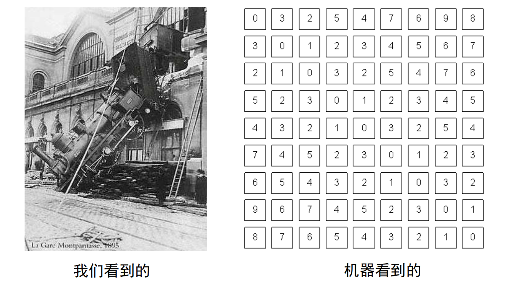
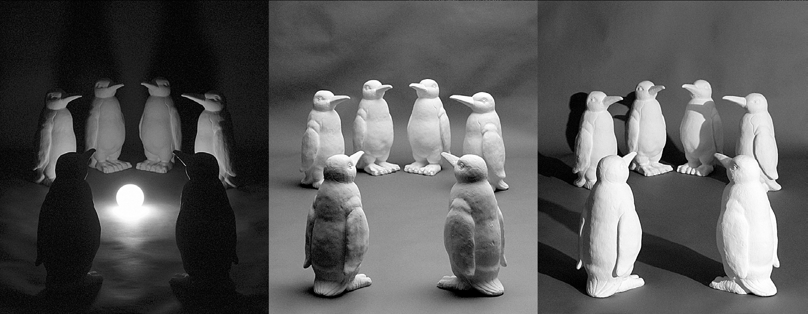
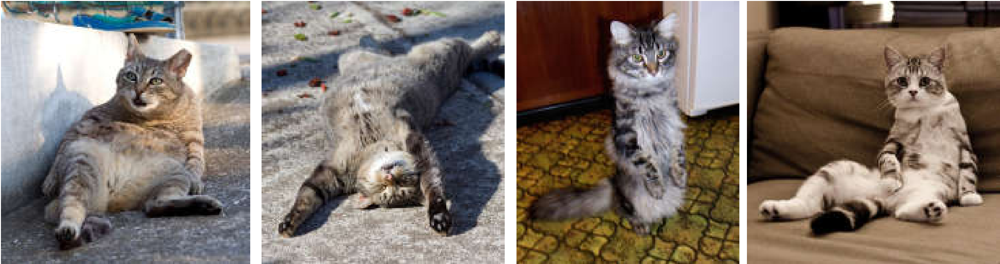
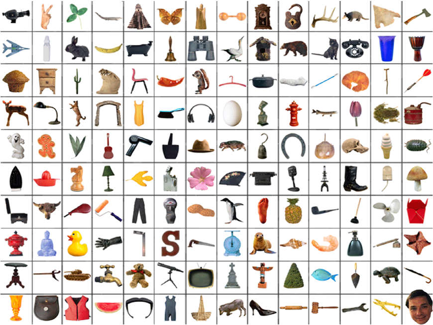
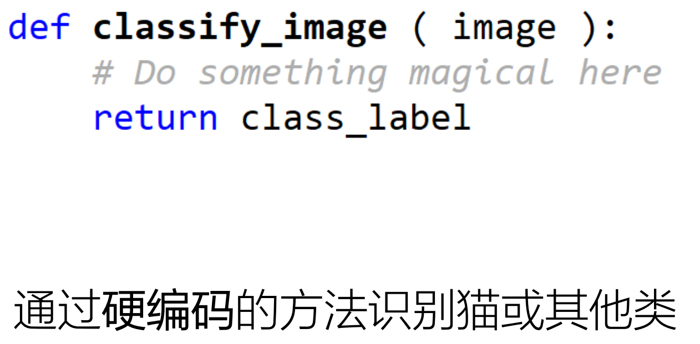
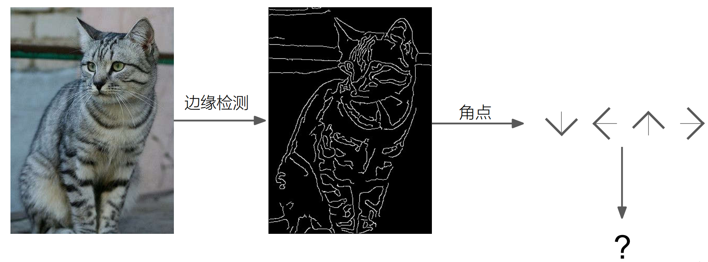
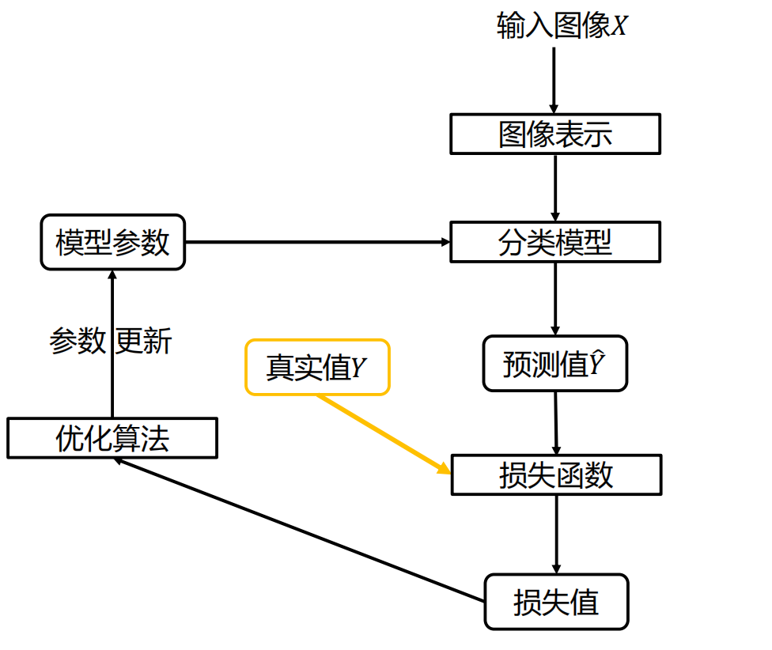
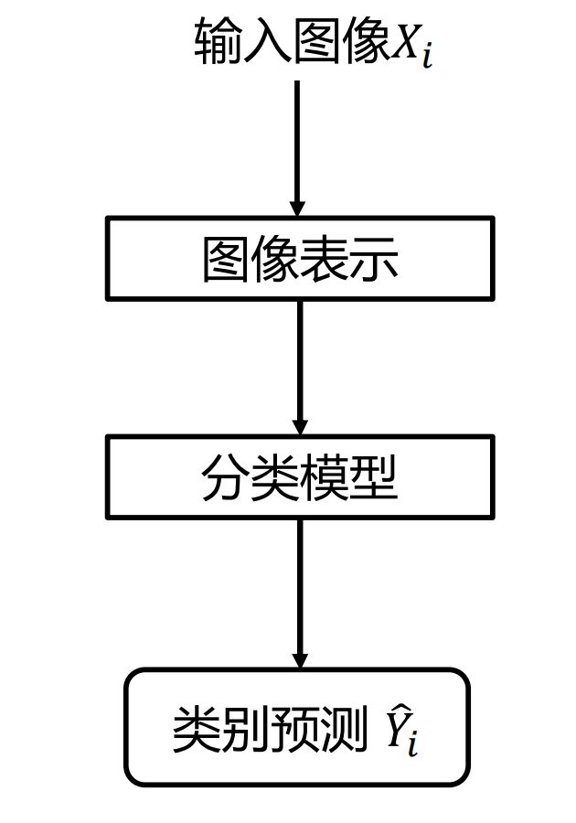
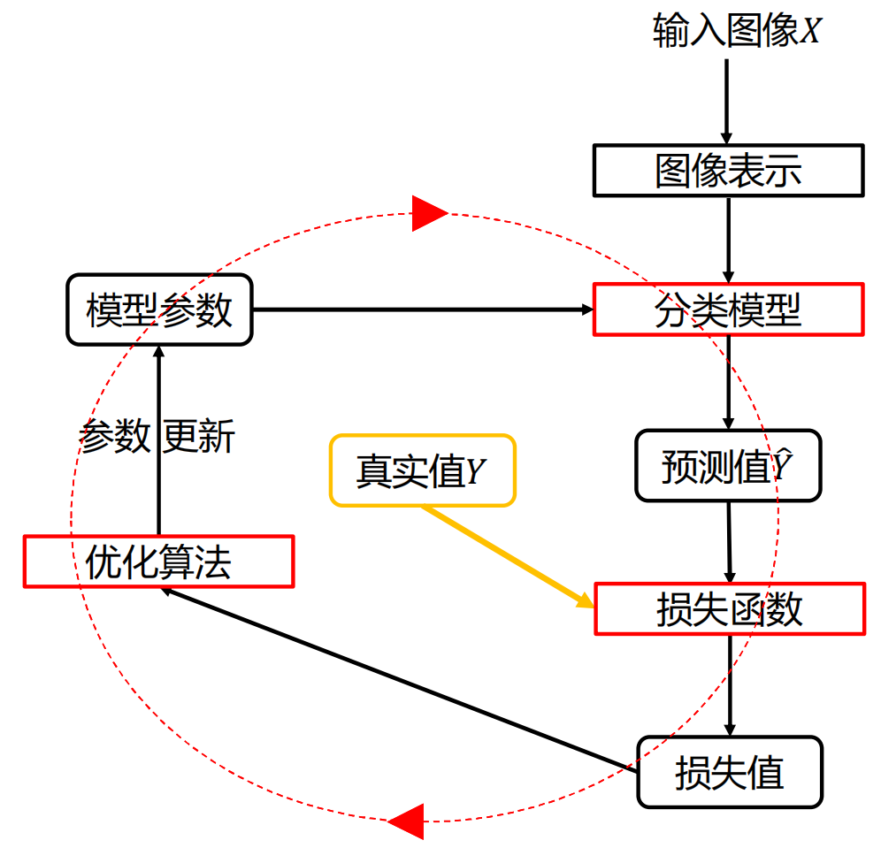
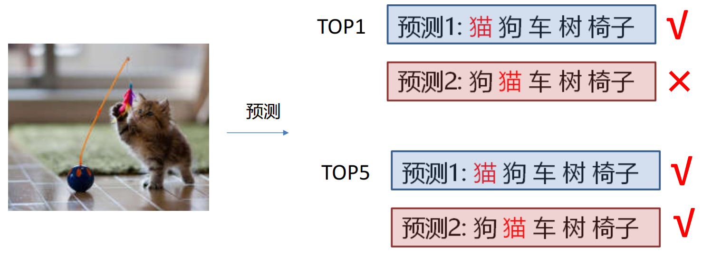

# 图像分类任务

## 难点

> [!NOTE]
>
> 我们必须要知道各种难点，但是每一个难点都对应了一个解决方案。那么也就是说只要我们清楚每一步都做什么，清楚计算机视觉系统设计怎样，那么才可以为后面更好地铺路

1. 语义鸿沟

   图像识别要做的任务：跨越“语义鸿沟”，建立像素到语义的映射

   - 像素：低层，用字节表示
   - 语义：高层，用几个词语描述

   

2. 视角

   人来看：这三个雕像都是同一个石雕

   机器看：这三个雕像的像素差异很大

   

3. 光照

   人看最右边的图就可以知道石膏是白色的，但是最左边的石膏在暗光环境下还是白色吗？不是！

   所以光照的变化引起了物体整体颜色的变化，也会对我们的识别算法产生影响

   

4. 尺度

   假如我们训练的时候用右边的图训练，得到的结果：笔记本占人很小的一部分

   但是如果我们用左边的图进行验证，这个笔记本占据了人的很大一部分，那么我们的识别算法是死了

   所以我们要考虑物体离摄像机的远近

   

5. 遮挡

   第三张图所示的遮挡，系统基本是挂掉的

   

6. 形变

   如果我们训练的猫是四脚走路的，但是刚好遇见了：

   

7. 背景杂波

   要识别的物体与背景非常相似，那么这个背景就是一种噪声，阻碍了对物体的识别

   

8. 类内形变

   同一个语义的多形态问题

   

9. 运动模糊

   我们对鸟头做了很精细的识别，但是遇到这样的运动模糊就挂了

   这种问题不是来自物体本身，而是来自成像器件

   一种方法是高速相机，另一种方法是`运动模糊恢复`

   

10. 类别繁多

    计算机视觉系统识别的东西越多，那么拟合就更难。

    不过我们做某种任务就只需要考虑我们需要识别的东西

    

## 基于规则的分类方法是否可行？

简单的说我设计一个图像分类系统，我要做的事情是什么？🤔

👉其实就是做一个分类器，如图：（传入图像，我希望这个函数返回图像标签）

> [!NOTE]
>
> 跨越语义鸿沟，是我们图像识别所需要的

举个例子：猫

最早有什么尝试呢？🤔

👉我对这张图提取一个边缘，然后我去记录图像上每一个边缘点是往哪里走的，然后把这些走向变为一种规则。但是我们遇到那些躺着、卧着、站着的猫，这套系统能工作吗？不能！

> 所以直观来看，通过`硬编码`的方法识别猫或其他类，是一件**很困难**的事。
>
> 我们现在更常用的是`数据驱动`的方法👇

## 什么是`数据驱动`的图像分类范式？

### 数据驱动的图像分类的`系统设计`步骤

1. `数据集构建`：我要识别猫，我就要找到一堆猫的图片，然后打上标签🐱。我还找到一堆狗的图片，然后打上标签🐕

   从数据集的角度来看，我们可以把机器人的学习分为：

   - `有监督`：每个图片都是有标签的，将来我要从图片与标签的关系里面去学到这种内容与标签之间的关系（图像识别更倾向于这种）
   - `无监督`：有一类数据集，有很多数据但是没有标签，那我们更多的希望从数据里去找一些规律，这种就是无监督

2. `分类器设计与学习`：我要从数据中去归纳出规律。步骤：

   - 找一个数学模型（就是分类器）
   - 有了数学模型以后，从数据中把数学模型中未知的参数填上

3. `分类器决策`：我们最终的目标就是能用这个模型对未知的图像进行决策

### 核心步骤：分类器设计与学习

我们需要设计的是：图像表示、分类模型、损失函数、优化算法

- `图像表示`：我们要把输入的图像设计为能够被算法接受的形式。

  我输入的可以是一个图像，也可以是一个三维矩阵（RGB），那么算法需要的是图像还是三维矩阵呢？

- `分类模型`：我要选择一个分类模型来对模型进行预测。

  但是无论这个分类模型是好的还是坏的，他都会输出一个`预测值`

  👇

- `损失函数`：我们需要把`预测值`与`真实值`通过`损失函数`进行比较，然后输出一个`损失值`

  `损失值`：反映了当前分类器的性能的好坏。因为随便一个模型都可以用于预测，只是预测的好与坏的程度，决定了这个模型能不能用。那么损失值就是用于评估这个分类模型做的好不好

  👇

- `优化算法`：如果我们得到一个不好的模型，我们就要更新这个模型的参数，那么谁来更新呢? -> 优化算法

  `优化算法` 看到这个 `损失值` 后，通过调整这个参数来让损失值下降，这就是优化算法做的事。

  优化算法输出是一组新的模型参数。

  我们希望新的模型参数比上一次的模型参数更好一些，**预测值与真实值之间的差异越来越小**

> 这几个步骤会一直进行循环，直到这个分类器的性能损失下降到一定程度时，我们就认为这个分类器达到我们的需求

实际使用：`决策`

我们训练好一个分类器后，就需要进行`决策`，也就是模型的部署使用

#### 图像表示

1. `像素表示`

   即使用RGB三维矩阵来表示，假如一张图像的像素是300*300，那么这个三维矩阵就是300\*300\*3

2. `全局特征表示`（如GIST）

   `全局特征`：特征计算过程中要依赖所有的像素，一旦测试样本出现了遮挡而训练样本没有时，特征就会丢失一部分，计算的时候这个特征就可能与原来全局计算的特征不太一样

   因为像素维度还是太高了，那么我们能不能从图像中抽取一个特征来表示整图呢？

   GIST：从图像上抽取一些频率的特征。它把图像均分为16块（假设），每一块抽出一些频率表示，把这些特征连起来变为一个长的特征向量（适用于风景类，室内场景，城市建筑等大场景的分类。但是对于猫狗不合适，因为猫狗是属于局部特征表示）

3. `局部特征表示`（如SIFT特征+词袋模型）

   从图像中抽取出100个有典型意义的区块，然后用这个区块来表示整图。这个时候即使有几个区块被遮挡住了，影响也不大

   比如我用眼睛、鼻子、嘴巴来描述人脸，即使我的眼睛左眼被挡住了，我还有一个右眼、鼻子、嘴巴

> [!NOTE]
>
> 在这门课程中，我们要说的是`像素表示`
>
> 神经网络强调的是`结构设计`，它把特征提取和分类集成到一起了。所以不在乎你的图像有没有特征或被特征提取过，你可以把图像直接输给神经网络就好了，神经网络就可以做后面的事情

#### 分类器

> 我们要理解每个分类器的强项是什么，理解它的原理，可以对其进行改造以适应我们的任务

- 近邻分类器
- 贝叶斯分类器
- 线性分类器
- 支撑向量机分类器
- 神经网络分类器
- 随机森林

#### 损失函数

- 0-1损失
- 多类支撑向量机损失
- 交叉熵损失

#### 优化算法

损失值反应了损失函数不行的程度，所以我们要根据损失值来调整模型参数，希望我的模型下一次预测值的的损失值越小越好

- 一阶方法
  - 梯度下降
  - 随机梯度下降
  - 小批量随机梯度下降
- 二阶方法
  - 牛顿法
  - BFGS
  - L-BFGS

#### 训练过程

- 数据集划分

- 数据预处理

- 数据增强

- 欠拟合与过拟合

  - 减小算法复杂度
  - 使用权重正则项
  - 使用droput正则化

- 超参数调整

  超参数：模型设计阶段需要指定的一些参数。神经网络是由神经元组成的，神经元个数就是我需要设计的，我们设计好了这个神经网络才能去学习。那么这个神经个数就是一个超参数，怎么设计合理是我们需要考虑的

  参数：样本里的参数【】

- 模型集成：用多个模型来让系统的性能更好

### 图像分类任务的评价指标

- `正确率` = 分对的样本数/全部样本数
- `错误率` = 1 - 正确率

#### Top1指标与Top5指标

- `Top1 准确率`：对于一张图像，**模型可能会预测出多个候选标签**，并且这些标签通常会按照**置信度从高到低排序**。Top-1 只看模型预测的第一个标签，也就是置信度最高的标签，是否和真实标签一致。

  例如一张图像的真实类别是“狗”。如果模型预测的第一个标签是“狗”，那么这次预测就是正确的；如果模型第一个标签预测成“猫”，即使后面的标签里包含“狗”，在 Top-1 评价中也算错误。

- `Top5 准确率`：对于一张图像，模型会给出置信度最高的前 5 个预测标签。只要这 5 个标签里面有一个和真实标签一致，就认为这次预测是正确的。

