# 线性分类器

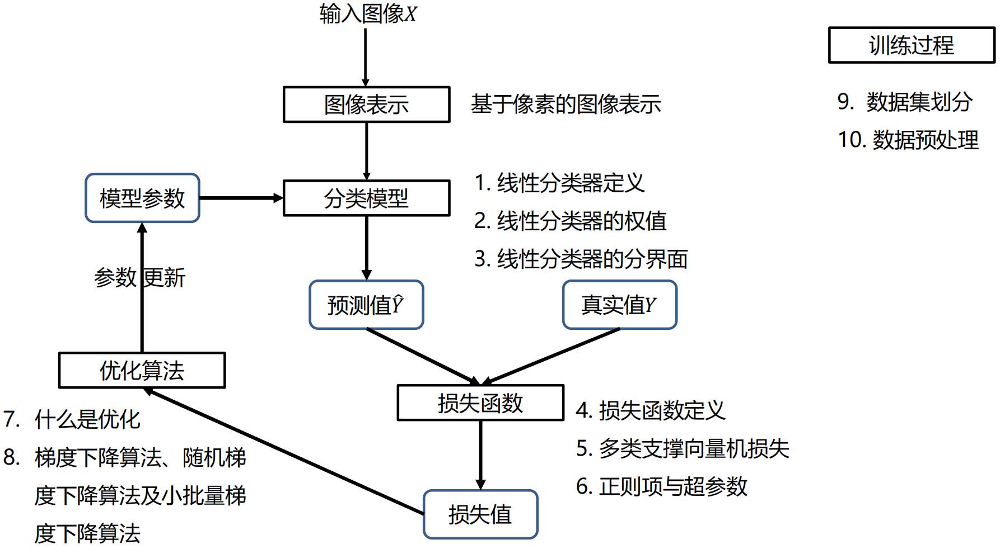


## 图像类型

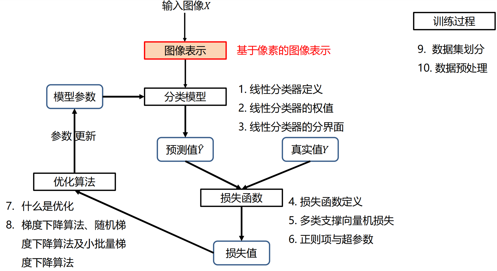

图像分为三类：

1. 二进制图像：要么黑，要么白

   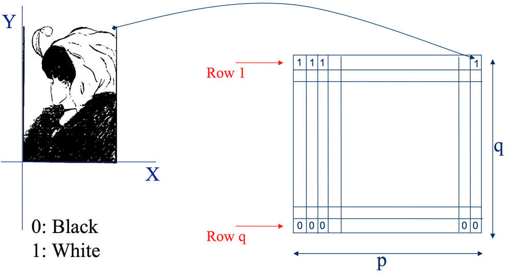

2. 灰度图像：一个像素由一个byte表示，所以取值范围为0~255（256种可能）

   最黑是0，最白是255

   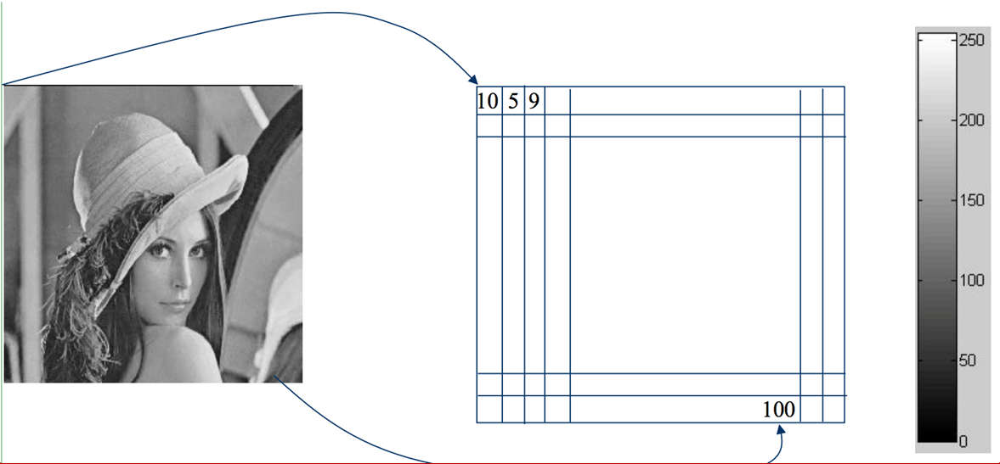

3. 彩色图像：一个像素由R,G,B表示，R,G,B分别用一个byte表示，也就是一个像素用3个byte表示

   比如下面这张图的像素是500\*500，那么因为有RGB三个通道，每个通道都是500\*500的像素，所以这张RGB图的表示是500\*500\*3（宽500，高500，深3）

   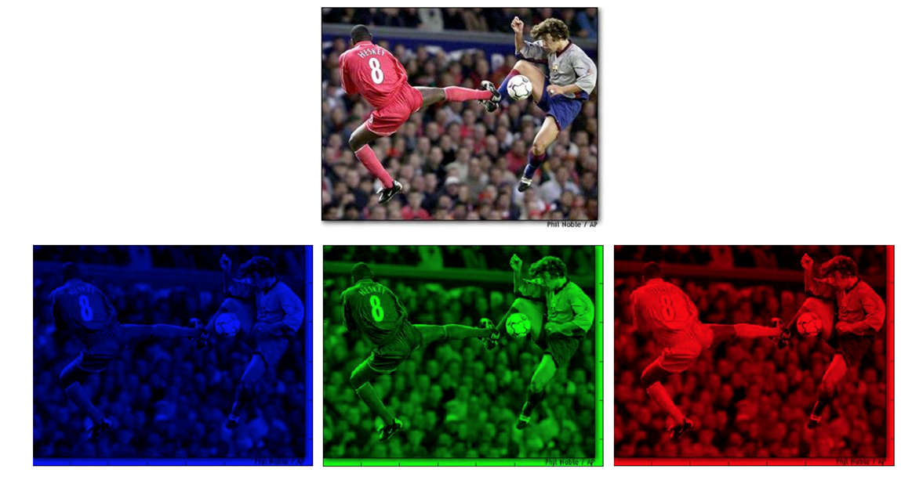

## 图像表示

> [!NOTE]
>
> 大多数分类算法都要求输入`向量`！

将图像转换成向量的方法有很多，这里我们用一种最简单的方法，**直接将图像矩阵转换成向量**

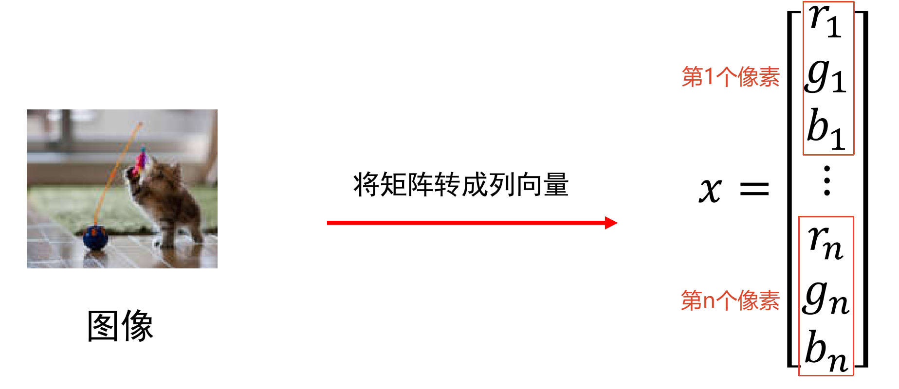

举个例子：已知`CIFAR10`中每一张图像的像素都是**32*32**，而且每张图像都是RGB图，那么CIFAR10中每一张图像转换为向量是多少维？

因为每张图像的像素是32\*32，而且是RGB图，所以答案是32\*32\*3=3072维

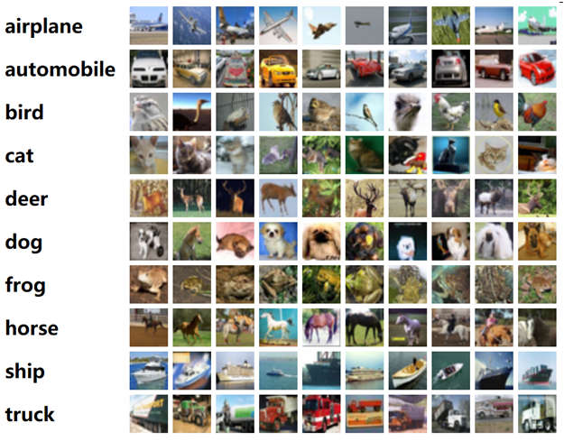


## 分类模型选择

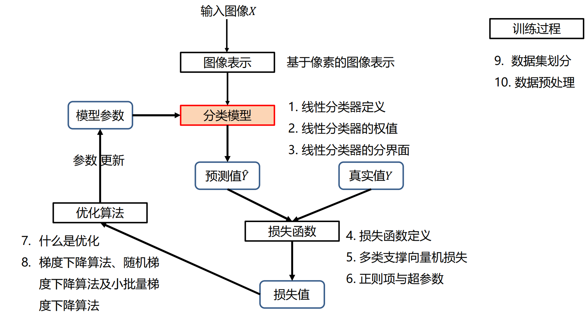

> [!IMPORTANT]
>
> 线性分类器的优点
>
> - 形式简单、易于理解
>
> - 通过层级结构（`神经网络`）或者高维映射（`支撑向量机`）可以形成功能强大的非线性模型，也就是说：
>
>   <p style="color: red; text-align: center;">
>     线性分类器是神经网络的基础，也是支撑向量机的基础
>   </p>


## 什么是线性分类器？

> `线性分类器`是一种线性映射，将输入的图像特征映射为类别分数。
>
> <div style="text-align: center; line-height: 1.8;">
> <div>输入图像 X（3072 维向量）</div>
> <div>↓</div>
> <div>线性转换</div>
> <div>↓</div>
> <div>1 个类别标签</div>
> <br>
> <div>
>  这个转换过程是线性的，因此称为<strong>线性分类器</strong>
> </div>
> </div>

### 线性分类器定义

我们先来看这个具体的数学描述：

我们设定 $x$代表输入的 $d$维图像即$x=\begin{bmatrix}x_1&x_2&\cdots&x_d\end{bmatrix}^T$，$c$为类别个数（例如 CIFAR-10 有 $c=10$ 类），则：

$$
f_i(x,w_i)=w_i^Tx+b_i
\\
\mathrm{i}=1,\cdots,c
$$
其中

- $f_i$：第 $i$ 个类别的分类分数

- $w_i=\begin{bmatrix}w_{i1}&\cdots&w_{id}\end{bmatrix}^T$：第$i$个类别的权值向量，$d$表示每个$w_i$都是一个$d$维向量
- $b_i$：第 $i$ 个类别对应的偏置

也就是说，每一个类别都有一套自己的参数：
$$
w_i=
\begin{bmatrix}
w_{i1} \\
w_{i2} \\
\vdots \\
w_{id}
\end{bmatrix},
\quad
b_i
$$
可以理解为：

> $w_i$ 用来衡量输入图像 $x$ 和第 $i$ 个类别有多匹配，
> $b_i$ 用来整体调整第 $i$ 个类别的分数。

> [!NOTE]
>
> `决策规则`：
>
> 如果 $f_i(x)>f_j(x),\quad\forall j\neq i$，则决策 输入图像$x$ 属于 第$i$类

### 线性分类器示例

**任务**：为图片分配类别标签（汽车类、猫类、鸟类）。即我们已知图片，假设我也已经有线性分类器了，我们怎么决策呢？

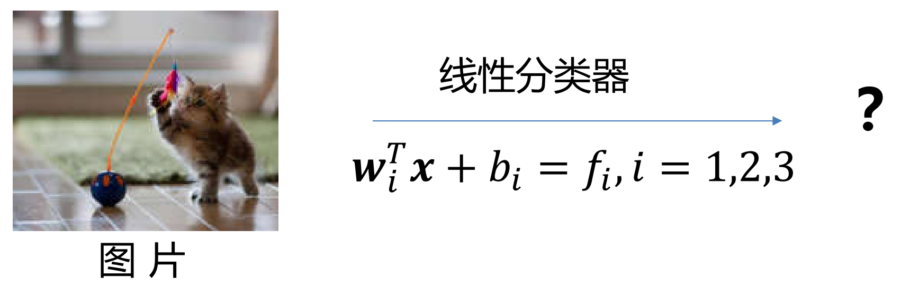

步骤：

1. 图像表示成向量。假设图像只包含4个像素，把这个图像的像素展开为一个向量，即

   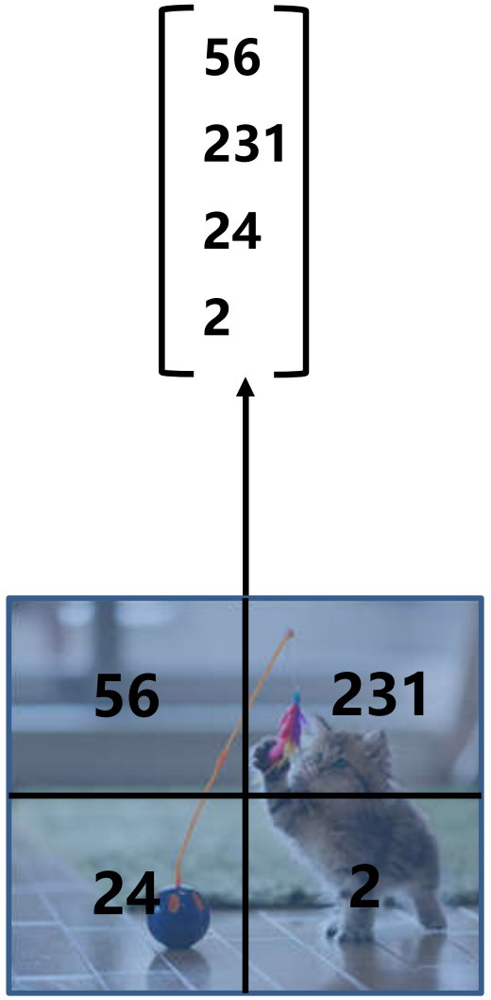

2. 计算当前图片每个类别的分数

   > 对应类别的权值 * 图像像素展开得到的向量 + 偏移 = 得分
   >
   > 那么这样我们就得到了一个`分数向量`，每一项都代表了对应类的得分

   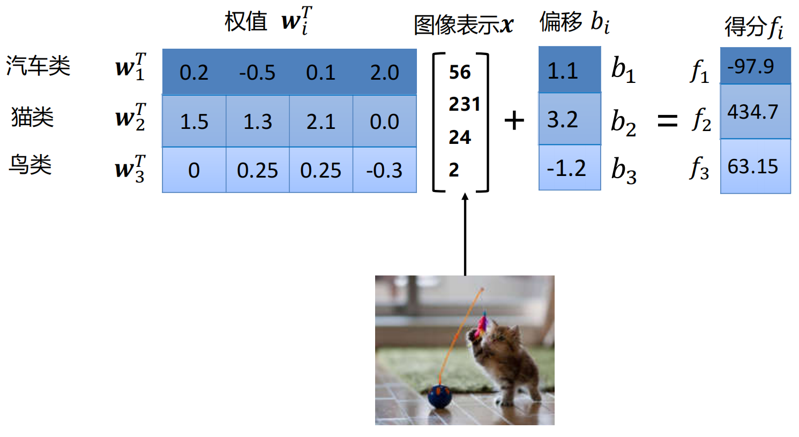

3. 按类别的分判定当前图像

   在这里，我们得到的这个`图像对应猫类`的分数最高，所以这个线性分类器输出的就是猫类

   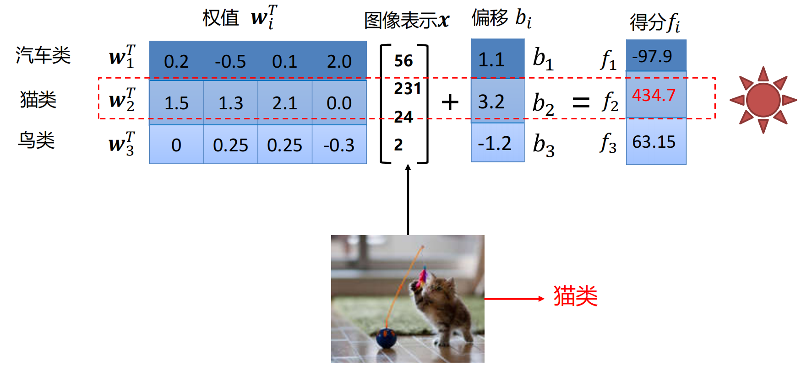


### 线性分类器的矩阵表示

通过观察我们可以注意到：

- 权值矩阵$W$：**行数**由`类别`决定，**列数**由`图像表示（图像的像素向量）`决定

- 偏移向量$b$：**行数**由`类别`决定

- 得分向量$f$：**行数**由`类别`决定

- **问题：CIFAR10 数据集分类任务的分类器，$W$，$x$，$b$ 的维度是多少？**

  **回答**：CIFAR10有**10个类别**且**图像大小为32x32x3**，因此:

  $x$ 是图像向量，其维度为3072维（$d$为`特征数量`，也就是3072）；

  $W$ 是权值矩阵，其维度为10x3072；

  $b$ 是偏置向量，其维度为10x1的向量；

  $f$ 是得分向量，其维度为10x1的向量；

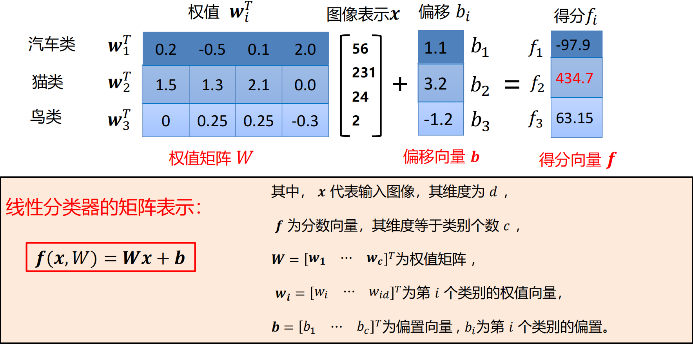


### 线性分类器的权值向量（从权值角度理解）

🤔线性分类器的 权值矩阵$W$ 到底是个什么？这个 $W$ 的含义是什么?

- 权值矩阵$W$ 看做是一种`模板`，其实就是**一个类别的平均值**
- 输入图像$x$ 与评估模板$w$ 的匹配程度越高，分类器输出的分数就越高

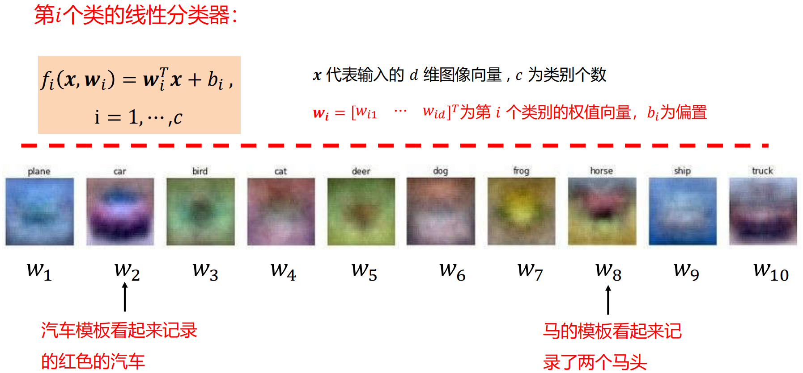


### 线性分类器的分界面（从几何角度理解）

🤔分类问题的`本质`是什么？

👉假设我们把图像表示为2维向量（2维特征），分类问题就是希望找一些`决策面（分类器用来划分不同分类区域的边界）`，把一堆图像给分开为好几个类别。

因为是 **线性分类器**，所以 **决策面**就是`线性`的

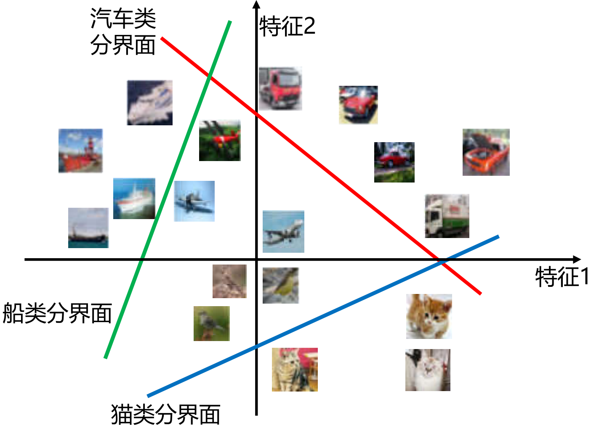

- 以上面为例：

  - 根据上图，我们得到的条件是：

    - 特征数量（图像像素总数） $d=2$，有3个类别即$c=3$

    - 所以：

      图像表示为$x=\begin{bmatrix}x_1\\x_2\end{bmatrix}$ （特征数量 × 1）

      权重表示为\[ W= \begin{bmatrix} w_{11}&w_{12}\\ w_{21}&w_{22}\\ w_{31}&w_{32} \end{bmatrix} \in\mathbb R^{3\times2} \]（类别数 × 特征数量）

  - 我们输入的线性公式是：
    \[
    f_i(x,w_i)=w_i^Tx+b_i,\qquad i=1,\ldots,c
    \]
    我们的输入向量是 $x=\begin{bmatrix}x_1\\x_2\end{bmatrix}$ ，于是每个类别的权重向量也变成 \[ w_i=\begin{bmatrix}w_{i1}\\w_{i2}\end{bmatrix} \]，代入到公式得：
    \[
    \begin{aligned} f_i(x,w_i)&=w_i^Tx+b_i\\ &=\begin{bmatrix}w_{i1}&w_{i2}\end{bmatrix}\begin{bmatrix}x_1\\x_2\end{bmatrix}+b_i\\ &=w_{i1}x_1+w_{i2}x_2+b_i \end{aligned}
    \]

  - 我们只分 3个类别，即**汽车、船、猫**

    由于每个类别都有自己的参数，因此：

    **汽车类别：**
    \[
    f_1(x)=w_{11}x_1+w_{12}x_2+b_1
    \]
    **船类别：**
    \[
    f_2(x)=w_{21}x_1+w_{22}x_2+b_2
    \]
    **猫类别：**
    \[
    f_3(x)=w_{31}x_1+w_{32}x_2+b_3
    \]
    假设我们分别令三个分类分数等于零：
    \[
    \begin{cases} w_{11}x_1+w_{12}x_2+b_1=0\\ w_{21}x_1+w_{22}x_2+b_2=0\\ w_{31}x_1+w_{32}x_2+b_3=0 \end{cases}
    \]
    那么这三个方程在二维坐标系中分别描述一条直线，对应你看到的图：

    - `红色直线`：可以表示汽车类别分数 \(f_1(x)=0\)。
    - `绿色直线`：可以表示船类别分数 \(f_2(x)=0\)。
    - `蓝色直线`：可以表示猫类别分数 \(f_3(x)=0\)。

  - 结论：

    - 分数等于0的线就是`决策面` $w_i^Tx+b_i=0,i=1,\cdots,c$

      <img src="data:image/svg+xml;charset=utf-8,%3Csvg%20font-family%3D%22-apple-system-body%2C%20ui-sans-serif%2C%20-apple-system%2C%20system-ui%2C%20Segoe%20UI%2C%20Helvetica%2C%20Apple%20Color%20Emoji%2C%20Arial%2C%20sans-serif%2C%20Segoe%20UI%20Emoji%2C%20Segoe%20UI%20Symbol%22%20font-weight%3D%22400%22%20data-d-component%3D%22svg%22%20fill%3D%22currentColor%22%20style%3D%22color%3Argb(13%2C%2013%2C%2013)%22%20viewBox%3D%220%200%20340%20290%22%20width%3D%22100%25%22%20xmlns%3D%22http%3A%2F%2Fwww.w3.org%2F2000%2Fsvg%22%3E%3Crect%20x%3D%2248%22%20y%3D%2220%22%20width%3D%22260%22%20height%3D%22240%22%20fill%3D%22%233B82F6%22%20fill-opacity%3D%220.07%22%2F%3E%3Cpath%20d%3D%22M48%2020%20H308%20V20%20L48%20260%20Z%22%20fill%3D%22%2316A34A%22%20fill-opacity%3D%220.12%22%2F%3E%3Cline%20x1%3D%2248%22%20y1%3D%2220%22%20x2%3D%2248%22%20y2%3D%22260%22%20stroke%3D%22currentColor%22%20stroke-opacity%3D%220.09%22%2F%3E%3Cline%20x1%3D%2248%22%20y1%3D%22260%22%20x2%3D%22308%22%20y2%3D%22260%22%20stroke%3D%22currentColor%22%20stroke-opacity%3D%220.09%22%2F%3E%3Cline%20x1%3D%22100%22%20y1%3D%2220%22%20x2%3D%22100%22%20y2%3D%22260%22%20stroke%3D%22currentColor%22%20stroke-opacity%3D%220.09%22%2F%3E%3Cline%20x1%3D%2248%22%20y1%3D%22212%22%20x2%3D%22308%22%20y2%3D%22212%22%20stroke%3D%22currentColor%22%20stroke-opacity%3D%220.09%22%2F%3E%3Cline%20x1%3D%22152%22%20y1%3D%2220%22%20x2%3D%22152%22%20y2%3D%22260%22%20stroke%3D%22currentColor%22%20stroke-opacity%3D%220.09%22%2F%3E%3Cline%20x1%3D%2248%22%20y1%3D%22164%22%20x2%3D%22308%22%20y2%3D%22164%22%20stroke%3D%22currentColor%22%20stroke-opacity%3D%220.09%22%2F%3E%3Cline%20x1%3D%22204%22%20y1%3D%2220%22%20x2%3D%22204%22%20y2%3D%22260%22%20stroke%3D%22currentColor%22%20stroke-opacity%3D%220.09%22%2F%3E%3Cline%20x1%3D%2248%22%20y1%3D%22116%22%20x2%3D%22308%22%20y2%3D%22116%22%20stroke%3D%22currentColor%22%20stroke-opacity%3D%220.09%22%2F%3E%3Cline%20x1%3D%22256%22%20y1%3D%2220%22%20x2%3D%22256%22%20y2%3D%22260%22%20stroke%3D%22currentColor%22%20stroke-opacity%3D%220.09%22%2F%3E%3Cline%20x1%3D%2248%22%20y1%3D%2268%22%20x2%3D%22308%22%20y2%3D%2268%22%20stroke%3D%22currentColor%22%20stroke-opacity%3D%220.09%22%2F%3E%3Cpath%20d%3D%22M48%2010%20V260%20H320%22%20fill%3D%22none%22%20stroke%3D%22currentColor%22%20stroke-width%3D%222%22%2F%3E%3Cpath%20d%3D%22M48%2010%20l-4%209%20h8%20Z%20M320%20260%20l-9%20-4%20v8%20Z%22%20fill%3D%22currentColor%22%2F%3E%3Cline%20x1%3D%2248%22%20y1%3D%22116%22%20x2%3D%22205%22%20y2%3D%22260%22%20stroke%3D%22%23DC2626%22%20stroke-width%3D%223.5%22%2F%3E%3Ccircle%20cx%3D%22204%22%20cy%3D%2268%22%20r%3D%226%22%20fill%3D%22%2316A34A%22%20stroke%3D%22%23fff%22%20stroke-width%3D%222%22%2F%3E%3Ccircle%20cx%3D%22100%22%20cy%3D%22212%22%20r%3D%226%22%20fill%3D%22%232563EB%22%20stroke%3D%22%23fff%22%20stroke-width%3D%222%22%2F%3E%3Ccircle%20cx%3D%22126%22%20cy%3D%22188%22%20r%3D%225%22%20fill%3D%22%23DC2626%22%20stroke%3D%22%23fff%22%20stroke-width%3D%221.5%22%2F%3E%3Ctext%20x%3D%22213%22%20y%3D%2261%22%20font-size%3D%2212%22%20fill%3D%22%2316A34A%22%20font-weight%3D%22600%22%3EA%20(3%2C4)%3C%2Ftext%3E%3Ctext%20x%3D%22110%22%20y%3D%22228%22%20font-size%3D%2212%22%20fill%3D%22%232563EB%22%20font-weight%3D%22600%22%3EB%20(1%2C1)%3C%2Ftext%3E%3Ctext%20x%3D%22146%22%20y%3D%22179%22%20font-size%3D%2211%22%20fill%3D%22%23DC2626%22%20font-weight%3D%22600%22%3EC%20(1.5%2C1.5)%3C%2Ftext%3E%3Ctext%20x%3D%22211%22%20y%3D%22119%22%20font-size%3D%2212%22%20fill%3D%22%2315803D%22%3E%E5%88%86%E6%95%B0%20%26gt%3B%200%3C%2Ftext%3E%3Ctext%20x%3D%22190%22%20y%3D%22144%22%20font-size%3D%2211%22%20fill%3D%22%2315803D%22%3E%E6%B1%BD%E8%BD%A6%E5%8C%BA%E5%9F%9F%3C%2Ftext%3E%3Ctext%20x%3D%2266%22%20y%3D%22237%22%20font-size%3D%2211%22%20fill%3D%22%232563EB%22%3E%E5%88%86%E6%95%B0%20%26lt%3B%200%3C%2Ftext%3E%3Ctext%20x%3D%2266%22%20y%3D%22250%22%20font-size%3D%2211%22%20fill%3D%22%232563EB%22%3E%E9%9D%9E%E6%B1%BD%E8%BD%A6%E5%8C%BA%E5%9F%9F%3C%2Ftext%3E%3Ctext%20x%3D%2260%22%20y%3D%22106%22%20font-size%3D%2211%22%20fill%3D%22%23DC2626%22%3E%E5%86%B3%E7%AD%96%E9%9D%A2%EF%BC%9Ax%E2%82%81%2Bx%E2%82%82%E2%88%923%3D0%3C%2Ftext%3E%3Ctext%20x%3D%22316%22%20y%3D%22278%22%20text-anchor%3D%22end%22%20font-size%3D%2212%22%20fill%3D%22currentColor%22%3E%E7%89%B9%E5%BE%811%20(x%E2%82%81)%3C%2Ftext%3E%3Ctext%20x%3D%2210%22%20y%3D%2215%22%20font-size%3D%2212%22%20fill%3D%22currentColor%22%3E%E7%89%B9%E5%BE%812%20(x%E2%82%82)%3C%2Ftext%3E%3Ctext%20x%3D%2235%22%20y%3D%22275%22%20font-size%3D%2211%22%20fill%3D%22currentColor%22%3E0%3C%2Ftext%3E%3C%2Fsvg%3E" alt="img" style="zoom: 25%;" />

    - $w$ 控制着线的方向
    - $b$ 控制着线的偏移
    - **箭头方向代表分类器的正方向，沿着箭头方向距离决策面越远分数就越高**。

    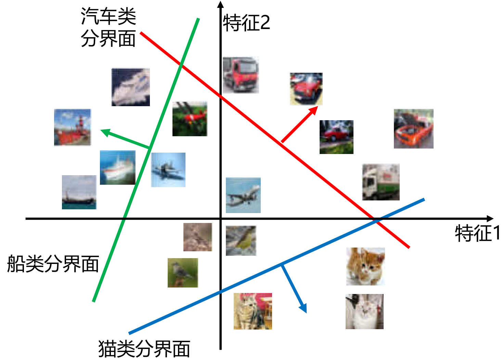


# 损失函数

现在我们讨论线性分类器模型，之前的模型我们得到的是 权值矩阵$W$ 和 偏置$b$，我就可以计算对应类别的分数。

🤔那么这个 权值矩阵$W$ 和 偏置$b$ 好或不好，我们应该怎么办？

- 我们总是需要一个东西去度量，所以需要`损失函数`
- 然后我们还需要学习，那就需要`优化算法`

## 损失函数的定义

### 如何衡量分类器对当前样本的效果好坏？

如图，我有两个分类器，分别得到一个正确的结果与一个错误的结果，那么人眼看，肯定是：**分类器1的性能 > 分类器2的性能**

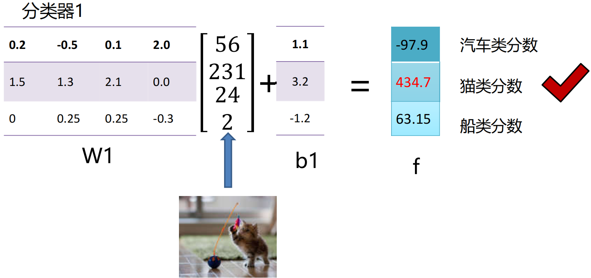

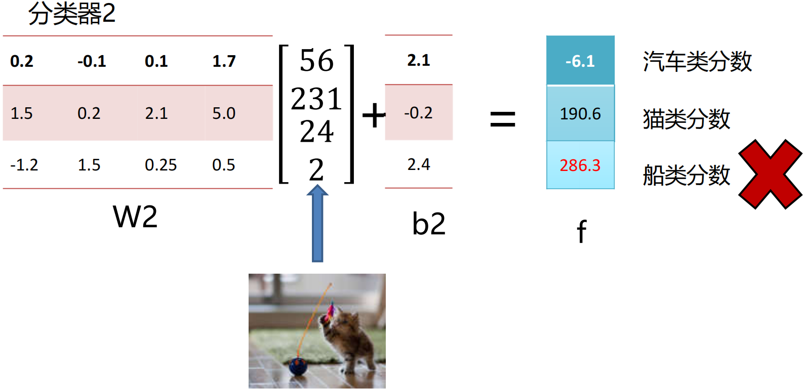

🤔**问题来了：机器人怎么去看到这个效果呢？如何定量表示呢？**

那么这就需要使用`损失函数`


### 什么是损失函数？

> 损失函数搭建了模型性能与模型参数之间的桥梁，指导模型参数优化。
>
> - **损失函数（Loss Function）** 是一个函数，用于度量分类器的**预测输出**与样本的**真实标签**之间的不一致程度，其输出通常是一个**非负实数**。
>
> - 损失值越小，通常表示模型的预测结果与真实标签越一致；损失值越大，通常表示两者越不一致。
>
> - 在模型训练过程中，可以利用损失函数提供的反馈，通过**优化算法**调整模型参数，使损失值逐渐减小，从而提升分类器的分类效果。

- **单个样本的损失函数**

  对于数据集中的第 $i$个样本，其损失函数可以表示为：
  $$
  L_i=\ell(f(x_i,W),y_i)
  $$
  其中：

  - $x_i$：数据集中的**第 $i$ 张图像**。
  - $W$：线性分类器的**权重矩阵**，属于模型参数。
  - $f(x_i,W)$：分类器对图像 $x_i$ 的**预测输出**。
  - $y_i$：图像 $x_i$ 对应的**真实类别标签**，通常使用整数表示。
  - $\ell$：损失函数，用于计算预测输出与真实标签之间的不一致程度。
  - $L_i$：第 $i$ 个样本的**损失值**，通常是一个非负实数。

  **需要注意：**

  - 对于 线性分类器$f(x_i,W)=Wx_i$ ，其输出通常是一个包含各个类别得分的向量，而不是直接输出一个类别标签。

    例如，假设分类器需要区分三个类别 $f(x_i,W)=\begin{bmatrix}2.5\ 1.2\ 0.3\end{bmatrix}$，这个向量表示分类器对三个类别分别给出的得分。

    最终预测类别$\hat y_i$ 可以通过 得分最大的类别$\arg\max_j f_j(x_i,W)$ 确定，即使用函数 $\hat y_i=\arg\max_j f_j(x_i,W)$

  - 但在计算常见的`分类损失函数`时，通常需要使用模型输出的**完整得分向量**（或由得分转换得到的概率），而不只是最终预测的类别编号。

- **整个数据集的损失函数**

  假设数据集中共有 $N$ 个样本，则整个数据集的平均损失可以定义为：
  $$
  L(W)=\frac{1}{N}\sum_{i=1}^{N}L_i
  $$
  将单个样本的损失函数代入，可得：
  $$
  L(W)=\frac{1}{N}\sum_{i=1}^{N}\ell(f(x_i,W),y_i)
  $$
  其中：

  - $N$：数据集中的样本总数。
  - $i$：样本索引，取值为 $1,2,\ldots,N$。
  - $L_i$：第 $i$ 个样本的损失值。
  - $L(W)$：整个数据集的**平均损失**，反映分类器在该数据集上的整体预测表现。

- **损失函数与模型参数的关系**

  在线性分类器中 样本$x_i$ 通过分类模型，得到其对应的 预测输出$f(x_i,W)$：
  $$
  x_i\xrightarrow{\text{分类模型 }f}f(x_i,W)
  $$
  随后，损失函数$\ell$ 同时接收 分类器的预测输出$f(x_i,W)$ 和 真实标签$y_i$：
  \[
  \left(f(x_i,W),y_i\right)\xrightarrow{\ell}L_i
  \]
  由于分类器的预测输出 $f(x_i,W)$ 依赖模型参数 $W$，因此损失值也会受到模型参数的影响。
  
  **模型训练的目标，就是通过优化算法不断调整参数 $W$，尽可能减小训练数据集上的平均损失 $L(W)$。**


## 多类支撑向量机损失（`折页损失`）

- 求解 某个样本 在 某个类别 下的 `预测分数`：

  因为**每一个样本**在**每一个类别**下都**各有一个分数**，我们来展开讨论的话，对于第$i$个样本中第$j$个类别标签：
  $$
  s_{ij}=f_j\left(x_i,w_j,b_j\right)=w_j^Tx_i+b_j
  $$
  其中：

  - $i$：样本索引，表示第 \(i\) 个样本。

  - $j$：类别索引，表示第 \(j\) 个类别，取值范围$\{1，2，...，c\}$；
  - $w_j,b_j$：第$j$个类别分类器的参数；
  - $x_i$：表示数据集中的第$i$个样本
  - $s_{i,j}$：分类器对 **第\(i\)个样本** 在 **第\(j\)个类别** 上的**预测分数**。

### 多类支撑向量机的定义

> **多类支持向量机（Multiclass Support Vector Machine，Multiclass SVM）** 是一种用于解决**多类别分类问题**的机器学习方法。

- **核心思想**：

  不仅要求分类器能够正确预测样本的类别，还希望正确类别的得分比其他错误类别的得分至少高出一个指定的间隔（这个间隔用 \(\Delta\) 表示）。

- **举个例子**：

  假设这张图像的真实类别是猫。

  - 分类器给出的得分为：
    \[
    s_0=2.5,\quad s_1=1.2,\quad s_2=0.3
    \]
    其中：

    - \(s_0\)：猫的得分。
    - \(s_1\)：狗的得分。
    - \(s_2\)：鸟的得分。

  - 因为猫是真实类别，所以我们希望：\[ s_0>s_1,s_0>s_2 \]

    这意味着猫的得分应该高于其他类别。

  - 但是，多类 SVM 的要求更加严格。

    SVM不仅要求：

    - 正确类别得分最高，即 \[ s_0>s_1,s_0>s_2 \]（在本例中$s_0$为正确类别）

    - 还要求
      $$
      s_0\ge s_1+\Delta,s_0\ge s_2+\Delta
      $$
      其中：

      - \(\Delta\)：**间隔（Margin）**，通常设置为 \(1\)。

  - 因此，当 \(\Delta=1\) 时：
    \[
    s_0\ge s_1+1
    \\
    s_0\ge s_2+1
    \]
    代入具体数值：
    \[
    2.5\ge1.2+1\\ 2.5\ge0.3+1
    \]
    两个条件都成立。

  - 因此，这个样本满足多类 SVM 的间隔要求。

    **此时，该样本的多类 SVM 损失为 0。**

- **为什么需要间隔？**

  - 假设两个分类器对同一张猫的图像分别输出：

    | 类别           | 分类器 A | 分类器 B |
    | -------------- | -------- | -------- |
    | 猫（正确类别） | 2.5      | 2.5      |
    | 狗             | 2.4      | 1.2      |
    | 鸟             | 0.3      | 0.3      |

    不难看出，两个分类器得到的都是猫的分数最高，因此两个分类器都预测该照片为猫。

  - 但是：

    **分类器 A：** 猫的得分仅比狗高 \(0.1\)。

    **分类器 B：** 猫的得分比狗高 \(1.3\)。

    如果设置 \(\Delta=1\)，那么：

    - 分类器 A：虽然预测正确，但没有满足间隔要求。
    - 分类器 B：预测正确，而且满足间隔要求。

    因此，多类 SVM 损失函数会对分类器 A 产生惩罚，而不会对分类器 B 产生惩罚。

    这就是**间隔（Margin）**的意义。


### 第$i$个样本的多类支撑向量机损失定义

$$
\begin{aligned}L_{i}&=\sum_{j\neq y_i}\begin{cases}0&\quad ifs_{y_i}\geq s_{ij}+1\\s_{ij}-s_{y_i}+1&\quad otherwise&\end{cases}\\&=\sum_{j\neq y_i}\max(0,s_{ij}-s_{y_i}+1)\end{aligned}
$$
其中：

- $j\neq y_i$：表示不考虑自己（自己跟自己做什么比较呢？肯定是没有损失，也就是损失是0）

- \(L_i\) ：第 \(i\) 个样本的总损失（Loss）。

- $s_{i,j}$：分类器对 **第\(i\)个样本** 在 **第\(j\)个类别** 上的**预测分数**。

- $s_{y_i}$：**第$i$个样本** 在 **真实类别（$y_i$是第$i$个样本的真实类别的编号）** 的**预测分数**（即如果**某个样本**的**真实类别**是狗，那么$y_i$就是狗类的编号，$s_{y_i}$就是狗类对应的分数）

- $s_{y_i}\geq s_{ij}+1$：表示 第$i$个样本**真实类别**的预测分数 **必须大于等于** 第$i$个样本**其他类别**的预测分数+1

  - 如果$L_i$结果等于0，这时候就认为没有损失，否则就是有损失！
  - 这里1代表一个边界，让其他样本类别的分数不要靠近真实样本的分数。比如真实类别是**狗**的情况下，图片样本的狗类得分是0.5，猫类得分是0.4，马类得分是0.3，由于该图片样本的狗类得分与猫类和狗类的得分相差不到1，那么这个模型还是不行的


**举个例子**：假设有3个类别的训练样本各一张，分类器是线性分类器$f(x,W)=Wx+b$，其中权值$W$，$b$已知，分类器对三个样本的打分如下，计算各个样本的LOSS值

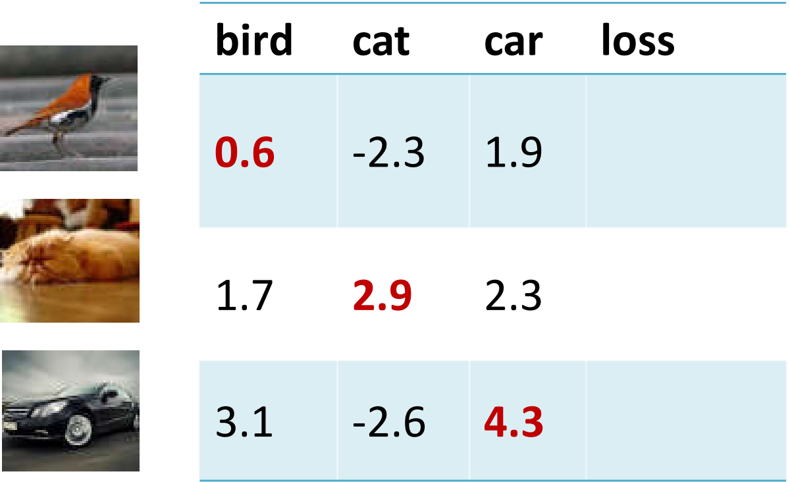

当前分类器对于鸟这张图像的损失：
$$
\begin{aligned}L_{i}
&=
\sum_{j\neq y_i}\max(0,s_{ij}-s_{y_i}+1)\\
&=
\max(0,-2.3-0.6+1)+\max(0,1.9-0.6+1)\\
&=
\max(0,-1.9)+\max(0,2.3)\\&=0+2.3\\&=2.3\end{aligned}
$$
说明：

- 首先是cat与bird做比较，因为cat得分为-2.3，而bird得分为0.6，此时就认为没有损失！

- 然后是car与bird做比较，因为car得分为1.9，而bird得分为0.6，此时就认为有损失，损失值为$1.9-0.6+1=2.3$

- 然后损失值相加，得到 $0+2.3=2.3$，也就是最终损失值是2.3

- 按照这样的步骤，我们分别得到：

  - 图1损失值：2.3
  - 图2损失值：$0+0.4=0.4$
  - 图3损失值：$0+0=0$

- 得到 `当前分类器对于整个数据集图像的损失`：（整个数据集损失的平均值）
  $$
  L=\frac{1}{N}\sum_{i=1}^NL_i
  $$
  带入公式，得：
  $$
  L=(2.3+0.4+0)/3=0.9
  $$


## 正则项与超参数

### 再谈损失函数

> **如果某组参数 $W$ 能让训练损失 $L(W)=0$，那这组 $W$ 是唯一的吗？**
>
> 答案是：**一般不唯一**

- 公式是：
  $$
  L(W)=\frac{1}{N}\sum_i L_i(f(x_i,W),y_i)
  $$
  其中：

  - $W$：模型参数，比如神经网络里的权重。
  - $x_i$：第 $i$ 个训练样本。
  - $y_i$：第 $i$ 个样本的真实标签。
  - $f(x_i,W)$：模型对 $x_i$ 的预测。
  - $L_i$：第 $i$ 个样本的损失。
  - $L(W)$：整个训练集上的平均损失。

  如果 $L(W)=0$，通常表示：**模型在训练集上完全拟合了所有样本**。但这不代表 $W$ 唯一。

- **举个例子**：示例：假设两个线性器分类$f_1(x,W_1)=W_1x$，$f_2(x,W_2)=W_2x$，其中，$W_2=2W_1$。对于下面图像已知分类器1的打分结果(如表所示),请计算分类器2的打分结果，以及两个分类器对当前样本的多类支撑向量机损失：

  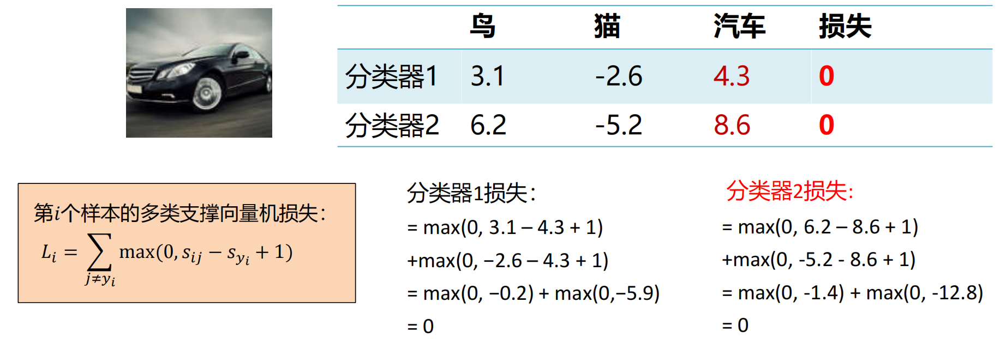

  我们发现在这个例子中，`分类器1损失`与`分类器2损失`都是0，但是此时 参数$W$ 并不是一样的

  > 🤔问题来了，我应该选择 参数$W_1$ 还是 参数$W_2$呢？
  >
  > 答案：引入`正则项`


### 正则项

$$
L(W)=\frac{1}{N}\sum_i L_i(f(x_i,W),y_i)
+{\color{red}\underbrace{\lambda R(W)}_{\text{正则项}}}
$$

#### 数据损失（上面所说的损失函数）

> 评价 分类器 在样本上的表现

- 在刚才的例子中，我们得到 `分类器1` 与 `分类器2` 的数据损失都是0

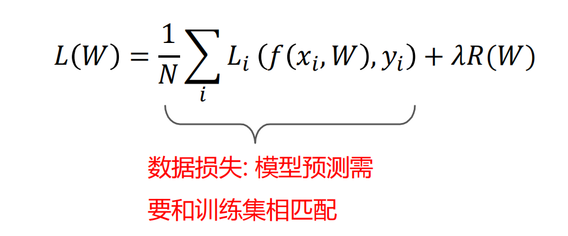

#### 正则项损失

> 评价 模型参数

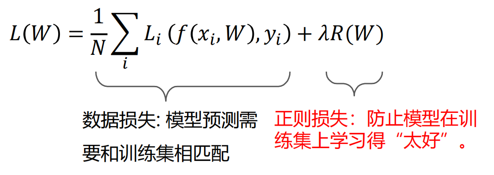

其中：

- $\lambda$：是一个`超参数（在开始学习过程之前设置值的参数，而不是通过学习得到的）`，控制着正则损失在总损失中所占的比重

- $R(W)$：是一个与权值$W$有关，跟图像数据无关的函数


### 超参数

> 概念：`超参数`是在开始学习过程之前设置值的参数，而不是学习得到。
>
> 超参数一般都会对模型性能有着重要的影响。

$$
L(W)=
\underbrace{
\frac{1}{N}\sum_i L_i(f(x_i,W),y_i)
}_{\substack{
\text{数据损失：模型预测需}\\
\text{要和训练集相匹配}
}}
+
\underbrace{
{\color{red}\lambda}R(W)
}_{\substack{
\text{正则损失：防止模型在}\\
\text{训练集上学习得“太好”}
}}
$$

其中：

- $\lambda$：**正则化系数（Regularization Strength）**，它是一个**超参数（Hyperparameter）**，用于控制正则损失在总损失函数中的重要程度。

  - $\lambda=0$：表示优化结果仅与数据损失相关


  - $\lambda=\infty$：表示优化结果与数据损失无关，仅考虑权重损失。

    此时，因为 我们希望 总损失函数$L(W)$ 最低，而 $R(W)$一般随着$W$增大而增大，所以此时系统最优解为 $W=0$。


### L2正则项

#### 范数与L2范数

##### 什么是范数？

> `范数` 是一个用来衡量向量大小的数学概念。

例如，有一个向量：
\[
x=[3,4]
\]
我们希望用一个数字来衡量这个向量有多大。

但是，衡量大小的方法不止一种，因此产生了不同的范数。


##### 什么是Lp范数

> `Lp 范数` 是一套计算向量大小的通用公式。当 p 取不同的值时，就得到不同的范数。
>
> 其中，**p 是一个参数，用于决定如何计算向量的大小。**

对于一个向量：
\[
x=[x_1,x_2,\ldots,x_n]
\]
Lp 范数定义为：
\[
\|x\|_p=\left(\sum_{i=1}^{n}|x_i|^p\right)^{\frac{1}{p}}
\]
其中：

- \(n\)：表示向量中元素的数量。
- \(p\)：表示范数的阶数，通常要求 \(p\geq 1\)。
- \(|x_i|\)：表示第 \(i\) 个元素的绝对值。
- \(\sum_{i=1}^{n}|x_i|^p\)：表示将所有元素的绝对值取 \(p\) 次方后相加。
- \(\frac{1}{p}\)：表示对求和结果取 \(p\) 次方根。


##### 什么是L2范数

> L2 范数 就是一种衡量向量大小的方法，它计算的是向量的`欧几里得长度`。

对于向量 \[ x=[x_1,x_2,\ldots,x_n] \] ，L2 范数定义为：
\[
\|x\|_2=\sqrt{x_1^2+x_2^2+\cdots+x_n^2}
\]
也可以写成：
\[
\|x\|_2=\sqrt{\sum_{i=1}^{n}x_i^2}
\]
其中：

- \(\|x\|_2\)：表示向量 \(x\) 的 L2 范数。
- \(x_i\)：表示向量中的第 \(i\) 个元素。
- \(\sum_{i=1}^{n}x_i^2\)：表示把所有元素平方后相加。
- **为什么叫 L2？** 因为它属于 Lp 范数的一种，且这里的 \(p=2\)。


#### L2正则项公式

- 公式：
  $$
  R(W)=\sum_k\sum_lW_{k,l}^2
  $$
  其中：

  - $W_{k,l}$：表示第 $k$ 行、第 $l$ 列的那个权重。
  - $\sum_k\sum_l$：把矩阵里面每一个元素都拿出来平方，再全部加起来。
  
- 举个例子：

  - 条件：

    样本：$x=[1,1,1,1]$

    分类器1：$W_1=[1,0,0,0]$

    分类器2：$W_2=[0.25,0.25,0.25,0.25]$

    正则项（采用L2正则化）：$R(W)=\sum_k\sum_lW_{k,l}^2$

    正则化系数：$\lambda=1$

  - 计算过程：

    - 两个分类器对该样本的输出为：
      \[
      W_1^Tx=W_2^Tx=1
      \]
      （也就是说对于**这两个分类器**而言，在该样本上`数据损失`是一样的 ）

    - 两个分类器的正则化损失：
      \[
      R(W_1)=1^2+0^2+0^2+0^2=1
      \]

      \[
      R(W_2)=0.25^2+0.25^2+0.25^2+0.25^2=0.25
      \]

      （那么这个时候谁的正则项小，我就取谁，但是有什么物理含义呢？🤔）

  - **结论**：

    **在两个分类器对该样本输出相同的情况下，L2 正则化更偏好分类器 2，因为它的权重平方和更小。**

  - **探讨正则损失的物理含义**

    在上面我们列出了两组权值 $W_1=[1,0,0,0]$ 与 $W_2=[0.25,0.25,0.25,0.25]$，

    $W_2$意义在于让$x$的每一维都参与运算来得到最后的结果，而$W_1$只关注了第一维的特征

    这就会引出一个问题：**在真实过程中，我的传感器设备得到的数据的低维度不准确的情况下，$W_1$就容易出错，而$W_2$考虑了全部维度的特征，那么$W_2$的容错率更高**。

  > [!IMPORTANT]
  >
  > `L2正则项损失`：我不光让我的损失能够选出唯一解，同时让这个解尽量的去考虑所有的特征，**让我的模型有了一定的偏好（偏好权值比较分散！）**

- 所以正则项解决了2个问题：

  1. 让解唯一（可以在多个**数据损失相同**的解中，通过**额外的约束（偏好）**选出一个**最优解**）
  2. 让我们去选择 权值$W$ 时有一定的`偏好性`。在所有可选的$W$里面，我可以选择对我现在所做的事情最有利的那一组权值


### 常用的正则项损失

- L1正则项：$R(W)=\sum_k\sum_l|W_{k,l}|$

  > **偏好稀疏的权重。** 希望尽可能多的权重变成 0，只保留部分重要特征。

- L2正则项：$R(W)=\sum_k\sum_lW_{k,l}^2$

  > **偏好较小的权重。** 不希望某些权重过大，在特征都有效的情况下，可能更倾向于让多个特征共同参与预测。

- 弹性网络正则项Elastic net(L1+L2)：$R(W)=\sum_k\sum_l\beta W_{k,l}^2+|W_{k,l}|$

  > **同时具有 L1 和 L2 的偏好。** 既希望部分权重变成 0，又希望保留下来的权重不要过大。


# 优化算法


我们现在有了`损失函数`，能够准确地定量地度量预测值与真实值之间的关系，算出来的结果就叫做`损失值`。

🤔假设现在`损失值`很大，我们应该怎么去调整模型呢？我们不可能初始设置一组权值，就能让这个模型分类性能很好。我随机给模型一组权值，通常结果并不好。那么我们就需要有东西来帮我调整这些参数

## 什么是参数优化

> `参数优化`是机器学习的核心步骤之一，它`利用损失函数`的输出值`作为反馈信号`来`调整分类器参数`，以提升分类器对`训练样本`的`预测性能`。
>
> - **优化算法目标**：损失函数$L$是一个与参数$W$有关的函数，优化的目标就是找到使损失函数$L$达到最优的那组参数$W$。
>
> - **直接方法**：**求出损失函数的最小值点，也就是使损失函数最小的那组参数 \(W\)**，对应下面
>   $$
>   \frac{\partial L}{\partial W}=0
>   $$
>   （当然还要区分`局部极小点`，`局部极大点`，`鞍点`）
>
>   **通常，$L$形式比较复杂，很难从这个等式直接求解出$W$！**

## 梯度下降算法

假设 特征$W$维度是1，损失值$L$与特征$W$的函数如图：（`二维`）

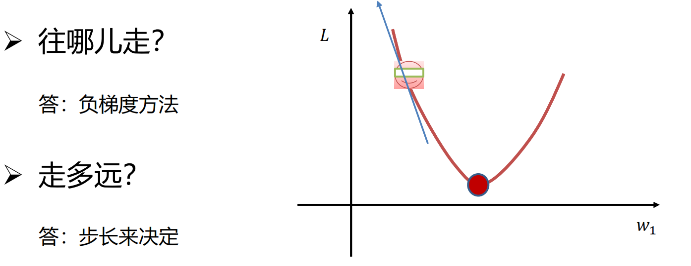

假设 特征$W$维度是2，损失值$L$与特征$W$的函数如图：（`三维`）


所以：

- 梯度下降算法

  **通过不断计算损失函数对权重的梯度，判断应该朝哪个方向调整权重，然后一步一步减小损失函数的值。**

- 画成伪代码

  ```python
  while True:
      权值的梯度 = 计算梯度(损失, 训练样本, 权值)		# 计算梯度
  	更新后的权值 = 当前权值 – 学习率 * 权值的梯度		# 更新权重
  ```

  其中：

  - **计算梯度**：权值的梯度 = 计算梯度(损失, 训练样本, 权值)

    - 对应数学公式：
      $$
      g_t=\nabla_W L(W_t)
      $$
      其中：

      - $t$：迭代次数。表示当前是第几次参数优化。

      - \(g_t\)：梯度。第 t 次迭代时计算得到的梯度结果。

      - \(L(W_t)\)：将当前权重代入损失函数后得到的损失值
        - $L$：损失函数
        - \(W_t\)：第 t 次迭代时，权重的具体取值
      - \(\nabla_W\)：关于 W 的梯度算子。表示对权重 W 中的每一个元素求偏导数。
        - \(\nabla\)：梯度算子。表示对函数的各个变量求偏导数。

    - 含义：

      根据当前权重和训练样本，计算损失函数对每个权重的偏导数。

      当权重是向量或者矩阵时，梯度也是相同形状的向量或者矩阵。

  - **更新权重**：更新后的权值 = 当前权值 - 学习率 * 权值的梯度

    - 对应数学公式：
      \[
      W_{t+1}=W_t-\eta\nabla_W L(W_t)
      \]
      其中：

      - \(W_t\)：第 \(t\) 次迭代时的权重。
      - \(W_{t+1}\)：更新后的权重。
      - \(\eta\)：学习率，控制每次更新的步长。
      - \(\nabla_W L(W_t)\)：当前权重位置上的损失函数梯度。

    

## 梯度计算

在上面我们说了`梯度下降算法`的大概流程，下面我们说明`梯度下降算法`中的 **梯度计算** 是怎么做的？


### 梯度计算的两种方法

#### 数值法（计算量大，不精确）

对于一维变量，函数求导的定义是：
$$
\frac{dL(w)}{dw}=\lim_{h\to0}\frac{L(w+h)-L(w)}{h}
$$
**示例**：损失函数 $L(w)=w^2$ 求$w=1$点处的梯度
$$
\frac{dL(w)}{dw}=\lim_{h\to0}\frac{L(w+h)-L(w)}h\approx\frac{L(1+0.0001)-L(1)}{0.0001}=2.0001
$$


#### 解析法（精确，速度快，导数函数推导易错）

**示例**：损失函数 $L(w)=w^2$ 求$w=1$点处的梯度
$$
\nabla L(w)=2w
\\
\nabla_{w=1}L(w)=2
$$


> [!NOTE]
>
> **数值梯度有什么作用？**
>
> 答：求梯度时一般使用解析梯度，而数值梯度主要用于解析梯度的正确性校验（梯度检查）。


### 批量梯度下降算法

> [!NOTE]
>
> `梯度下降`：利用所有样本计算损失并更新梯度
>
> **当N很大时，权值的梯度计算量很大！**

为什么呢？我们来看批量梯度下降算法的一次权重更新过程中，如何计算损失及损失函数的梯度：

- **计算总损失**
  \[
  L(W)=\underbrace{\frac{1}{N}\sum_{i=1}^{N}L_i(x_i,y_i,W)}_{\text{平均数据损失}}+\underbrace{\lambda R(W)}_{\text{正则化损失}}
  \]
  计算总损失需要**计算每个训练样本的数据损失**，然后求平均值，最后加上正则化损失。

- **计算总损失函数的梯度**
  $$
  \nabla_W L(W)=\underbrace{\frac{1}{N}\sum_{i=1}^{N}\nabla_W L_i(x_i,y_i,W)}_{\text{平均数据损失的梯度}}+\underbrace{\lambda\nabla_W R(W)}_{\text{正则化损失的梯度}}
  $$
  整个训练集的数据损失梯度，等于**每个训练样本的数据损失梯度的平均值**。

由此，我们知道每进行一次梯度更新，我们都需要遍历整个训练集。那么当 **样本数$N$** 很大时，遍历一次训练集的成本就很大了。

由此我们就提出 <span style="color:red;">随机梯度下降算法</span>


### 随机梯度下降算法

> [!NOTE]
>
> `随机梯度下降`：每次随机**选择一个样本$x_i$**，计算损失并更新梯度
>
> - 核心思想：
>
>   🤔既然计算所有训练样本的梯度成本很高，那么能不能**不计算所有样本的梯度，只随机选择一个样本的梯度来近似整个训练集的梯度呢？**
>
> - 这会引出的问题：
>
>   🤔 那么每次都只随机选择一个样本，如果该样本对应的梯度方向与整个训练集的梯度方向不一致，那么是不是会带偏权重的更新方向，甚至导致总损失不降反升？
>
>   👉 会。由于单个样本的梯度只能近似整个训练集的梯度，因此每次计算得到的梯度都可能存在估计误差，导致权重朝不同方向更新，使总损失产生波动。
>
>   但是，在**均匀随机采样**的情况下，随机梯度的期望等于整个训练集的真实梯度。因此，在学习率合适等条件下，经过多次迭代，总损失整体上仍然趋向下降。

随机梯度下降每次只随机选择一个训练样本，用该样本对应的损失梯度来估计整个训练集的梯度。

- 我们来看随机梯度下降算法的一次**权重更新**过程中，如何计算 **损失** 及 **损失函数的梯度**：

  - 计算当前随机样本对应的损失
    $$
    \hat{L}_i(W)=\underbrace{L_i(x_i,y_i,W)}_{\text{单个样本的数据损失}}+\underbrace{\lambda R(W)}_{\text{正则化损失}}
    $$
    其中：

    - \(x_i\)：随机选中的训练样本的特征
    - \(y_i\)：该样本对应的真实标签
    - \(W\)：分类器的权重参数
    - \(R(W)\)：正则项\(\lambda\)正则化系数
    - \(\hat{L}_i(W)\)：使用单个样本得到的总损失估计

  - 计算当前随机样本对应的梯度
    $$
    \begin{aligned}
    \nabla_W\hat{L}_i(W)&=\nabla_W\left(L_i(x_i,y_i,W)+\lambda R(W)\right)\\[6pt]
    &=\nabla_W L_i(x_i,y_i,W)+\lambda\nabla_W R(W)
    \end{aligned}
    $$

- 把这个过程写成伪代码：

  ```python
  # 输入：训练集 D，学习率 η，正则化系数 λ
  # 输出：优化后的权重 W
  
  初始化权重 W
  
  while True:
      # 1. 从训练集中随机采样一个样本
      单个训练样本(x_i, y_i) = RandomSample(D)
      # 2. 计算当前样本对应的损失梯度
  	权值的梯度g = ∇_W L_i(x_i, y_i, W) + λ∇_W R(W)
      # 3. 沿梯度的反方向更新权重
  	权值W = 权值W – 学习率η * 权值的梯度g
  ```


### 小批量梯度下降算法

> [!NOTE]
>
> `小批量随机梯度下降`：每次随机选择 **$m$（批量的大小，这是一个超参数）** 个样本，计算损失并更新梯度
>
> - **核心思想**：
>
>   每次从整个训练集中随机选择 m 个样本，计算这 m 个样本的数据损失梯度的平均值，以此来估计整个训练集的梯度，然后更新权重。

- 其计算过程为：

  - **计算小批量损失**
    $$
    \hat{L}(W)=\underbrace{\frac{1}{m}\sum_{i=1}^{m}L_i(x_i,y_i,W)}_{\text{小批量样本的平均数据损失}}+\underbrace{\lambda R(W)}_{\text{正则化损失}}
    $$

  - **计算小批量梯度**
    $$
    \nabla_W\hat{L}(W)=\underbrace{\frac{1}{m}\sum_{i=1}^{m}\nabla_W L_i(x_i,y_i,W)}_{\text{小批量样本的平均数据损失梯度}}+\underbrace{\lambda\nabla_W R(W)}_{\text{正则化损失的梯度}}
    $$

- 因为每次更新权重只使用一部分训练样本，而不是整个训练集，这就引出了三个需要区分的概念：

  - **Batch Size（批量大小）**

    > 定义：一次迭代中，用于计算梯度的训练样本数量。

    对应小批量梯度下降公式中的 m：
    \[
    \nabla_W\hat{L}(W)=\frac{1}{m}\sum_{i=1}^{m}\nabla_W L_i(x_i,y_i,W)+\lambda\nabla_W R(W)
    \]
    假设整个训练集有 1000 个样本 \[ N=1000 \]

    设置 Batch Size 为 100 \[ m=100 \]

    那么每次只使用 100 个样本计算损失函数的梯度，然后更新一次权重。

  - **Iteration（迭代）**

    > 定义：完成一次梯度计算和权重更新的过程，称为一次迭代。

    一次完整的迭代包含以下过程：

    ```
    选择一批训练样本
            ↓
    计算这一批样本的预测结果
            ↓
    计算这一批样本的损失
            ↓
    计算损失函数关于权重的梯度
            ↓
    更新权重 W
    ```

  -  **Epoch（训练轮数）**

    > 定义：将整个训练集中的所有样本完整地用于训练一遍，称为一个 Epoch。

    - **为什么需要引入 Epoch？**

      因为小批量梯度下降每次只使用部分训练样本，所以完成一次 `Iteration`，并不代表整个训练集都已经参与了训练。

    - 举个例子：

      假设 样本数\[ N=1000 \]，批量大小\[ m=100 \]，通常会先将训练集随机打乱，再将其划分为 10 个小批量，如下图所示：

      ```
      整个训练集（1000 个样本）
      │
      ├── Batch 1  （100 个样本）→ Iteration 1  → 更新权重
      ├── Batch 2  （100 个样本）→ Iteration 2  → 更新权重
      ├── Batch 3  （100 个样本）→ Iteration 3  → 更新权重
      ├── Batch 4  （100 个样本）→ Iteration 4  → 更新权重
      ├── Batch 5  （100 个样本）→ Iteration 5  → 更新权重
      ├── Batch 6  （100 个样本）→ Iteration 6  → 更新权重
      ├── Batch 7  （100 个样本）→ Iteration 7  → 更新权重
      ├── Batch 8  （100 个样本）→ Iteration 8  → 更新权重
      ├── Batch 9  （100 个样本）→ Iteration 9  → 更新权重
      └── Batch 10 （100 个样本）→ Iteration 10 → 更新权重
      
      至此，整个训练集被完整训练了一遍
                      ↓
                完成 1 个 Epoch
      ```

      因此：
      \[
      \underbrace{1\text{ Epoch}}_{\text{完整遍历训练集一次}}
      =
      \underbrace{10\text{ Iterations}}_{\text{完成10次权重更新}}
      \]
      如果设置训练 5 个 Epoch，那么整个训练过程中一共会更新 50 次权重。

- 把这个过程写成伪代码：

  ```python
  # 输入：训练集 D，损失函数 L，学习率 η，批量大小 m，训练轮数 E
  # 输出：优化后的权重 W
  
  初始化权重 W
  
  # 每执行一次外层循环，完成一个 Epoch
  for epoch in range(E):
      # 1. 随机打乱训练集（引入随机性）
      D = Shuffle(D)
      # 2. 按照批量大小 m 划分训练集
      Batches = Split(D, m)
     	
      # 每执行一次内层循环，完成一次 Iteration
      for B in Batches:
          # 3. 计算当前小批量样本对应的梯度
          g = ComputeGradient(L, B, W)
          # 4. 更新权重
          W = W - η * g
  
  return W
  ```


### 总结

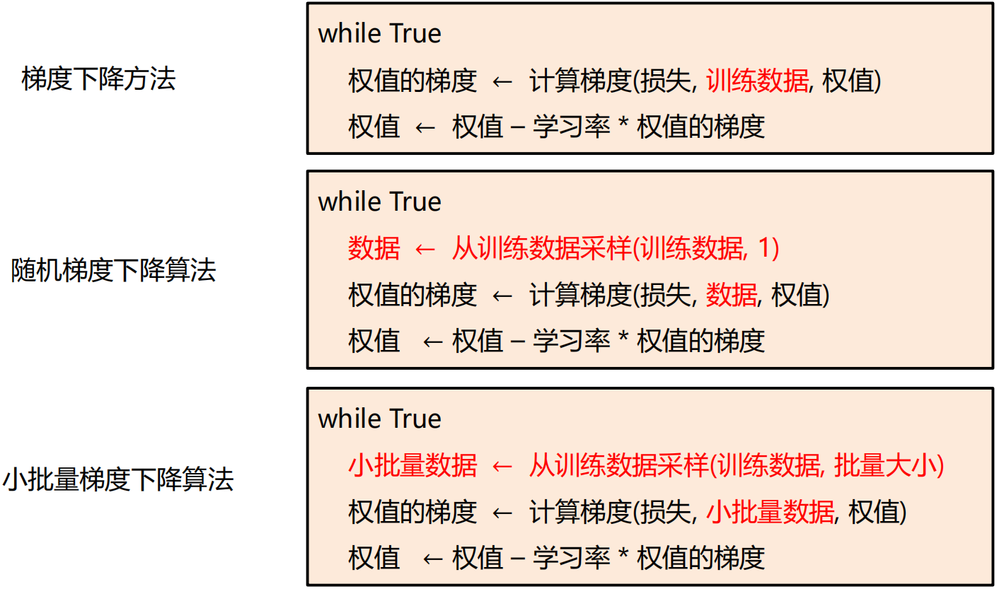


# 训练过程

## 数据集划分

- 我们一般把一个`数据集` 划分为三个集合：训练集，验证集，测试集

  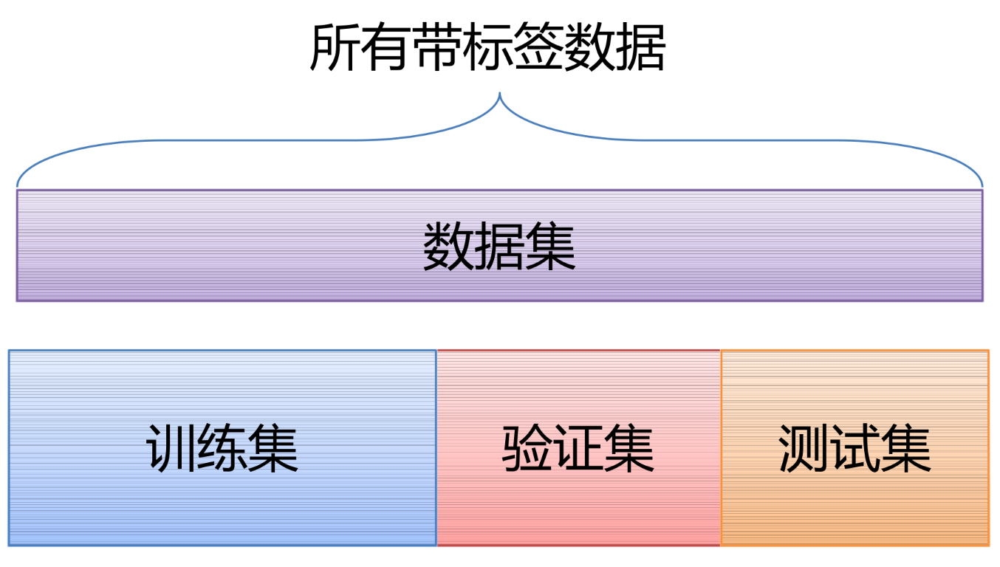

  - **训练集** 用于在给定超参数的情况下，**学习分类器的模型参数$W$**。

  - **验证集** 用于**选择超参数**：尝试不同的超参数取值，分别训练模型，然后根据模型在验证集上的表现，选择表现最好的一组超参数。

  - **测试集** 用于**评估最终模型的泛化能力**，即评估模型在从未参与训练和超参数选择的数据上的表现。

- 一般流程：

  ```mermaid
  flowchart TD
      A["数据集（Dataset）"]
  
      A --> B["训练集（Training Set）"]
      A --> C["验证集（Validation Set）"]
      A --> D["测试集（Test Set）"]
  
      E["设定一组超参数<br/>例如：正则化系数、学习率、Batch Size"]
  
      E --> F["训练模型<br/>学习模型参数 W"]
      B --> F
  
      F --> G["评估当前模型的表现"]
      C --> G
  
      G --> H{"是否完成超参数选择？"}
  
      H -->|否| I["调整超参数"]
      I --> E
  
      H -->|是| J["选择验证集上表现最好的超参数"]
      J --> K["确定最终模型"]
  
      K --> L["评估最终模型的泛化能力"]
      D --> L
  
      L --> M["得到最终测试结果"]
  
      classDef train fill:#DAE8FC,stroke:#6C8EBF,color:#000
      classDef val fill:#F8CECC,stroke:#B85450,color:#000
      classDef test fill:#FFE6CC,stroke:#D79B00,color:#000
      classDef dataset fill:#E1D5E7,stroke:#9673A6,color:#000
  
      class A dataset
      class B,F train
      class C,G,H,I,J val
      class D,L,M test
  ```

- **问题**：如果数据很少，那么可能验证集包含的样本就太少，从而无法在统计上代表数据。

  - 这个问题很容易发现：如果在划分数据前进行不同的随机打乱，最终得到的模型性能差别很大，那么就存在这个问题。

  - 怎么解决呢？

    接下来会介绍 `K折验证` 与 `重复的K折验证`，它们是解决这一问题的两种方法。


### K折交叉验证

- K折交叉验证的概念：

  为了更加可靠地评估一组超参数对应的模型性能，将用于训练和验证的数据划分为 K 个互不重叠的子集。

  在**给定一组超参数**的情况下，依次选择一个子集作为验证集，其余 K−1 个子集作为训练集，共进行 K 次模型训练，得到 K 个模型。分别计算这 K 个模型在各自验证集上的性能分数，并取其平均值，作为**该组超参数**的交叉验证分数。

  通过比较不同超参数对应的交叉验证分数，选择表现最优的一组超参数，从而降低单次数据集划分的偶然性对超参数选择结果的影响。

- 举个例子：**3折交叉验证**

  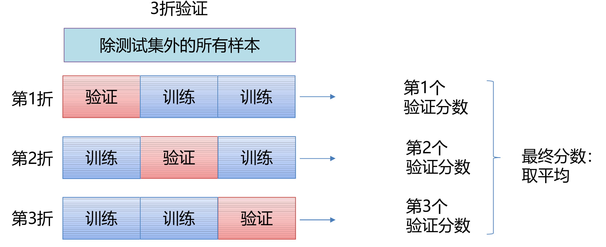

  - 我的目的：

    评估 **同一组超参数（这里设为超参数组A）**在**相同模型结构（）**下，经过不同训练集训练后得到的模型的平均验证性能，从而判断这组超参数是否合适。

  - 过程：

    - 将用于**训练和验证的数据**划分为 **3 个互不重叠的子集** \[ D=D_1\cup D_2\cup D_3 \]，依次进行 3 次训练与验证：（如上图所示，🟦 训练集　🟥 验证集）

      | 验证轮次 | 超参数 | 子集 $D_1$ | 子集 $D_2$ | 子集 $D_3$ | 学习得到的模型参数 | 验证分数 |
      | -------- | ------ | ---------- | ---------- | ---------- | ------------------ | -------- |
      | 第 1 折  | A      | 🟥          | 🟦          | 🟦          | $W_1$              | $S_1$    |
      | 第 2 折  | A      | 🟦          | 🟥          | 🟦          | $W_2$              | $S_2$    |
      | 第 3 折  | A      | 🟦          | 🟦          | 🟥          | $W_3$              | $S_3$    |

      我使用 同一组超参数A，在每一折中学习到不同的模型参数$W$，并且训练出来的模型在各折的验证集中得到了不同的分数$S$

    - 最后，**对 三个模型的验证分数 求 平均值**，作为 **超参数组 A** 的交叉验证分数：
      \[
      \underbrace{\operatorname{Score}(A)}_{\text{超参数组 A 的交叉验证分数}} = \frac{S_1+S_2+S_3}{3}
      \]

    - 然后可以更换超参数组 B、C 等，重复上述过程，比较各组超参数的交叉验证分数，选择表现最优的一组超参数。


### 带有打乱数据的重复K折交叉验证

> **带有数据打乱的重复 K 折交叉验证**，是在普通 K 折交叉验证的基础上，每次重新随机打乱数据集、重新划分 K 个子集，并重复执行完整的 K 折交叉验证。
>
> 其目的是**进一步降低数据集划分的偶然性对超参数评估结果的影响**。

- **普通 K 折交叉验证存在什么问题？**

  以 3 折交叉验证为例，假设有 9 个样本：\[ D=\{1,2,3,4,5,6,7,8,9\} \] ，随机打乱后，将数据划分为 3 个子集：\[ \begin{aligned} D_1&=\{1,5,8\}\\ D_2&=\{2,4,9\}\\ D_3&=\{3,6,7\} \end{aligned} \]

  虽然进行了 3 次训练与验证，但是这 3 个子集的组成始终没有发生变化。也就是说，**普通 K 折交叉验证仍然依赖于最初的数据集划分方式**。如果最初划分得到的子集不够合理，那么最终得到的交叉验证分数仍然可能存在较大的**偶然性（由于数据集的随机划分，导致模型的性能评估结果受到某一次数据划分的影响，而不能稳定、可靠地反映模型的真实泛化能力）**。

- 举个例子：重复 3 次的 3 折交叉验证

  - **我的目的：** 给定一组超参数（这里设为超参数组 A），通过多次随机打乱数据集，并重复执行 带有打乱数据的K折交叉验证，更加可靠地评估这组超参数对应的模型性能。

  - **设定**：

    - 超参数：超参数组 A
    - 折数：\(K=3\)
    - 重复次数：\(M=3\)

  - **执行过程**：

    - 第一次 K 折交叉验证：

      第一次随机打乱数据，并划分子集，得到：\[ \begin{aligned} D_1&=\{1,5,8\}\\ D_2&=\{2,4,9\}\\ D_3&=\{3,6,7\} \end{aligned} \]

      | 轮次    | 超参数 | 子集 $D_1$ | 子集 $D_2$ | 子集 $D_3$ | 模型参数  | 验证分数  |
      | ------- | ------ | ---------- | ---------- | ---------- | --------- | --------- |
      | 第 1 折 | A      | 🟥          | 🟦          | 🟦          | $W_{1,1}$ | $S_{1,1}$ |
      | 第 2 折 | A      | 🟦          | 🟥          | 🟦          | $W_{1,2}$ | $S_{1,2}$ |
      | 第 3 折 | A      | 🟦          | 🟦          | 🟥          | $W_{1,3}$ | $S_{1,3}$ |

      第一次交叉验证分数：
      \[
      S_1=\frac{S_{1,1}+S_{1,2}+S_{1,3}}{3}
      \]

    - 第二次 K 折交叉验证

      重新随机打乱整个训练与验证数据集，并重新划分子集，得到：\[ \begin{aligned} D_1&=\{2,5,7\}\\ D_2&=\{1,3,8\}\\ D_3&=\{4,6,9\} \end{aligned} \]

      | 轮次    | 超参数 | 子集 $D_1$ | 子集 $D_2$ | 子集 $D_3$ | 模型参数  | 验证分数  |
      | ------- | ------ | ---------- | ---------- | ---------- | --------- | --------- |
      | 第 1 折 | A      | 🟥          | 🟦          | 🟦          | $W_{2,1}$ | $S_{2,1}$ |
      | 第 2 折 | A      | 🟦          | 🟥          | 🟦          | $W_{2,2}$ | $S_{2,2}$ |
      | 第 3 折 | A      | 🟦          | 🟦          | 🟥          | $W_{2,3}$ | $S_{2,3}$ |

      第二次交叉验证分数：
      \[
      S_2=\frac{S_{2,1}+S_{2,2}+S_{2,3}}{3}
      \]

    - 第三次 K 折交叉验证

      再次随机打乱数据，并重新划分子集，得到：\[ \begin{aligned} D_1&=\{1,4,7\}\\ D_2&=\{2,6,8\}\\ D_3&=\{3,5,9\} \end{aligned} \]

      | 轮次    | 超参数 | 子集 $D_1$ | 子集 $D_2$ | 子集 $D_3$ | 模型参数  | 验证分数  |
      | ------- | ------ | ---------- | ---------- | ---------- | --------- | --------- |
      | 第 1 折 | A      | 🟥          | 🟦          | 🟦          | $W_{3,1}$ | $S_{3,1}$ |
      | 第 2 折 | A      | 🟦          | 🟥          | 🟦          | $W_{3,2}$ | $S_{3,2}$ |
      | 第 3 折 | A      | 🟦          | 🟦          | 🟥          | $W_{3,3}$ | $S_{3,3}$ |

      第三次交叉验证分数：
      \[
      S_3=\frac{S_{3,1}+S_{3,2}+S_{3,3}}{3}
      \]

    - **计算最终的超参数分数**

      对三次 K 折交叉验证的分数求平均值：
      \[
      \begin{aligned} \operatorname{Score}(A)&=\frac{S_1+S_2+S_3}{3}\\ &=\frac{ S_{1,1}+S_{1,2}+S_{1,3} +S_{2,1}+S_{2,2}+S_{2,3} +S_{3,1}+S_{3,2}+S_{3,3} }{9} \end{aligned}
      \]
      因此，最终实际上是对 **9 个模型的验证分数求平均值**，作为超参数组 A 的性能评估分数。


## 数据预处理

这一部分我们讨论两个问题：

- **数据能否直接使用？** 原始数据是否满足模型的输入要求，是否有利于模型学习？
- **有哪些数据处理方式？** 如果原始数据不适合直接输入模型，应该如何处理？


### 数据能否直接使用？

原始数据不一定能够直接用于模型训练，主要存在以下几个问题。

| 存在的问题             | 举例                             | 可能造成的影响           |
| ---------------------- | -------------------------------- | ------------------------ |
| 数据不是数值形式       | 文本、类别标签                   | 无法直接进行数值计算     |
| 数据的取值范围差异较大 | 年龄为 0～100，收入为 0～1000000 | 可能影响梯度下降的效率   |
| 数据存在缺失值         | 某个样本缺少年龄信息             | 可能导致模型无法正常计算 |
| 数据存在异常值         | 年龄为 1000 岁                   | 可能干扰模型学习         |
| 数据格式不统一         | 图像的尺寸不同                   | 可能不满足模型的输入要求 |
| 数据存在错误或重复     | 错误的分类标签、重复样本         | 可能影响模型的学习效果   |


### 有哪些数据预处理方式？

| 处理方式                            | 英文名称               | 主要目的                           |
| ----------------------------------- | ---------------------- | ---------------------------------- |
| 数据清洗                            | Data Cleaning          | 处理错误、重复及异常数据           |
| <font color="red">数据向量化</font> | Data Vectorization     | 将数据转换为模型能够计算的数值形式 |
| <font color="red">数据归一化</font> | Normalization          | 将数据缩放到特定的数值范围         |
| <font color="red">数据标准化</font> | Standardization        | 调整数据的均值和标准差             |
| <font color="red">缺失值处理</font> | Missing Value Handling | 填补或删除缺失的数据               |
| 特征编码                            | Feature Encoding       | 将类别型数据转换为数值形式         |
| 数据增强                            | Data Augmentation      | 通过合理变换增加训练样本的多样性   |
| 特征提取                            | Feature Extraction     | 从原始数据中提取有用的信息         |
| 特征选择                            | Feature Selection      | 保留有用的特征，减少无关特征       |


### 数据预处理的一些方式

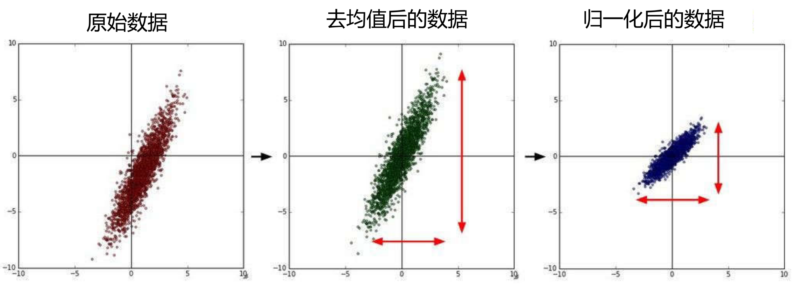
\[
\text{原始数据} \xrightarrow{\text{去均值}} \text{去均值后的数据} \xrightarrow{\text{归一化}} \text{归一化后的数据}
\]

#### 去均值（Zero-centering）

> **目的：使每一个特征的均值都为 0**

- 为什么需要去均值？

  很多时候，我们关心的并不是数据的原始数值，而是数据相对于某个参考水平的差异。

  例如，在分析学生的能力时，高考的原始分数不仅与学生自身的能力有关，还与当年试卷的难易程度有关。因此，相比于直接观察原始分数，我们可能更加关心学生相对于当年平均水平的表现（关注的是排名而不是绝对分数）。

  去均值就是让每一个数据减去其对应的均值，将数据的参考基准从坐标原点转换为数据的平均水平。

  通过去均值，可以消除数据的整体偏移，保留数据之间的相对差异，使数据分布的中心位于坐标原点，从而简化部分数学计算，并有利于某些模型的优化。

- 举个例子

  假设两个特征的均值分别为：
  $$
  \mu_1=\frac{1}{N}\sum_{i=1}^{N}x_{i,1}
  \\
  \mu_2=\frac{1}{N}\sum_{i=1}^{N}x_{i,2}
  $$
  对每一个样本的每一个特征减去对应特征的均值：
  \[
  \begin{bmatrix} x'_{i,1}\\ x'_{i,2} \end{bmatrix} = \begin{bmatrix} x_{i,1}-\mu_1\\ x_{i,2}-\mu_2 \end{bmatrix}
  \]
  处理之后：
  \[
  \begin{aligned} \operatorname{Mean}(x'_1)&=0\\ \operatorname{Mean}(x'_2)&=0 \end{aligned}
  \]

#### 归一化（Normalization）

> **目的：使不同特征具有相近的数值尺度。**

- 为什么需要归一化？

  在上图的中间图，虽然经过了去均值处理，但是纵向和横向的数据分布范围仍然存在较大的差异。

  这是因为去均值处理只改变了数据分布的中心位置，并没有改变数据分布的范围。而不同特征可能由于<font color="red">量纲</font>、计量单位以及数据自身分布的不同，导致其数值尺度存在较大的差异。

  假设这个数据集描述的是**人的体重与身高的关系**，特征1是体重（单位为吨），特征2是身高（单位为毫米），那么这时候：

  - 横坐标上，人与人之间的体重在数值上的**差异微乎其微**（1吨=1000kg）
  - 纵坐标上，人与人之间的身高在数值上的**差异特别大**（1cm=10mm）

  在某些分类算法中，如果直接使用原始数据进行计算，那么数值尺度较大的特征可能会占据主导地位（模型认为样本在这个特征上差异非常大），而数值尺度较小的特征可能会被弱化（模型认为样本在这个特征上都很相似）。

  然而，数值尺度的大小并不能代表特征的重要程度。

  因此，我们希望通过归一化处理，消除不同特征的量纲和数值尺度差异，将不同特征的数据转换到相同的数值范围内进行比较，从而避免计量单位和数值尺度对模型产生不合理的影响。

- 举个例子：

  一种常见的处理方式是，让每个特征除以其对应的 **标准差**
  \[
  \begin{bmatrix} x''_{i,1}\\ x''_{i,2} \end{bmatrix} = \begin{bmatrix} \displaystyle\frac{x'_{i,1}}{\sigma_1}\\[10pt] \displaystyle\frac{x'_{i,2}}{\sigma_2} \end{bmatrix}
  \]
  处理之后：
  \[
  \begin{aligned} 
  \operatorname{Mean}(x''_1)&=0\\ 
  \operatorname{Mean}(x''_2)&=0\\ 
  \operatorname{Var}(x''_1)&=1\\ 
  \operatorname{Var}(x''_2)&=1 
  \end{aligned}
  \]

---

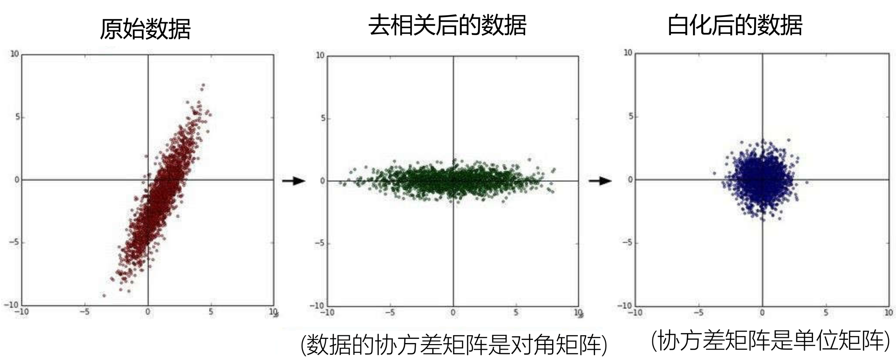
$$
\text{原始数据}
\xrightarrow{\text{去相关}}
\text{去相关后的数据}
\xrightarrow{\text{尺度缩放}}
\text{白化后的数据}
$$

#### 去相关（Decorrelation）

> **目的：消除不同特征之间的线性相关性。**（降维）

- **什么叫特征之间存在相关性？**

  - 例如，有两个特征：

    | 样本 | 身高（cm） | 体重（kg） |
    | ---- | ---------- | ---------- |
    | 1    | 150        | 45         |
    | 2    | 160        | 52         |
    | 3    | 170        | 65         |
    | 4    | 180        | 75         |
    | 5    | 190        | 90         |

    可以发现，随着身高的增大，体重也倾向于增大。这种关系就是`正相关`。

  - 我们可以使用**协方差矩阵**描述不同特征之间的线性相关程度：

    > [!NOTE]
    >
    > **协方差（Covariance）** 用于衡量两个变量之间共同变化的方向，即一个变量偏离其均值时，另一个变量倾向于向相同方向偏离，还是向相反方向偏离。
    >
    > - **方差（Variance）**：描述一个变量自身的离散程度。
    > - **协方差（Covariance）**：描述两个变量共同变化的情况。

    \[
    \Sigma= \begin{bmatrix} \operatorname{Var}(x_1)& {\color{red}\operatorname{Cov}(x_1,x_2)}\\ {\color{red}\operatorname{Cov}(x_2,x_1)}& \operatorname{Var}(x_2) \end{bmatrix} 
    \]

    

    其中，对角线上的元素表示各个特征自身的方差，红色的非对角线元素表示不同特征之间的协方差。

    去相关之后：

    \[
    \Sigma'= \begin{bmatrix} \sigma_1^2&{\color{red}0}\\ {\color{red}0}&\sigma_2^2 \end{bmatrix}
    \]
    此时，不同特征之间的协方差为 0。

- **为什么需要去相关？**

  如上图所示，在原始数据中，当 x 方向上的数据增大时，y 方向上的数据也倾向于增大，这说明两个特征之间存在线性相关性。

  当数据的维度较高时，不同特征之间可能存在信息冗余。因此，我们希望通过坐标变换，将原本具有线性相关性的特征转换为线性不相关的新特征，使我们能够更加方便地分析各个特征。（**主成分分析**）

  经过去相关处理后，可能会发现数据在某些特征方向上的变化很大，而在另外一些特征方向上的变化很小。此时，如果变化较小的特征对于当前任务不重要，就可以考虑舍弃这些特征，从而实现降维。（**PCA 降维**）

  因此，去相关主要具有以下好处：

  - 消除不同特征之间的线性相关性，减少线性信息冗余。
  - 便于分析不同特征方向上的数据变化程度。
  - 为后续舍弃不重要的特征、实现数据降维提供条件。


#### 白化（Whitening）

> **目的：在消除不同特征之间线性相关性的基础上，使每一个特征的方差都为 1。**

- 什么是白化：

  **白化：在去均值、去相关的基础上，对每一个新特征除以其对应的标准差，使各个特征的均值为 0、方差为 1，并且特征之间线性不相关。**

  因此，白化可以分解为三个步骤：
  \[
  \underbrace{\text{去均值}}_{\text{使均值为 0}} + \underbrace{\text{去相关}}_{\text{使协方差为 0}} + \underbrace{\text{尺度缩放}}_{\text{使方差为 1}}
  \]
  以二维数据为例，整个过程中的协方差矩阵变化如下：
  \[
  \underbrace{ \begin{bmatrix} \sigma_x^2&\operatorname{Cov}(X,Y)\\ \operatorname{Cov}(Y,X)&\sigma_y^2 \end{bmatrix} }_{\text{原始数据}} \xrightarrow{\text{去相关}} \underbrace{ \begin{bmatrix} \sigma_1^2&0\\ 0&\sigma_2^2 \end{bmatrix} }_{\text{对角矩阵}} \xrightarrow{\text{除以各自的标准差}} \underbrace{ \begin{bmatrix} {\color{red}1}&0\\ 0&{\color{red}1} \end{bmatrix} }_{\text{单位矩阵}}
  \]

-  为什么需要白化？

  假设经过去相关处理后，得到两个线性不相关的特征，但是它们的方差差异很大：
  \[
  \Sigma'= \begin{bmatrix} 100&0\\ 0&0.01 \end{bmatrix}
  \]
  

  虽然两个特征之间已经不存在线性相关性，但是两个特征的数据变化尺度仍然存在很大的差异。

  | 特征   | 方差 | 标准差 | 数据变化程度 |
  | ------ | ---- | ------ | ------------ |
  | \(X'\) | 100  | 10     | 变化很大     |
  | \(Y'\) | 0.01 | 0.1    | 变化很小     |

  这种数值尺度的差异可能会给梯度下降等优化算法带来困难。

  因此，我们通过白化，使各个特征既线性不相关，又具有相同的离散尺度。


# 总结

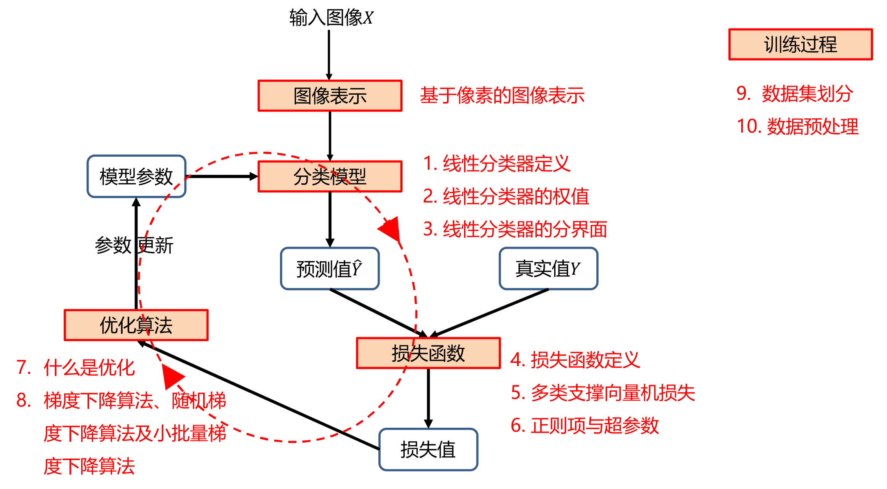
