# 图像表示

如何表示图像？

直接利用原始像素作为特征，展开为列向量。


例如：cifar10中每个图像可表示为一个3072（32\*32\*3）维的向量


# 分类模型

## 多层感知器

### 回顾线性分类器

- 什么是线性分类器：
  $$
  f(x,W)=Wx+b
  $$
  其中

  - **分数向量 \(f\)**：表示输入图像在各个类别上的得分，其维度等于类别个数 \(c\)。\[ f=\begin{bmatrix} f_1 & f_2 & \cdots & f_c \end{bmatrix}^{T}\in\mathbb{R}^{c} \]

  - **输入向量 \(x\)**：表示输入图像，其维度为 输入图像的特征维度\(d\)。   \[ x=\begin{bmatrix} x_1 & x_2 & \cdots & x_d \end{bmatrix}^{T}\in\mathbb{R}^{d} \]

  - **权值矩阵 \(W\)**：行数为 类别数$c$ ，列数为 输入图像的特征维度\(d\)。

    \[ W=\begin{bmatrix} w_1 & \cdots & w_c \end{bmatrix}^{T}\in\mathbb{R}^{c\times d} \] ， 其中\(w_i\)为第\(i\)个类别的权值向量 \[ w_i=\begin{bmatrix} w_{i1} & w_{i2} & \cdots & w_{id} \end{bmatrix}^{T}\in\mathbb{R}^{d} \]

  - **偏置向量 \(b\)**：由 \(c\) 个类别的偏置组成，其中 \(b_i\) 为第 \(i\) 个类别的偏置。 \[ b=\begin{bmatrix} b_1 & \cdots & b_c \end{bmatrix}^{T}\in\mathbb{R}^{c} \]

> [!NOTE]
>
> **对于线性分类器来说，将输入图像向量化后，只需要经过一个线性变换（\(Wx+b\)），就可以得到该图像在各个类别上的预测分数，并选择分数最高的类别作为最终分类结果。**


### 全连接神经网络

> [!NOTE]
>
> 全连接神经网络 **把线性分类器经过非线性操作后级联起来** 来实现 **输入到输出的映射**。

- 两层全连接网络
  $$
  f=
  \underbrace{
  W_2
  \underbrace{
  \max\left(0,\underbrace{W_1x+b_1}_{\text{第一层仿射变换}}\right)
  }_{\text{非线性激活函数}}
  +b_2
  }_{\text{第二层仿射变换}}
  $$
  **解释：** 两层全连接网络包含两次仿射变换，并在两次仿射变换之间引入非线性激活函数，使网络具有学习非线性关系的能力。

  其中：

  - **第一层线性变换：**
    $$
    z_1=W_1x+b_1
    $$
    其中，$x$ 是输入的图像向量，经过第一层线性变换后，得到预激活向量 $z_1$。

    这里不建议将 \(z_1\) 称为类别分数向量，因为第一层的输出并不直接对应不同的类别，而是隐藏层神经元的输出（激活前）。

  - **非线性激活函数（ReLU）：**
    $$
    h=\max(0,W_1x+b_1)
    $$
    这里的 $\max$ 并不是从向量中选取最大的元素，而是将向量中的每一个元素分别与 0 取最大值，即保留正数，将负数置为 0。

    经过激活函数后，**向量的维度保持不变**，得到隐藏层特征向量 $h$。

    例如：经过 ReLU 激活函数之后，\[ h= \max\left( 0, \begin{bmatrix} -3\\ 2\\ -5\\ 4 \end{bmatrix} \right) = \begin{bmatrix} \max(0,-3)\\ \max(0,2)\\ \max(0,-5)\\ \max(0,4) \end{bmatrix} = \begin{bmatrix} {\color{red}0}\\ 2\\ {\color{red}0}\\ 4 \end{bmatrix} \]

  - **第二层线性变换：**
    $$
    f=W_2\underbrace{\max(0,W_1x+b_1)}_{\text{隐藏层特征向量}}+b_2
    $$
    将隐藏层特征向量作为第二层的输入，经过第二次线性变换，最终得到**输入图像在不同类别上的分数向量**。

- 三层全连接网络
  \[
  f=W_3{\color{red}\max}\left(0,W_2{\color{red}\max}\left(0,W_1x+b_1\right)+b_2\right)
  \]


### 全连接神经网络的权值

现在我们来解释 全连接神经网络 中的 <font color="red">权值模板</font>

全连接神经网络 与 线性分类器很相似也存在 权值模板$W_1,W_2,...$ 。那么 全连接神经网络 与 线性分类器 有什么不一样呢？

我们能不能直观理解一下，全连接神经网络这种 级联线性分类器的 构架是怎么工作的？


- 在前面讲过，在线性分类器中，权值可以看作是模板。

  那么在全连接神经网络中，我们可以将 $W_1$ 也看作模板。但是这个$W_1$的行数与线性分类器有很大的不一样。

  - **线性分类器：** 
  
    权重矩阵 \(W\) 的每一行对应一个类别的权值模板。因此，其行数由类别数量 \(c\) 决定，列数由输入特征维度 \(d\) 决定。当分类任务和输入特征维度确定之后，权重矩阵的形状也随之确定。
  
  - **全连接神经网络：**
  
    `隐藏层`权重矩阵的每一行可以看作一个用于提取特征的权值模板。由于这些模板不需要与具体类别一一对应，因此`隐藏层`权重矩阵的行数不受类别数量 \(c\) 的限制，可以由我们人为指定，但其列数必须等于上一层的输出向量维度。
  
    只有最后一层权重矩阵的行数必须等于类别数量 \(c\)，从而保证最终输出的分数向量 \(f\) 的维度为 \(c\)。
  
  - 比如说：
  
    - 对于**线性分类器**：
  
      
  
      线性分类器对一个类别就只提取一个模板，那么这时候模板其实不一定会反映现实情况。
  
      比如说上图的 **horse类模板**，我们直观看上去这个 模板记录了两个马头（左边一个右边一个），那么这个显然是不符合我们的现实情况的。
  
    - 对于**两层全连接神经网络**：
      $$
      f=W_2\underbrace{\max(0,W_1x+b_1)}_{\text{隐藏层特征向量}}+b_2
      $$
  
      - $W_1$ 可看作模板，模板个数人为指定。
  
        例如说cifar10有10个类别，但是我可以指定$W_1$的行数为100行（即设置100个模板），然后对于cifar10的 **horse类**，我们可以分配4到5个模板
  
      - $W_2$ 融合多个模板的匹配结果来实现最终类别打分
  
        例如说$W_2$对当前样本与100个模板进行比较，对比较后的结果做综合性的考虑。
  
        比如说我们设的100个模板中，第1,3,5个模板记录的是马，然后我们使用$W_2$融合 某个具体样本A 时，那么得到的结果是 样本A在第1,3,5模板上的分数高，那么我们就的出 样本A是马的结论。
  
      - 我们来分析一下两层全连接神经网络中各个变量的行数与列数
  
        能确定的变量
  
        - $x$：图像向量
  
          因为cifar10中每张图像的分辨率是32×32，所以像素数量为3072，也就是说行数是3072
  
          因为是向量，所以列数为1
  
          所以$x$的维度是 3072×1
  
        - $f$：分数向量
  
          我们希望一张图像输入到这个两层神经网络，输出的是该图像样本在每个类别上的分数，用向量表示就是 行数为类别数，列数是1
  
          对于cifar10来说，就是10个类别。所以 $f$的行数是10，列数是1
  
        推导过程：
  
        - $W_1$：
  
          我们想要记录100个模板，所以$W_1$的行数是100
  
          因为$x$的行数是特征数即32\*32\*3=3072，所以$W_1$的列数是3072
  
        - $b_1$：
  
          因为 $W_1$维度是100×3072，$x$维度是3072×1，所以 $W_1x$维度是100×1
  
          所以$b_1$维度也是100×1
  
        - $\max(0,W_1x+b_1)$：
  
          max 对 $W_1x+b_1$（维度为100×1）矩阵中每个元素都与0比较，比0大的留下，比0小的变为0
  
          所以 $\max(0,W_1x+b_1)$ 的维度也是100×1
  
        - $W_2$：
  
          因为我们需要的 分数向量$f$ 的行数是10行（10个类别，每个类别输出1个分数），所以$W_2$的行数是10
  
          因为 $\max(0,W_1x+b_1)$的行数是100，所以$W_2$的列数也是100
  
          因此 $W_2$的维度是 10×100
  
        - $b_2$：
  
          因为 $W_2$的维度是 10×100，而 $\max(0,W_1x+b_1)$的维度是100×1，所以$W_2\max(0,W_1x+b_1)$的维度是10×1

> [!IMPORTANT]
>
> 全连接神经网络的描述能力更强。因为调整$W_1$行数等于增加模板个数,分类器有机会学到两个不同方向的马的模板。


### 全连接神经网络与线性不可分

> [!IMPORTANT]
>
> - 线性分类器 只能解决 线性可分的问题
> - 全连接神经网络 可以解决 线性可分与线性不可分的问题

比如说：

- 线性可分的情况

  > [!NOTE]
  >
  > **线性可分**：至少存在一个**线性分界面**能把两类样本没有错误的分开。

  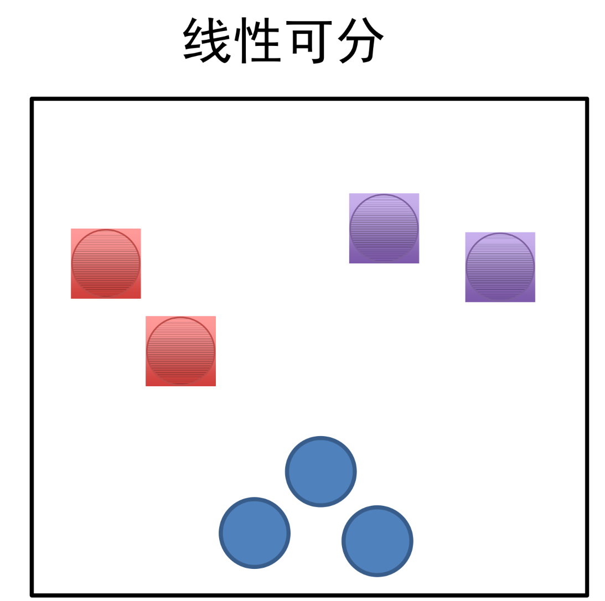

  在这个特征空间中，分类器就是要把这些类别划分开来，形成一个个分界面，如下图：

  

  > 问题来了，是不是所有的真实情况中，样本都是线性可分的呢？

- 线性不可分的情况

  > [!NOTE]
  >
  > **线性不可分**：不存在任何一个线性分界面，能够将两类样本完全正确地分开。

  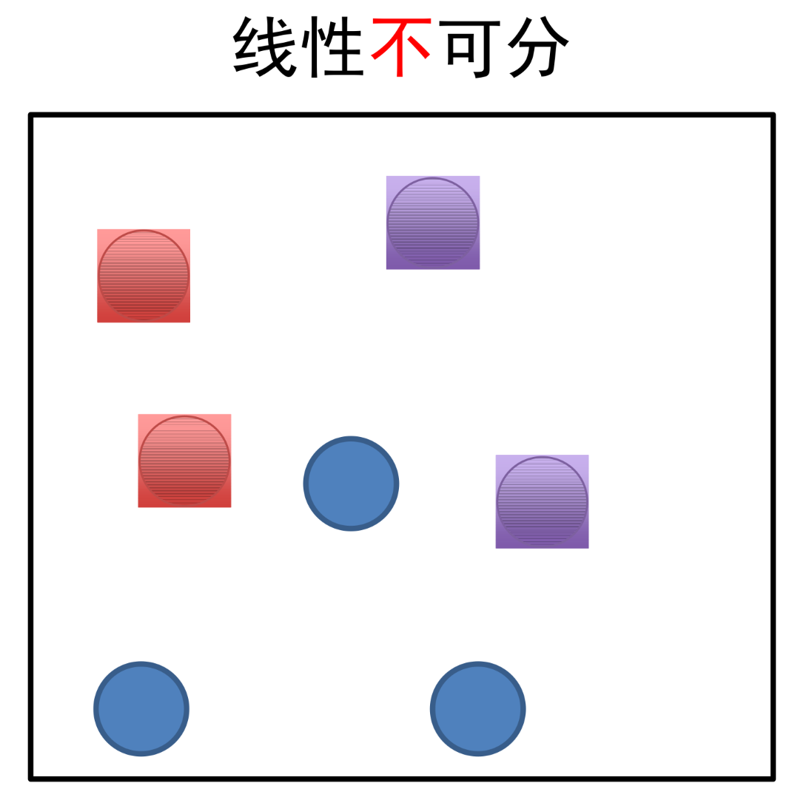

  - 很多情况下，我们采集到的数据是类似于这样的**线性不可分**的。比如说cifar10的数据，如果我们将全部图像投到3072维，我们会发现我们无法找到分界面去划分数据，也就是线性不可分。

  - 对于这种**线性不可分**的数据，如果我们使用线性分类器去做的话，我们求不到很好的解。

  - 因此我们需要引入 **具有非线性激活函数的全连接神经网络**，只有通过非线性的映射关系，我们才能实现线性不可分的类别的学习，如下图

    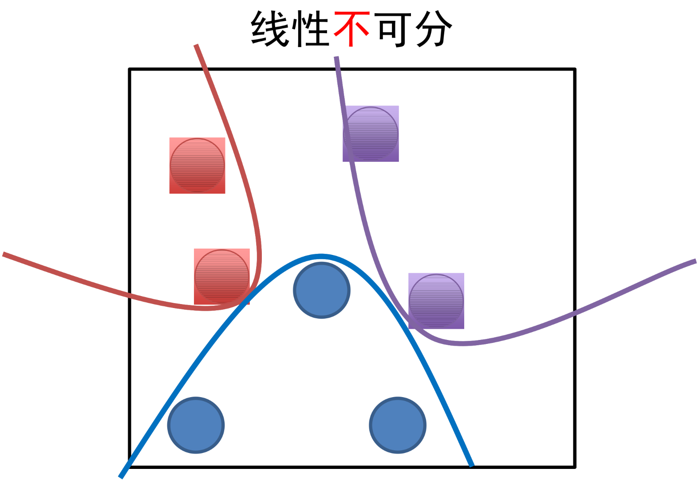


### 全连接神经网络绘制与命名

> 这里我们以下面这两个东西举例：
>
> - 两层全连接神经网络：$f=W_2{\max(0,W_1x+b_1)}+b_2$
> - cifar10数据集

- **全连接神经网络的绘制**

  - 画法1（不常用）

    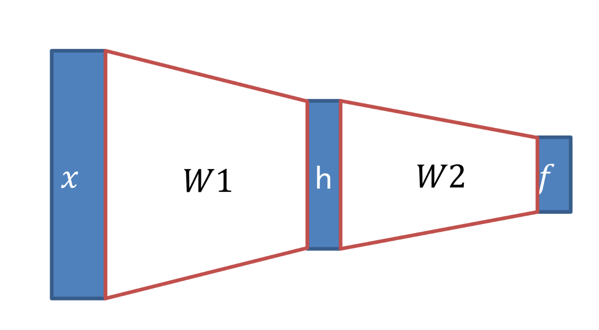

    其中：

    | 符号  | 含义             | 维度                                        |
    | ----- | ---------------- | ------------------------------------------- |
    | $x$   | 输入特征向量     | $输入特征的数量d\times 1$                   |
    | $W_1$ | 第一层权重矩阵   | $我们需要的模板个数m\times 输入特征的数量d$ |
    | $h$   | 隐藏层特征向量   | $我们需要的模板个数m\times 1$               |
    | $W_2$ | 第二层权重矩阵   | $输出类别的数量c\times 我们需要的模板个数m$ |
    | $f$   | 输出类别分数向量 | $输出类别的数量c\times 1$                   |

  - 画法2（常用）

    

    其中：

    - **输入层**：

      - 输入层其实就是输入特征向量 \(x\)：\[ x= \begin{bmatrix} x_1\\ x_2\\ \vdots\\ x_d \end{bmatrix} \in\mathbb{R}^{d} \]

        在神经网络结构图中，我们将输入特征向量的每一个元素 \(x_i\) 单独表示为一个**输入神经元**（也称输入节点）。

      - 在 CIFAR-10 中：\[ d=32\times32\times3=3072 \] 

        因此，输入层一共有 3072 个输入神经元。

    - **隐层**：

      隐藏层的输出就是隐藏层特征向量 \(h\)：\[ h= \begin{bmatrix} h_1\\ h_2\\ \vdots\\ h_m \end{bmatrix} \in\mathbb{R}^{m} \]​ ，其计算公式为：\[ h=\operatorname{ReLU}(W_1x+b_1) \]

      其中 $m$是人为指定的第一层模板的个数（比如说我设模板个数为100个）

    - **输出层**：

      输出层的输出就是类别分数向量 \(f\)：\[ f= \begin{bmatrix} f_1\\ f_2\\ \vdots\\ f_c \end{bmatrix} \in\mathbb{R}^{c} \]​ ，其计算公式为：\[ f=W_2h+b_2 \]

      在当前这种每个类别对应一个输出分数的分类网络中，输出层神经元的数量由类别数量 \(c\) 决定，**每一个输出神经元对应一个类别分数**。

      例如，CIFAR-10 具有 10 个类别，因此输出层具有 10 个神经元。

    ---

    因为**每一个隐层神经元要和前层的所有神经元相连**，所以我们把这个网络叫做全连接神经网络

    每一个连接上都有一条边，每一条这样的边都是一个**权值$w$**，而像图中输入层到隐层的所有边组成了权值$W_1$，隐层到输出层的所有边组成了权值$W_2$

    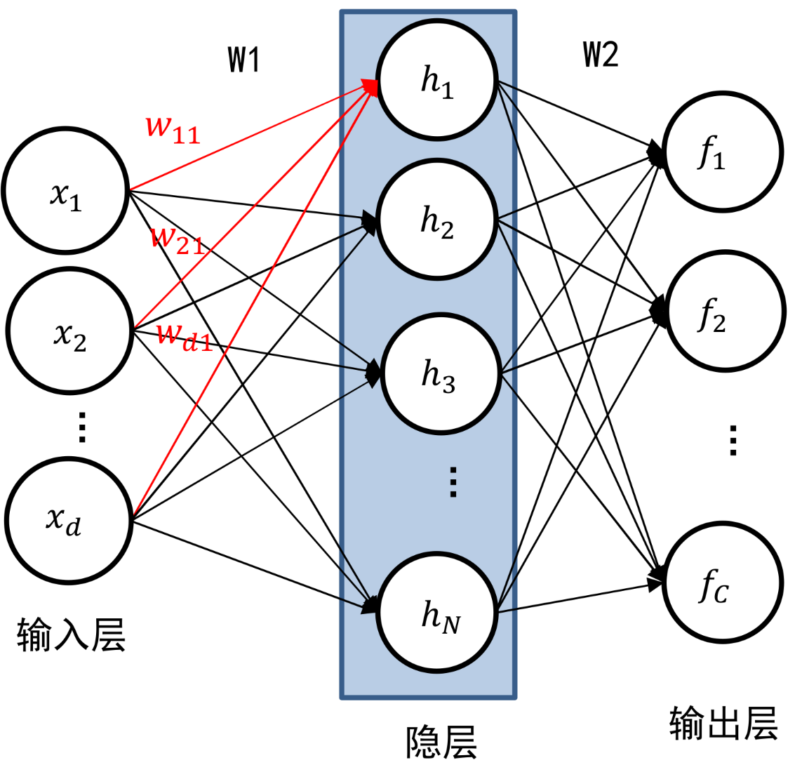

- **连接神经网络的命名**

  > [!IMPORTANT]
  >
  > **N层全连接神经网络**：除输入层之外其他层的数量为N的网络
  >
  > **N个隐层的全连接神经网络**：网络隐层的数量为N的网络

  例如：

  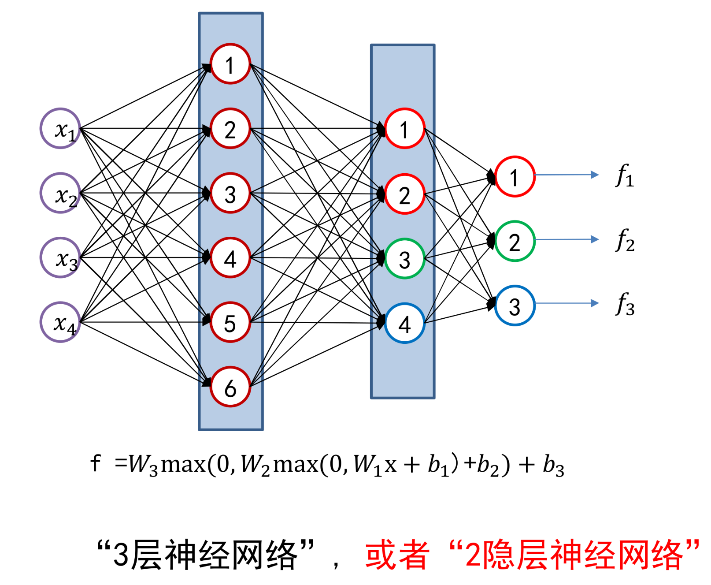


## 激活函数

### 为什么需要非线性操作？

- 我们知道，三层全连接网络是
  $$
  f^2=W_3\max(0,W_2\max(0,W_1\mathrm{x}+b_1)+b_2)+b_3
  $$
  其中：

  - $max$ 就是 `激活函数`

- 如果网络中缺少了激活函数，<font color="red">全连接神经网络还能保持非线性的性质吗？</font>

  不能，如果网络中缺少了激活函数，全连接神经网络将变成一个**线性分类器**

  证明如下（去掉激活函数）：
  $$
  \begin{aligned}&f=W_3(W_2(W_1x+b_1)+b_2)+b_3\\&=W_3W_2W_1x+(W_3W_2b_1+W_3b_2+b_3)\\&=W^\prime x+b^\prime\end{aligned}
  $$


### 常用的激活函数

> [!NOTE]
>
> 神经网络上的几个问题：
>
> - **梯度消失问题（Vanishing Gradient）**
>
>   - **概念**
>
>     在神经网络的 `反向传播` 过程中，梯度随着网络层数的增加逐渐减小，使得靠近输入层的网络参数难以得到有效更新的现象。
>
>     ```
>     正向传播：
>     
>     输入层 → 隐藏层1 → 隐藏层2 → 隐藏层3 → 输出层 → 损失函数
>     
>     反向传播：
>     
>     输入层 ← 隐藏层1 ← 隐藏层2 ← 隐藏层3 ← 输出层 ← 损失函数
>                极小         很小         较小         较大
>     
>                ←──────── 梯度逐渐减小 ───────────
>     ```
>
>   - **为什么会产生梯度消失？**
>
>     因为反向传播需要使用**链式求导法则（Chain Rule）**，而链式求导涉及多个导数的连续相乘。
>
>     举个例子：
>
>     假设一个简化的标量神经网络：
>     \[
>     h_1=g(x),
>     h_2=g(h_1),
>     h_3=g(h_2),
>     h_4=g(h_3)
>     \]
>     那么，根据链式求导法则：
>     \[
>     \frac{\partial L}{\partial h_1} = \frac{\partial L}{\partial h_4} \cdot \frac{\partial h_4}{\partial h_3} \cdot \frac{\partial h_3}{\partial h_2} \cdot \frac{\partial h_2}{\partial h_1}
>     \]
>     假设每一层的局部导数都是 0.1，并且：
>     \[
>     \frac{\partial L}{\partial h_4}=1
>     \]
>     那么：
>     $$
>     \frac{\partial L}{\partial h_3}=1\times0.1=0.1
>     \\
>     \frac{\partial L}{\partial h_2}=1\times0.1\times0.1=0.01
>     \\
>     \frac{\partial L}{\partial h_1}=1\times0.1\times0.1\times0.1=0.001
>     $$
>     如果连续乘以 10 次 0.1：
>     \[
>     0.1^{10}=0.0000000001
>     \]
>     可以发现，多个小于 1 的正数不断相乘，会使最终结果越来越接近 0。
>
> - **神经元死亡问题（Dying ReLU）**
>
>   神经元死亡是指 **某个神经元**在训练过程中，对于**所有训练样本 经过激活函数后 输出值始终为 0**，并且由于激活函数的梯度为 0，导致该神经元自身的权重和偏置难以继续更新的现象。

#### Sigmoid函数

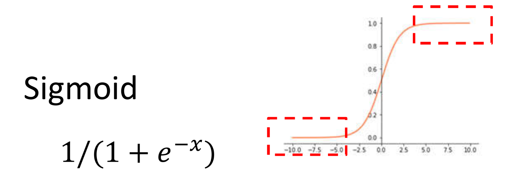

- 定义域为 $\mathbb{R}$，值域为 $(0,1)$。

- 当 $x<-5$ 时，函数值非常接近 0；

  当 $x>5$ 时，函数值非常接近 1。

  这两个区域属于 Sigmoid 函数的饱和区域，在这些区域中，函数输出变化缓慢，梯度接近于 0，容易导致 `梯度消失问题`。

- Sigmoid 函数关于 $(0,0.5)$ 中心对称，但不关于坐标原点 $(0,0)$ 中心对称。

#### tanh函数


- 义域为 $\mathbb{R}$，值域为 $(-1,1)$。

- 当 $x$ 趋近于负无穷时，函数值趋近于 $-1$；

  当 $x$ 趋近于正无穷时，函数值趋近于 $1$。

  在这两个饱和区域中，梯度接近于 0，容易导致 `梯度消失问题`。

- Tanh 函数关于坐标原点 $(0,0)$ 中心对称，满足 $\tanh(-x)=-\tanh(x)$，因此它是一个**奇函数**。

- Tanh 函数的输出范围以 0 为中心，具有 `零中心化` 的特性。相比于 Sigmoid 函数，这种特性有利于梯度更新，使神经网络的参数优化更加容易。

#### ReLU函数


- 定义域为 $\mathbb{R}$，值域为 $[0,+\infty)$。

- 当 $x>0$ 时，输出值等于输入值，保持输入值不变。

  当 $x\leq0$ 时，输出值为 0。

- ReLU 函数的输出值始终非负，因此不具有 `零中心化` 的特性。

- 在正数区域，函数的梯度恒为 1，不存在饱和现象，因此可以**缓解梯度消失问题**。

  在负数区域，函数的梯度恒为 0，可能导致 `神经元死亡问题（Dying ReLU）`。

#### Leaky ReLU函数


- 定义域为 $\mathbb{R}$，值域为 $\mathbb{R}$，没有最大值和最小值。

- 当 $x>0$ 时，输出值等于输入值，保持输入值不变。

  当 $x\leq0$ 时，输出值为 $\alpha x$，其中 $\alpha$ 是一个较小的正常数，通常取 0.01。

- 函数可以输出正数、负数和 0，但不具有关于坐标原点中心对称的特性。

- 在正数区域，函数的梯度恒为 1，**不存在饱和现象，可以缓解梯度消失问题**。

  在负数区域，函数的梯度恒为 $\alpha$，而不是 0，因此可以**缓解 ReLU 的神经元死亡问题**。

- 计算简单，计算成本较低。


## 网络结构设计

在设计一个网络结构时，我们需要回答两个问题：

1. 用不用隐层，用一个还是用几个隐层？<font color="red">（深度设计）</font>

   | 隐藏层数量 | 表达能力                             | 特点                                               |
   | ---------- | ------------------------------------ | -------------------------------------------------- |
   | 0 个       | 线性表达能力                         | 结构简单，计算成本低                               |
   | 1 个       | 非线性表达能力                       | 理论上可以近似任意连续函数，但可能需要非常大的宽度 |
   | 多个       | 可以更加高效地表达某些复杂非线性函数 | 可以逐层组合特征，但训练难度可能增加               |

2. 每隐层设置多少个神经元比较合适？<font color="red">（宽度设计）</font>

   > 设置隐藏层的神经元数量，本质上就是设置这一层具有多少个可学习的权值模板，以及输出多少个新的特征值。

   | 神经元数量 | 权值模板数量 | 特征表达能力 | 潜在问题                   |
   | ---------- | ------------ | ------------ | -------------------------- |
   | 过少       | 少           | 可能不足     | 欠拟合                     |
   | 合适       | 适中         | 满足任务需求 | 表达能力与成本之间取得平衡 |
   | 过多       | 多           | 通常更强     | 过拟合风险、计算成本增加   |

   

   结论：神经元个数越多，分界面就可以越复杂，在这个集合上的分类能力就越强。

依据分类任务的难易程度来调整神经网络模型的复杂程度。分类任务越难，我们设计的神经网络结构就应该越深、越宽。但是，需要注意的是对训练集分类精度最高的全连接神经网络模型，在真实场景下识别性能未必是最好的（过拟合） 。


## 全连接神经网络小结

- 全连接神经网络组成：
  - 一个输入层
  - 一个输出层
  - 多个隐层
- **输入层** 与 **输出层** 的神经元个数由任务决定，而 **隐层数量** 以及 **每个隐层的神经元** 个数需要人为指定；
- **激活函数** 是全连接神经网络中的一个重要部分，缺少了激活函数，全连接神经网络将退化为**线性分类器**。


# 损失函数

## SOFTMAX与交叉熵

### SOFTMAX

- **全连接神经网络的输出与分类决策**

  对于两层全连接神经网络来说，公式为
  $$
  f=W_2max(0,W_1x+b_1)+b_2
  $$
  整个网络的计算过程为：
  $$
  \underbrace{x}_{\text{输入特征向量}}
  \xrightarrow{W_1,b_1,\text{ReLU}}
  \underbrace{h}_{\text{隐藏层特征向量}}
  \xrightarrow{W_2,b_2}
  \underbrace{f}_{\text{类别分数向量}}
  $$

  对应的绘制图层为：

  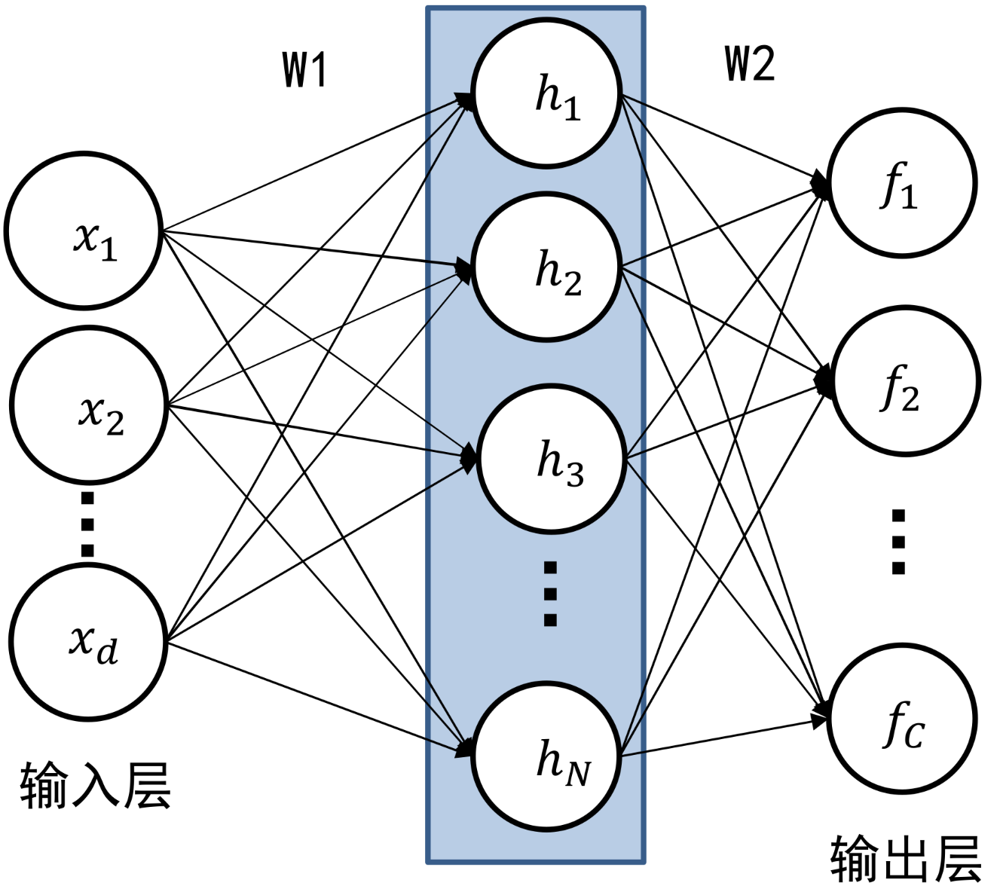

  那么给定一个 特征向量$x$时，我们会得到一个分数向量$f$，当我们判断输入样本 $x$ 属于哪个类别时，只需要在分数向量 $f$ 中找到分数最大的元素，该元素对应的下标就是模型预测的类别编号，这就是我们的**分类决策方式**，对应下式：
  $$
  \hat{y}=\arg\max_i f_i
  $$
  但是，有时候我们不仅希望知道模型预测的类别，还希望知道**模型认为当前样本属于各个类别的可能性有多大**。

  由于分数向量 $f$ 中每个元素的取值范围为 $(-\infty,+\infty)$，且所有分数之和不一定等于 1，因此无法直接将类别分数作为概率使用。

  所以，我们需要引入 **Softmax 操作，将类别分数向量转换为类别预测概率向量**。

  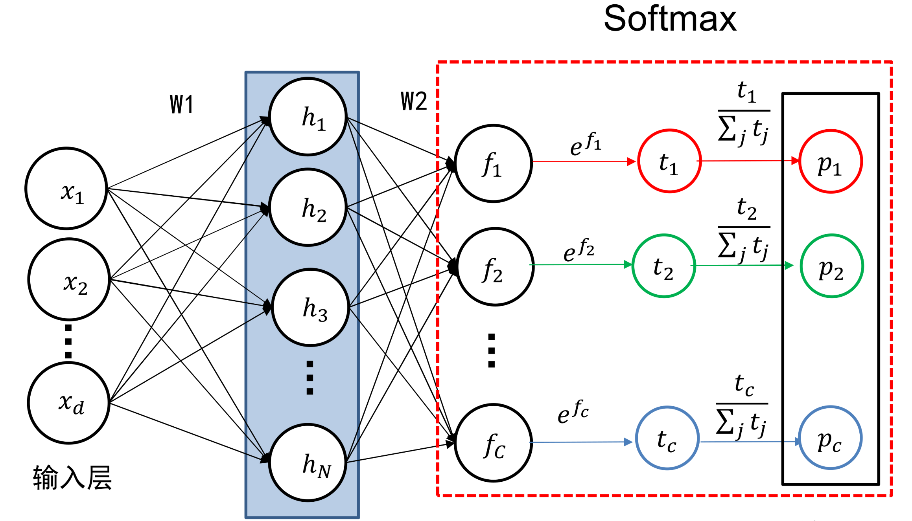

- **SOFTMAX做了什么？**

  Softmax 的计算过程分为两个步骤：

  1. **指数变换**

     对分数向量 $f$ 中的每一个元素 $f_i$ 进行指数运算，并将得到的结果记为 $t_i$：
     $$
     t_i=e^{f_i}
     $$
     这样既能保证所有分数经过变换后都大于 0，又不会改变原始分数之间的大小关系。（这个与罗杰斯的回归有关，这里不讲，记住就可以了）

  2. **归一化**

     将每一个 $t_i$ 除以所有 $t_j$ 之和，得到对应的预测概率 $p_i$：
     $$
     p_i=\frac{t_i}{\sum_{j=1}^{c}t_j}=\frac{e^{f_i}}{\sum_{j=1}^{c}e^{f_j}}
     $$
     对于具有两个及以上类别的分类任务，得到的预测概率满足：
     $$
     p_i\in(0,1),\qquad \sum_{i=1}^{c}p_i=1
     $$
     至此，我们就将类别 **分数向量$f$** 转换为了 **类别预测概率向量$p$** 。


- **结论**：

  由于 Softmax 不会改变各个类别分数之间的大小关系，因此它不会改变最终的分类决策结果。
  $$
  \arg\max_i f_i=\arg\max_i p_i
  $$
  通过 Softmax，我们不仅可以知道模型预测**当前样本 $x$ 属于哪个类别**，还可以知道**模型为各个类别分配的`预测概率`**。

- **举个例子：**

  


### 交叉熵损失

那么输出概率对我们后面的训练有什么影响呢？

- **one-hot编码**

  - 由于我们需要**比较 `分类器的预测概率分布` 与 `真实标签对应的目标概率分布`**，从而**衡量模型预测结果与真实结果之间的差异**，因此需要统一二者的表示形式。

    经过 Softmax 操作之后，分类器的输出已经是一个 **$c$ 维的预测概率向量 $p$**，但是原始的真实标签通常只是一个类别编号 $y$。

    因此，我们使用 **One-hot 编码（独热编码）**，将真实类别标签转换为一个 **$c$ 维的目标概率向量 $q$**：
    $$
    q_i=
    \begin{cases}
    1, & i=y\\
    0, & i\neq y
    \end{cases}
    \qquad i\in\{1,2,\ldots,c\}
    $$
    即真实类别对应的元素为 1，其余类别对应的元素均为 0。

    这样，分类器的预测概率分布与真实标签对应的目标概率分布就具有相同的表示形式，便可以通过损失函数（例如交叉熵损失函数）来衡量二者之间的差异。

  - 例如：

    

    该例子中，假设我的 样本$x$ 的真实标签是bird类，那么真实分布中bird类的概率为1，其他类都是0

- **如何度量现在的分类器输出与预测值之间的距离？**

  经过 Softmax 和 One-hot 编码之后，我们分别得到了 分类器预测分布 $q(x)$ 和 真实标签对应的目标概率分布 $p(x)$​。

  我们希望度量这两个概率分布之间的差异，从而衡量分类器的预测效果。

  **预测分布越接近真实分布，说明分类器对当前样本的预测效果越好。**

  

  - **多类支持向量机是如何解决这个问题的？**

    多类支持向量机使用多类 SVM 损失函数：
    $$
    L=\sum_{j\neq y}\max(0,f_j-f_y+\Delta)
    $$
    其中：

    - $f_y$：正确类别对应的分数。
    - $f_j$：其他类别对应的分数。
    - $\Delta$：正确类别与其他类别之间要求达到的最小分数间隔。

    多类支撑向量机 根本不考虑**真实分布**怎么样，只会比较分类预测分布中的 正确类别对应的项 与其他项的差距。

    > 多类 SVM 损失函数关注的是正确类别的分数是否比其他类别的分数高出一定的间隔，而不是直接比较预测概率分布与真实概率分布之间的差异。
    >
    > 但是，现在我们希望分类器的预测概率分布尽可能接近真实概率分布。
    >
    > 因此，我们需要引入能够衡量两个概率分布之间差异的方法，例如：
    >
    > - KL 散度（Kullback-Leibler Divergence）
    > - 交叉熵（Cross Entropy）

  - **交叉熵损失**

    交叉熵损失会比较 分类器预测分布 与 真实分布 之间的距离。当这两个分布接近时，交叉熵的损失值会越小

- **交叉熵**

  - 先验知识

    > [!NOTE]
    >
    > **熵**：
    >
    > - 概念：指的是信息论中的`信息熵`，用来**衡量一个随机变量的不确定性程度**。
    >
    >   **熵越大，表示随机变量的结果越不确定；熵越小，表示随机变量的结果越确定。**
    >
    > - 例子：
    >
    >   假设有三枚不同的硬币，它们出现正面和反面的概率分别为：
    >
    >   | 硬币   | 正面概率 | 反面概率 | 不确定性 | 信息熵 |
    >   | ------ | -------- | -------- | -------- | ------ |
    >   | 硬币 A | 100%     | 0%       | 完全确定 | 最小   |
    >   | 硬币 B | 90%      | 10%      | 比较确定 | 较小   |
    >   | 硬币 C | 50%      | 50%      | 最不确定 | 最大   |
    >
    >   对于硬币 A，在抛出硬币之前，我们就已经知道结果一定是正面，因此不存在不确定性。
    >
    >   对于硬币 C，在抛出硬币之前，正面和反面出现的可能性完全相同，我们最难预测结果，因此不确定性最大。
    >
    >   **熵就是用一个具体的数值来描述这种不确定性。**

  - **熵**

    - 公式：
      $$
      H(p)=-\sum_xp(x)logp(x)
      $$
      其中：

      - 随机变量\(X\) 有 \(n\) 种可能的取值：\[ X\in\{x_1,x_2,\ldots,x_n\} \]

        $x$ 是 随机变量$X$ 中的一种可能取值

      - \(H(p)\)：概率分布 \(p\) 的信息熵

      - $p(x)$：$X=x$的概率

      - \(-\log p(x)\)：事件 \(X=x\) 发生时的**信息量（当我们得知某个事件发生时，获得了多少信息）**

        例如：假设使用以 2 为底的对数：

        | 事件发生的概率 $p(x)$ | 信息量 $I(x)=-\log_2p(x)$ |
        | --------------------- | ------------------------- |
        | 1                     | 0                         |
        | 0.5                   | 1                         |
        | 0.25                  | 2                         |
        | 0.125                 | 3                         |
        | 0.0625                | 4                         |

        可以发现：

        - 当事件发生的概率越大时，信息量越小。
        - 当事件发生的概率越小时，信息量越大。
        - 当事件必然发生时，信息量为 0，因为我们事先就已经知道结果。

      - \(p(x_i)[-\log p(x_i)]\)：信息量乘以对应事件发生的概率

        \(-\log p(x)\) 只是**某一个事件发生时的信息量**。

        但是，一个随机变量通常具有多种可能的取值，而且每种取值出现的概率不同。

        如果我们想知道这个随机变量平均能够提供多少信息，就需要计算信息量的数学期望。

    - 举个例子：

      假设我们分别抛掷两枚不同的硬币。

      1. 情况一：硬币正反面出现的概率相同
         \[
         p(\text{正面})=0.5,\qquad p(\text{反面})=0.5
         \]
         计算信息熵：
         \[
         \begin{aligned} H(p)&=-\sum_xp(x)\log_2p(x)\\ &=-[0.5\log_2 0.5+0.5\log_2 0.5]\\ &=-[0.5\times(-1)+0.5\times(-1)]\\ &=1 \end{aligned}
         \]
         此时，信息熵为 1 bit。

         因为正面与反面出现的概率相同，所以我们在抛掷之前最难确定结果。

      2. 情况二：硬币必然出现正面
         \[
         p(\text{正面})=1,\qquad p(\text{反面})=0
         \]
         计算信息熵：
         \[
         \begin{aligned} H(p)&=-[1\log_2 1+0\log_2 0]\\ &=0 \end{aligned}
         \]
         此时，信息熵为 0 bit。

         因为我们在抛掷之前就已经知道结果，所以不存在不确定性。

  - **交叉熵**

    - 概念：用于描述使用一个概率分布 \(q\) 来表示另一个概率分布 \(p\) 时，所需要的平均信息量。

      当真实概率分布 \(p\) 固定时：

      - 预测分布 \(q\) 越接近真实分布 \(p\)（以 KL 散度衡量），交叉熵越小。
      - 预测分布 \(q\) 与真实分布 \(p\) 的差异越大，交叉熵越大。
      - 当预测分布与真实分布完全一致时，即 \(q=p\)，交叉熵取得最小值，此时 \(H(p,q)=H(p)\)。

    - 公式：
      $$
      H(p,q)=-\sum_xp(x)logq(x)
      $$
      其中：

      - 随机变量 \(X\) 有 \(n\) 种可能的取值：\[ X\in\{x_1,x_2,\ldots,x_n\} \]

        $x$ 是 随机变量$X$ 中的一种可能取值

      - \(H(p,q)\)：真实分布 \(p\) 与预测分布 \(q\) 之间的交叉熵

      - \(p(x_i)\)：事件 \(X=x_i\) 发生的真实概率
      - \(q(x_i)\)：模型预测事件 \(X=x_i\) 发生的概率

      - \(-\log q(x_i)\)：根据预测概率计算得到的信息量

    - 举个例子

      假设我们需要对图片进行分类，只有两个类别：**猫和狗**。

      现在输入一张猫的图片。

      - 真实概率分布（经过One-hot编码）：\[ p=\begin{bmatrix}1\\0\end{bmatrix} \]

      - 分类器的预测概率分布

        假设有两个分类器，它们的预测结果如下：

        | 类别 | 真实分布 \(p\) | 分类器 A 的预测分布 \(q_A\) | 分类器 B 的预测分布 \(q_B\) |
        | ---- | -------------- | --------------------------- | --------------------------- |
        | 猫   | 1              | 0.9                         | 0.1                         |
        | 狗   | 0              | 0.1                         | 0.9                         |

        显然，分类器 A 的预测结果更接近真实分布。

        那么，如何用一个具体的数值来衡量它们的预测效果呢？这就需要使用交叉熵。

      - 计算交叉熵

        交叉熵公式（使用自然对数）：
        \[
        H(p,q)=-\sum_x p(x)\ln q(x)
        \]
        **分类器 A：**
        \[
        \begin{aligned} H(p,q_A)&=-[1\times\ln0.9+0\times\ln0.1]\\ &=-\ln0.9\\ &\approx0.105 \end{aligned}
        \]
        **分类器 B：**
        \[
        \begin{aligned} H(p,q_B)&=-[1\times\ln0.1+0\times\ln0.9]\\ &=-\ln0.1\\ &\approx2.303 \end{aligned}
        \]

        > 可以发现：
        >
        > - 正确类别的预测概率越大，交叉熵越小。
        > - 正确类别的预测概率越小，交叉熵越大。
        > - 当预测分布与 One-hot 真实分布完全一致时，交叉熵为 0。

  - **相对熵（KL散度）**

    - 概念：使用 **预测概率分布 \(q\)** 代替 **真实概率分布 \(p\)** 来描述事件时，所产生的**额外平均信息量**。

      相对熵具有以下性质：

      - \(KL(p\|q)\geq 0\)：相对熵始终非负。
      - \(KL(p\|q)=0\)：表示两个概率分布完全相同。
      - \(KL(p\|q)\) 越大，表示两个概率分布在 KL 散度意义下的不相似程度越高。
      - \(KL(p\|q)\) 不一定等于 \(KL(q\|p)\)，因此相对熵不具有对称性，不能称为严格数学意义上的距离。

    - 公式：
      $$
      KL(p||q)=-\sum_xp(x)log\frac{q(x)}{p(x)}
      $$
      其中：

      - \(p(x)\)：事件 \(x\) 发生的真实概率

      - \(q(x)\)：事件 \(x\) 发生的预测概率

      - \(\log\frac{p(x)}{q(x)}\)：**预测分布 \(q\) 下的信息量** 与 **真实分布 \(p\) 下的信息量** 之**差**。

        \[  I_q(x)-I_p(x)=-\log q(x)+\log p(x)=\log\frac{p(x)}{q(x)}  \]

    - 举个例子：

      假设我们抛掷一枚公平的硬币，正面和反面出现的真实概率均为 0.5。

      - 真实概率分布为：\[ p=\begin{bmatrix}0.5\\0.5\end{bmatrix} \]

        现在有两个模型，分别给出了不同的预测概率分布：

        | 事件 | 真实分布 $p$ | 模型 A 的预测分布 $q_A$ | 模型 B 的预测分布 $q_B$ |
        | ---- | ------------ | ----------------------- | ----------------------- |
        | 正面 | 0.5          | 0.5                     | 0.9                     |
        | 反面 | 0.5          | 0.5                     | 0.1                     |

        我们使用相对熵来度量预测分布与真实分布之间的**不相似性**。

      - 计算模型 A 的相对熵
        \[
        \begin{aligned} KL(p\|q_A)&=-\sum_xp(x)\ln\frac{q_A(x)}{p(x)}\\ &=-\left(0.5\ln\frac{0.5}{0.5}+0.5\ln\frac{0.5}{0.5}\right)\\ &=-(0.5\ln1+0.5\ln1)\\ &=0 \end{aligned}
        \]
        相对熵为 0，说明预测分布与真实分布完全相同。

      - 计算模型 B 的相对熵
        \[
        \begin{aligned} KL(p\|q_B)&=-\sum_xp(x)\ln\frac{q_B(x)}{p(x)}\\ &=-\left(0.5\ln\frac{0.9}{0.5}+0.5\ln\frac{0.1}{0.5}\right)\\ &=-(0.5\ln1.8+0.5\ln0.2)\\ &\approx0.511 \end{aligned}
        \]
        相对熵大于 0，说明预测分布与真实分布存在差异。

      - 对比结果

        | 真实分布 $p$ | 预测分布 $q$  | 相对熵（自然对数） | 不相似程度 |
        | ------------ | ------------- | ------------------ | ---------- |
        | $(0.5,0.5)$  | $(0.5,0.5)$   | 0                  | 完全相同   |
        | $(0.5,0.5)$  | $(0.6,0.4)$   | 0.020              | 较小       |
        | $(0.5,0.5)$  | $(0.7,0.3)$   | 0.087              | 增大       |
        | $(0.5,0.5)$  | $(0.8,0.2)$   | 0.223              | 较大       |
        | $(0.5,0.5)$  | $(0.9,0.1)$   | 0.511              | 更大       |
        | $(0.5,0.5)$  | $(0.99,0.01)$ | 1.614              | 很大       |

  - 三者的关系
    $$
    \begin{aligned}H(p,q)&=-\sum_xp(x)logq(x)\\&=-\sum_xp(x)\log p(x)-\sum_xp(x)\log\frac{q(x)}{p(x)}\\&=H(p)+KL(p||q)\end{aligned}
    $$


## 交叉熵损失对比多类支撑向量机损失

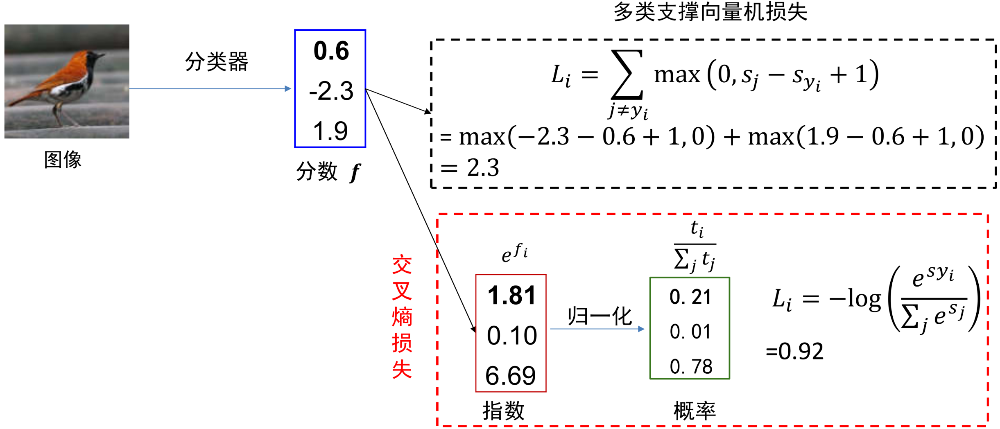

### 计算过程的比较

- **多类支撑向量机损失**：

  多类支持向量机损失 直接对 类别分数向量 $f$ 进行操作，将每个非正确类别的分数与正确类别的分数进行比较，并要求正确类别的分数至少比其他类别的分数高出一个指定的间隔 $\Delta$。
  $$
  L_i=\sum_{j\neq y_i}\max(0,f_j-f_{y_i}+\Delta)
  $$
  在该例子中，$\Delta=1$。

  - 如果 $f_j-f_{y_i}+\Delta\leq0$，说明满足分数间隔要求，损失为 0。
  - 如果 $f_j-f_{y_i}+\Delta>0$，说明不满足分数间隔要求，保留该值作为损失。

  > 因此，多类支持向量机损失关注的是**正确类别与非正确类别之间的分数间隔**。

- **交叉熵损失**：

  交叉熵损失并不直接比较类别分数，而是比较 **分类器预测概率分布** 与 **真实标签对应的目标概率分布**。
  首先，通过 Softmax 操作，对类别分数进行`指数变换`和`归一化`，得到预测概率分布 $q$：
  $$
  \underbrace{
  \begin{bmatrix}
  0.6\\
  -2.3\\
  1.9
  \end{bmatrix}
  }_{\text{类别分数}}
  \xrightarrow{\text{指数变换}}
  \underbrace{
  \begin{bmatrix}
  1.822\\
  0.100\\
  6.686
  \end{bmatrix}
  }_{\text{指数向量}}
  \xrightarrow{\text{归一化}}
  \underbrace{
  \begin{bmatrix}
  0.2117\\
  0.0116\\
  0.7767
  \end{bmatrix}
  }_{\text{预测概率分布}}
  $$

  然后，通过 One-hot 编码得到真实标签对应的目标概率分布 $p$：

  $$
  p=\begin{bmatrix}
  1\\
  0\\
  0
  \end{bmatrix}
  $$

  最后，使用**交叉熵公式**计算两个概率分布之间的`交叉熵损失`：

  $$
  \begin{aligned}
  L_i&=H(p,q)\\
  &=-\sum_{j=1}^{\overbrace{c}^{\text{类别数量}}}p_j\log q_j\\
  &=-(p_1\log q_1+p_2\log q_2+p_3\log q_3)\\
  &\approx-(1\log 0.2117+0\log 0.0116+0\log 0.7767)\\
  &=-\log 0.2117\\
  &\approx1.55
  \end{aligned}
  $$

  > 因此，交叉熵损失关注的是分类器预测概率分布与真实分布之间的差异。正确类别对应的预测概率越大，交叉熵损失就越小。

  


### 对实际事情的影响

#### 相同分数下两种分类器的损失有什么区别

- 仍然以之前的三分类任务为例，假设输入的是同一张鸟类图片，并假设分类器分别产生了以下三个不同的分数向量：
  $$
  \begin{aligned}
  &[\textcolor{red}{10},-2,3]\\
  &[\textcolor{red}{10},9,9]\\
  &[\textcolor{red}{10},-100,-100]
  \end{aligned}
  $$
  其中，每个分数向量的第一个元素均为正确类别 bird 对应的分数。

- 我们分别使用 `交叉熵损失函数` 和 `多类 SVM 损失函数` 对这三个分数向量进行计算，从而比较两种损失函数在面对相同预测结果时的区别：

  | 分数向量 $f$              | 交叉熵损失 $L_i=-\log\left(\frac{e^{s_{y_i}}}{\sum_j e^{s_j}}\right)$ | 多类 SVM 损失 $L_i=\sum_{j\neq y_i}\max(0,s_j-s_{y_i}+1)$ |
  | ------------------------- | ------------------------------------------------------------ | --------------------------------------------------------- |
  | $[\mathbf{10},-2,3]$      | 0.0004                                                       | 0                                                         |
  | $[\mathbf{10},9,9]$       | 0.2395                                                       | 0                                                         |
  | $[\mathbf{10},-100,-100]$ | $1.5\times10^{-48}$                                          | 0                                                         |

  在表格所展示的数据中，我们发现：

  - 第 1 行和第 3 行中，交叉熵损失都非常小（接近于 0），而多类 SVM 损失为 0，说明两种损失函数都认为当前的预测结果较好。

  - 是，当我们观察第 2 行数据时，会发现多类 SVM 损失为 0，而交叉熵损失仍然相对较大。那么，这是合理的吗？

    对于分数向量 $[10,9,9]$，如果直接进行归一化，那么三个分数对应的比例都接近 33%。但是经过 Softmax 操作之后，得到的预测概率分布为：
    $$
    q\approx[0.5761,0.2119,0.2119]
    $$
    而真实分布为：
    $$
    p=[1,0,0]
    $$
    虽然分类器已经正确地预测了类别，但是正确类别的预测概率只有 57.61%，预测分布与真实分布之间仍然存在较大的差异。

    因此，**交叉熵损失** 仍然会产生优化信号，促使正确类别的分数相对于其他类别的分数进一步提高，使预测分布更加接近真实分布。

    而 **多类 SVM 损失** 只要求正确类别的分数比其他类别的分数至少高出指定的间隔（此处为 1）。一旦满足该要求，该样本就不再产生 SVM 损失。

  - 这就是两种损失函数的核心区别：

    - **多类 SVM 损失：** 希望正确类别的分数比其他类别的分数至少高出指定的间隔。
    - **交叉熵损失：** 希望正确类别的预测概率尽可能接近 1，其他类别的预测概率尽可能接近 0。

  

# 优化算法

## 计算图与反向传播

### 什么是计算图？

- 导入

  - 我们知道，梯度下降算法需要计算损失函数 $L$ 关于模型中各个权重和偏置参数的梯度，并根据梯度不断更新模型参数，从而使损失函数尽可能小。

    对于线性分类器来说，由于模型结构相对简单，损失函数关于各个参数的梯度比较容易通过手动推导得到。

    但是，当我们使用神经网络时，例如三层、十层甚至二十层神经网络，随着隐藏层数量的增加，损失函数 $L$ 与各层权重之间的映射关系会变得越来越复杂。此时，如果仍然采用手动推导的方式计算损失函数关于各个权重的梯度，不仅计算过程十分繁琐，而且容易出错。

  - 那么，有没有一种方法，能够让计算机自动完成梯度的计算，而不需要我们手动推导整个损失函数的求导公式呢？

    因此，我们引入了**计算图（Computational Graph）**。

    计算图可以将一个复杂函数的计算过程拆分为多个简单的基本运算，并以图的形式描述这些运算之间的依赖关系。

- 什么是计算图

  > 计算图是一种 **有向图**，它用来表达输入、输出以及中间变量之间的计算关系，图中的每个节点对应着一种数学运算。

  我们以一个例子来说明

  函数$f=(x+y)^2$的<font color="red">计算图</font>：

  

  - **前向计算**

    我有了一个函数，我画出函数图，然后我指定自变量的具体值，那么我就可以顺着这个函数图一步步从输入推导到输出：

    比如对于 函数$f=(x+y)^2$，我输入 $x=1,y=2$，在计算图上只算局部环节，每次都只算一个局部，然后我就可以推导得：（$z=3,f=9$）

    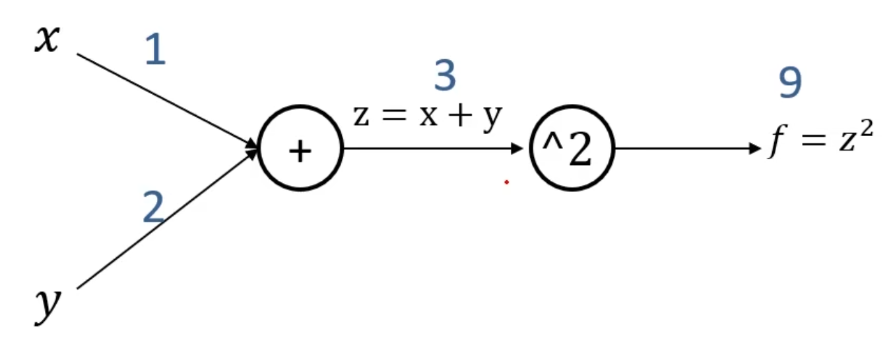

  - **反向计算**

    除了正向推导，我们还可以反向计算导数。还是以前向计算的例子为例：

    1. 求 $f$关于$z$的导数：$\frac{\partial f}{\partial z}=2z=6$
    2. 求 $z$关于$x$的导数：$\frac{\partial z}{\partial x}=1+0=1$
    3. 求 $z$关于$y$的导数：$\frac{\partial z}{\partial y}=0+1=1$

    

    依据 <font color="red">求导的链式法则</font>（高等数学知识），当我须要求$\frac{\partial f}{\partial x}$或$\frac{\partial f}{\partial y}$，那么我们就可以写成：
    $$
    \frac{\partial f}{\partial x}=\frac{\partial f}{\partial z}\frac{\partial z}{\partial x}=6
    \\[30px]
    \frac{\partial f}{\partial y}=\frac{\partial f}{\partial z}\frac{\partial z}{\partial y}=6
    $$

- **举个例子**

  对于函数 $f(w,x)=\frac{1}{1+e^{-(w_0x_0+w_1x_1+w_2)}}$，我们画出函数图：

  

  - **前向计算**

    假设自变量为 $w_0=3,w_1=-2,w_2=1,x_0=-1,x_1=-2$，得到计算图：

    

    那么能看出来，拆解出计算图中后，我们每一步运算都是单元计算，所以这个计算图就比较简单

  - **反向计算**

    根据之前学习的，我们将这个计算图中每一步的式子 及其 求导式子 写出来

    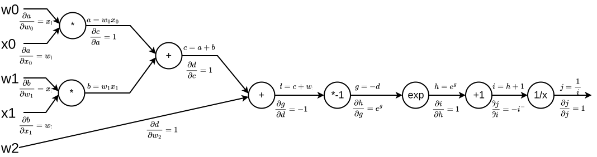

    然后我们就可以得到 **输出相对于任意一个节点的梯度**

    


### 总结

- 任意复杂的函数，都可以用计算图的形式表示
- 在整个计算图中，每个门单元都会得到一些输入，然后，进行下面两个计算：
  a) 这个门的输出值
  b) 其输出值关于输入值的局部梯度。
- 利用链式法则，门单元应该将回传的梯度乘以它对其的输入的局部梯度，从而得到整个网络的输出对该门单元的每个输入值的梯度。


### 计算图中常见的门单元


## 再谈激活函数

我们以 Sigmoid激活函数为例，Sigmoid激活函数的形式为
$$
\sigma(x)=1/(1+e^{-x})
$$
其图片形式为：

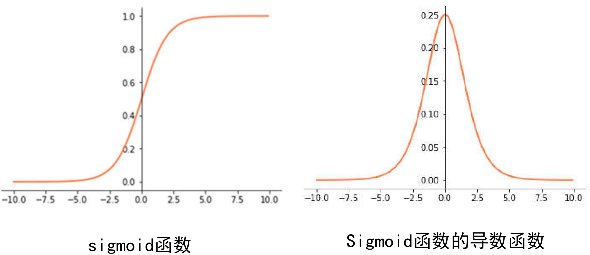

我们观察到：当输入值大于10或者小于-10时梯度基本上接近0；因为在计算图中我们做梯度回传时会让梯度连乘，这就引出了`梯度消失`的问题，与其相对应的还有一个`梯度爆炸`的问题。


### 梯度消失（神经网络训练最大的问题）

> [!IMPORTANT]
>
> `梯度消失`是神经网络训练中非常致命的一个问题，其本质是由于**链式法则的乘法特性**导致的。

#### 什么是梯度消失

**梯度消失（Vanishing Gradient）**是指在梯度回传过程中，梯度随着反向传播不断减小，最终导致靠近输入端的网络层梯度接近于 0，**参数难以得到有效更新**的现象。

#### 从计算图理解梯度消失

- 假设存在如下计算图：
  $$
  x_1\longrightarrow x_2\longrightarrow x_3 \longrightarrow x_4\longrightarrow L
  $$
  根据链式法则：
  $$
  \frac{\partial L}{\partial x_1} = \frac{\partial L}{\partial x_4} \frac{\partial x_4}{\partial x_3} \frac{\partial x_3}{\partial x_2} \frac{\partial x_2}{\partial x_1}
  $$

- 假设每个节点的局部导数都是 \(0.1\)，那么梯度回传的过程就是：
  $$
  \frac{\partial L}{\partial L}=1
  \\
  \frac{\partial L}{\partial x_4}=1\times0.1=0.1
  \\
  \frac{\partial L}{\partial x_3}=0.1\times0.1=0.01
  \\
  \frac{\partial L}{\partial x_2}=0.01\times0.1=0.001
  \\
  \frac{\partial L}{\partial x_1}=0.001\times0.1=0.0001
  $$

- 如果有 10 个这样的计算节点：
  \[
  \frac{\partial L}{\partial x_1} =\underbrace{0.1\times0.1\times\cdots\times0.1}_{10\text{ 次}} =0.0000000001
  \]
  此时梯度已经非常接近于 0。

  **这就是梯度消失。**

#### 为什么梯度消失会影响神经网络训练？

- 神经网络通过梯度下降更新权重：
  \[
  w_{\text{new}} =w_{\text{old}}-\alpha\frac{\partial L}{\partial w}
  \]
  

  其中：

  - \(w\)：网络权重。
  - \(\alpha\)：学习率。
  - \(\displaystyle\frac{\partial L}{\partial w}\)：损失函数对权重的梯度。

- 当出现梯度消失，也就是 \[ \frac{\partial L}{\partial w}\approx0 \] 时，我们会得到 \[ w_{\text{new}}\approx w_{\text{old}} \]

  那么这时候**即使进行了大量训练，权重也几乎没有发生变化**。

- 对于深层神经网络，就可能出现以下情况：

  | 网络层     | 梯度大小（示意） | 参数更新情况 |
  | ---------- | ---------------- | ------------ |
  | 输出层附近 | \(0.1\)          | 正常更新     |
  | 中间层     | \(0.0001\)       | 更新缓慢     |
  | 输入层附近 | \(0.0000000001\) | 几乎不更新   |

  靠近输出端的网络层仍然能够学习，而靠近输入端的网络层可能很难学习。

#### 为什么 Sigmoid 容易导致梯度消失？

Sigmoid 激活函数：$\sigma(x)=\frac{1}{1+e^{-x}}$ ，它的导数为：$\sigma'(x)=\sigma(x)(1-\sigma(x))$， 导数的取值范围为：$0<\sigma'(x)\leq0.25$

也就是说，梯度每经过一个 Sigmoid 激活节点，都会乘上一个不超过 \(0.25\) 的数。

如果连续经过多个 Sigmoid 节点，而其他计算节点又没有提供足够的梯度放大，就很容易发生梯度消失。

这也是深层神经网络经常使用 ReLU 激活函数的原因之一。


### 梯度爆炸

> [!IMPORTANT]
>
> `梯度爆炸`也是由于链式法则的乘法特性导致的。

#### 什么是梯度爆炸

**梯度爆炸**是指断崖处梯度乘以学习率后会是一个非常大得值，从而“飞”出了合理区域，最终导致算法不收敛；

#### 从计算图理解梯度爆炸

- 假设存在如下计算图：

  \[
  x_1\longrightarrow x_2\longrightarrow x_3 \longrightarrow x_4\longrightarrow L
  \]
  根据链式法则：

  $$
  \frac{\partial L}{\partial x_1} = \frac{\partial L}{\partial x_4} \frac{\partial x_4}{\partial x_3} \frac{\partial x_3}{\partial x_2} \frac{\partial x_2}{\partial x_1}
  $$

- 与梯度消失不同，这次假设每个节点的局部导数都是 \(10\)。
  $$
  \frac{\partial L}{\partial L}=1
  $$

  $$
  \frac{\partial L}{\partial x_4}=1\times10=10
  $$

  $$
  \frac{\partial L}{\partial x_3}=10\times10=100
  $$

  $$
  \frac{\partial L}{\partial x_2}=100\times10=1000
  $$

  $$
  \frac{\partial L}{\partial x_1}=1000\times10=10000
  $$


- 如果有 10 个这样的计算节点：
  \[
  \frac{\partial L}{\partial x_1} =\underbrace{10\times10\times\cdots\times10}_{10\text{ 次}} =10^{10}
  \]
  此时梯度已经变得非常大。

  **这就是梯度爆炸。**

#### 为什么梯度爆炸会影响神经网络训练？

- 神经网络通过梯度下降更新权重：
  $$
  w_{\text{new}} =w_{\text{old}}-\alpha\frac{\partial L}{\partial w}
  $$
  假设当前权重为：\[ w_{\text{old}}=1 \]

  学习率为：\[ \alpha=0.01 \]

  ---

  

  示意图，其中 虚线表示**正常情况** ，实线表示**梯度爆炸情况**

- **正常情况下**

  假设梯度为 \(2\)：
  \[
  \frac{\partial L}{\partial w}=2
  \]
  那么：
  \[
  w_{\text{new}}=1-0.01\times2=0.98
  \]
  权重只发生了小幅变化。

- **梯度爆炸情况下**

  假设梯度为 \(10000\)：
  \[
  \frac{\partial L}{\partial w}=10000
  \]
  那么：
  \[
  w_{\text{new}}=1-0.01\times10000=-99
  \]
  权重直接从 \(1\) 变成了 \(-99\)。

  > 这意味着，即使学习率很小，由于梯度过大，参数仍然可能发生剧烈变化，导致**参数越过最优点**，**损失函数值反而增大**，甚至发生数值溢出（Inf、NaN）。 

#### 解决方法：梯度裁减

- 概念：把沿梯度方向前进的步长限制在某个值内就可以避免“飞”出了，这个方法也称为梯度裁剪。

- 具体做法（这里以 **按梯度数值裁剪** 为例）：

  - 假设设定梯度裁剪阈值为 \(c\)，将梯度限制在：\[ [-c,c] \]

    令原始梯度为：\[ g=\frac{\partial L}{\partial w} \]

    那么裁剪后的梯度为：\[ \hat g= \begin{cases} c & g>c\\ g & -c\leq g\leq c\\ -c & g<-c \end{cases} \]

  - 假设裁剪阈值为：\[ c=5 \]

    那么：

    | 原始梯度 \(g\) | 裁剪后的梯度 \(\hat g\) |
    | -------------- | ----------------------- |
    | -10000         | -5                      |
    | -10            | -5                      |
    | -3             | -3                      |
    | 0              | 0                       |
    | 2              | 2                       |
    | 10             | 5                       |
    | 10000          | 5                       |


### 再看 激活函数

因为局部梯度特征不好（在一些区域的梯度都趋近于0），导致不利于网络梯度流反向传递的激活函数：

- Sigmoid激活函数：$\sigma(x)=1/(1+e^{-x})$

  

- 双曲正切激活函数：$\tanh\mathrm{(x)}=\frac{\mathrm{sin}hx}{\mathrm{cos}hx}=\frac{e^x-e^{-x}}{e^x+e^{-x}}$

  （与sigmoid类似，局部梯度特性不利于网络梯度流的反向传递）

  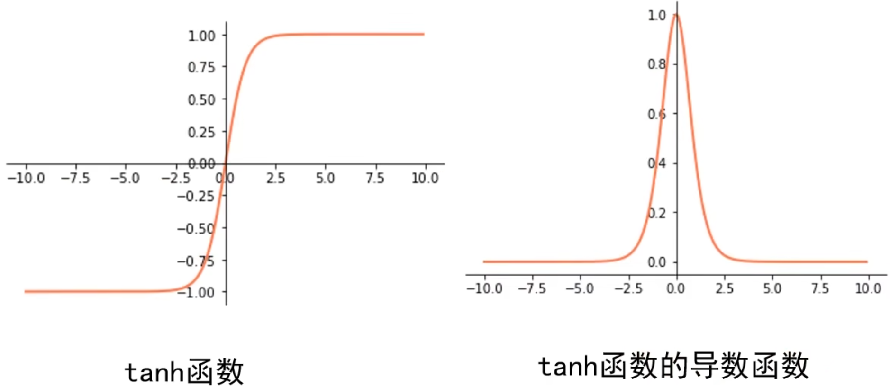

---

局部梯度特征比较好的函数：

- ReLU激活函数 $f(x)=\max(0,x)$：

  （当输入大于0时，局部梯度永远不会为0，比较有利于梯度流的传递）

  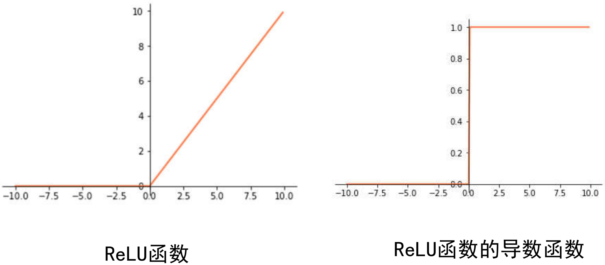

  但是也有问题：虽然ReLU在 \(x>0\) 时，局部梯度为 1，梯度可以无衰减地回传，但是在\(x<0\) 时，局部梯度为 0，梯度回传被直接截断。

- Leakly ReLU激活函数 $f(x)=\max(0.01x,x)$：

  （基本没有“死区”，也就是梯度永远不会为0。**之所以说“基本”，是因为函数在0处没有导数**。但是训练过程中基本没有为0的情况）

  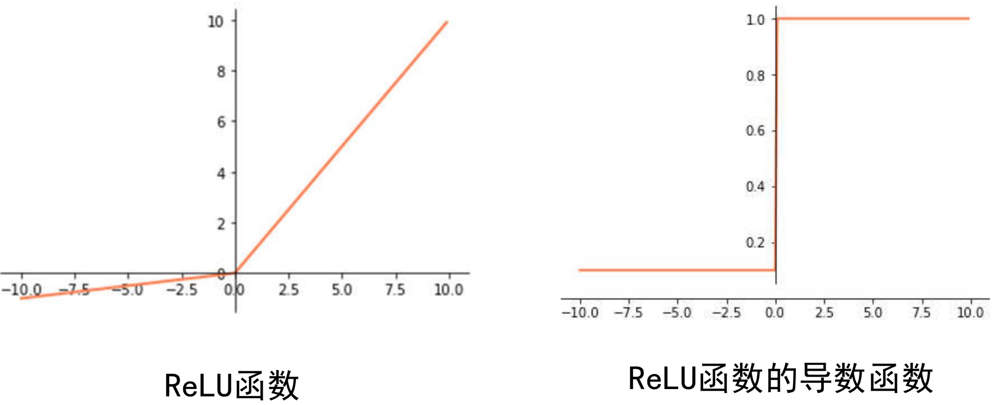

### 激活函数选择总结

尽量选择ReLU函数或者Leakly ReLU函数，相对于Sigmoid/tanh，ReLU函数或者Leakly ReLU函数会让梯度流更加顺畅，训练过程收敛得更快。


## 梯度下降算法改进

 ### 梯度下降算法存在的问题

在之前我们已经介绍了批量梯度下降算法，随机梯度下降算法，小批量梯度下降算法等，但是速度依然很慢。

- 问题

  - **假设**：

    假设神经网络只有两个权重参数 \(w_1、w_2\)，损失函数为：
    \[
    L=L(w_1,w_2)
    \]
    我们把损失函数的表现比喻为：

    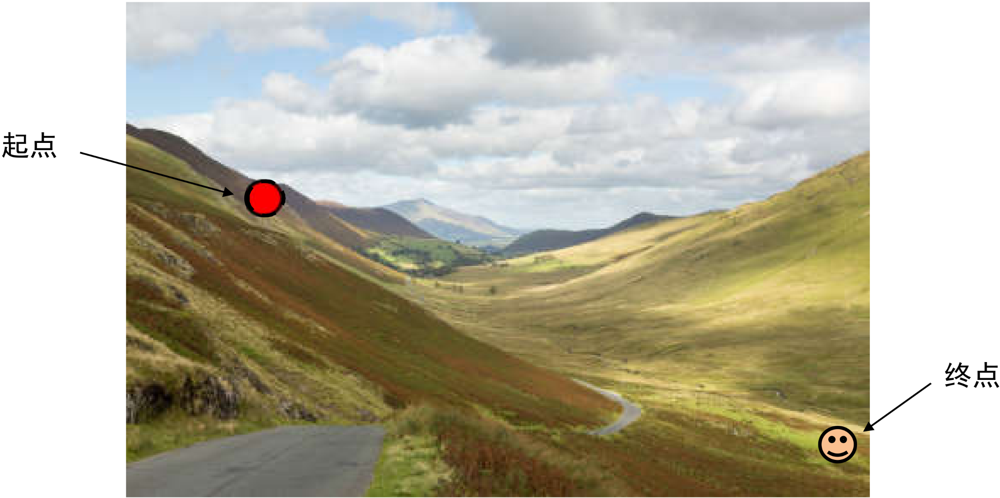

    其中：

    - 山谷地形：损失函数 \(L(w_1,w_2)\)
    - 地形高度：损失函数值 \(L\)
    - 横跨山谷：\(w_1\) 方向
    - 沿着山谷：\(w_2\) 方向（假设）
    - 小球：当前参数 \((w_1,w_2)\)
    - 笑脸：损失函数的最小值所对应的参数位置

  - **损失函数特性**：一个方向上变化迅速而在另一个方向上变化缓慢。

  - **优化目标**：从起点处走到笑脸处

  - **梯度下降算法存在的问题**：山壁间震荡，往谷低方向的行进较慢。

    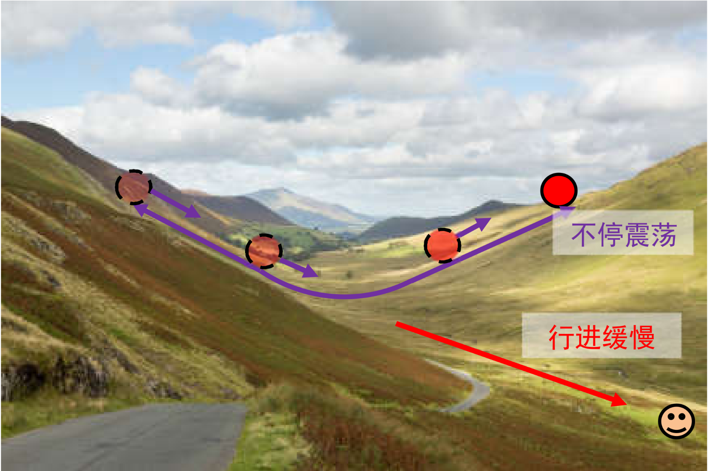

- 举一个具体例子

  - 假设有一个简单的神经网络：\[ \hat y=w_1x_1+w_2x_2+b \]

    为了方便理解，暂时忽略偏置 \(b\)，那么损失函数可以表示为：\[ L=L(w_1,w_2) \]

    对于损失函数，可以分别计算两个方向上的偏导数：

    \[ \frac{\partial L}{\partial w_1} \] 表示保持 \(w_2\) 不变，损失函数沿 \(w_1\) 方向的变化率。

    \[ \frac{\partial L}{\partial w_2} \] 表示保持 \(w_1\) 不变，损失函数沿 \(w_2\) 方向的变化率。

    这两个偏导数组成梯度向量：\[ \nabla_{\boldsymbol w}L= \begin{bmatrix} \frac{\partial L}{\partial w_1}\\[6pt] \frac{\partial L}{\partial w_2} \end{bmatrix} \]

  - 假设损失函数为：
    \[
    L(w_1,w_2)=100w_1^2+w_2^2
    \]
    分别计算偏导数：
    \[
    \frac{\partial L}{\partial w_1}=200w_1
    \]

    \[
    \frac{\partial L}{\partial w_2}=2w_2
    \]

    假设当前参数为：
    \[
    w_1=1,\qquad w_2=1
    \]
    那么：
    \[
    \nabla_{\boldsymbol w}L= \begin{bmatrix} 200\\ 2 \end{bmatrix}
    \]
    可以看到，在当前位置：

    - \(w_1\) 方向（紫色）：参数发生微小变化，损失函数值就会发生较大变化。
    - \(w_2\) 方向（红色）：参数发生相同幅度的微小变化，损失函数值的变化相对较小。

    实际上，这个例子中两个方向的曲率也不同：
    \[
    \frac{\partial^2 L}{\partial w_1^2}=200
    \]
    \[
    \frac{\partial^2 L}{\partial w_2^2}=2
    \]
    因此，\(w_1\) 方向比较陡峭，而 \(w_2\) 方向比较平缓。


### 动量法（Momentum）

> - `目标`：改进梯度下降算法存在的问题，即减少震荡，加速通往谷低
>
> - `核心思想`：
>
>   假设一个小球从山坡上向下滚动。
>
>   **普通梯度下降：**小球没有惯性，每次移动的方向和距离完全由当前位置的梯度决定，不考虑之前的运动状态。
>
>   **动量梯度下降：**小球具有惯性，每次移动不仅受到当前坡度的影响，还受到之前运动速度的影响。
>
>   因此：
>
>   - 如果连续受到相同方向的作用力，运动速度就会逐渐增大。
>   - 如果连续受到相反方向的作用力，运动趋势就会相互抵消。

#### 动量法的数学表示

- **普通梯度下降**

  - **计算梯度**
    $$
    \boldsymbol g_t=\nabla_{\boldsymbol w}L(\boldsymbol w_t)
    $$
    假设神经网络有 \(n\) 个权重参数，那么：
    \[
    \boldsymbol g_t= \begin{bmatrix} \frac{\partial L}{\partial w_1}\\[6pt] \frac{\partial L}{\partial w_2}\\[6pt] \vdots\\[6pt] \frac{\partial L}{\partial w_n} \end{bmatrix}_{\boldsymbol w=\boldsymbol w_t}
    \]

  - **更新权重**
    $$
    \boldsymbol w_{t+1}
    =\boldsymbol w_t-\alpha\boldsymbol g_t
    $$
    其中：

    - \(\boldsymbol w_t\)：当前权重参数。
    - \(\boldsymbol g_t\)：当前权重参数对应的梯度。
    - \(\alpha\)：学习率。
    - \(\boldsymbol w_{t+1}\)：更新后的权重参数。

- **动量梯度下降**

  - **计算梯度**
    \[
    \boldsymbol g_t=\nabla_{\boldsymbol w}L(\boldsymbol w_t)
    \]
    假设神经网络有 \(n\) 个权重参数，那么：
    \[
    \boldsymbol g_t= \begin{bmatrix} \frac{\partial L}{\partial w_1}\\[6pt] \frac{\partial L}{\partial w_2}\\[6pt] \vdots\\[6pt] \frac{\partial L}{\partial w_n} \end{bmatrix}_{\boldsymbol w=\boldsymbol w_t}
    \]
    该步骤与普通梯度下降相同，通过反向传播计算损失函数对当前各个权重参数的梯度。

  - **计算动量**
    \[
    \boldsymbol v_t= \underbrace{\mu\boldsymbol v_{t-1}}_{\text{保留历史梯度的累积趋势}} + \underbrace{\boldsymbol g_t}_{\text{引入当前梯度}}
    \]
    其中：

    - \(\boldsymbol v_t\)：当前动量，即当前梯度与历史动量的累积结果。

    - \(\boldsymbol v_{t-1}\)：上一次迭代计算得到的动量。

    - \(\boldsymbol g_t\)：当前权重参数对应的梯度。

    - \(\mu\)：动量系数，用于控制历史动量的保留程度，取值范围为$[0,1)$，通常取 \(0.9\)。其中：
      - $\mu=0$ 时表示不使用历史梯度，此时算法退化为`梯度下降算法`
    
      - \(\mu\) 不能等于 \(1\)，这是因为当 \(\mu=1\) 时 $v_t=v_{t-1}+g_t$，假设函数已经下降到一个平坦区域，此时$g_t$为0，但是 $v_t=v_{t-1}$也就是一直存在一个**速度**（或者说这个速度不会自然衰减）让函数下降“刹不了车”，此时循环会一直执行停不下来
    
    - \(\boldsymbol v_0\)：初始动量，通常初始化为**零向量**。
    
    当历史动量与当前梯度方向一致时，两者相互增强；当历史动量与当前梯度方向相反时，两者相互抵消。
    
  - **更新权重**
    \[
    \boldsymbol w_{t+1} =\boldsymbol w_t-\alpha\boldsymbol v_t
    \]
    其中：

    - \(\boldsymbol w_t\)：当前权重参数。
    - \(\boldsymbol v_t\)：当前迭代计算得到的动量。
    - \(\alpha\)：学习率。
    - \(\boldsymbol w_{t+1}\)：更新后的权重参数。

    与普通梯度下降不同，动量梯度下降不直接使用当前梯度更新权重，而是使用历史梯度与当前梯度的累积结果更新权重。

- **普通梯度下降与动量梯度下降的对比：**

  | 步骤     | 普通梯度下降                                                 | 动量梯度下降                                                 |
  | -------- | ------------------------------------------------------------ | ------------------------------------------------------------ |
  | 计算梯度 | \(\boldsymbol g_t=\nabla_{\boldsymbol w}L(\boldsymbol w_t)\) | \(\boldsymbol g_t=\nabla_{\boldsymbol w}L(\boldsymbol w_t)\) |
  | 计算动量 | 无                                                           | \(\boldsymbol v_t=\beta\boldsymbol v_{t-1}+\boldsymbol g_t\) |
  | 更新权重 | \(\boldsymbol w_{t+1}=\boldsymbol w_t-\alpha\boldsymbol g_t\) | \(\boldsymbol w_{t+1}=\boldsymbol w_t-\alpha\boldsymbol v_t\) |

#### 带动量与不带动量的小批量梯度下降伪代码表示

- 小批量梯度下降算法

  > Require: 学习率 $\epsilon$ 
  >
  > Require: 初始参数 $\theta$ （表示所有可训练参数，即\[ \boldsymbol\theta= \begin{bmatrix} w_1\\ w_2\\ b \end{bmatrix} \]）
  >
  > 
  >
  > while 停止标准未满足 do:  
  >
  >  1. 从训练集中采样$m$（批量大小）个样本$\{x^{(1)}, \dots, x^{(m)}\}$ 
  >       对应的目标为$\{y^{(1)}, \dots, y^{(m)}\}$  
  >
  >  2. 计算梯度：$\boldsymbol{g} \leftarrow \frac{1}{m} \nabla_{\theta} \sum_{i} L(f(\boldsymbol{x}^{(i)}; \theta), \boldsymbol{y}^{(i)})$ 
  >
  >  3. 更新权值：$\theta \leftarrow \theta - \epsilon \boldsymbol{g}$ 
  >
  >   end while

- 使用动量的小批量梯度下降算法

  > Require: 学习率 $\epsilon$，动量系数 $\mu$ 
  >
  > Require: 初始参数 $\theta$ （表示所有可训练参数，即\[ \boldsymbol\theta= \begin{bmatrix} w_1\\ w_2\\ b \end{bmatrix} \]）
  >
  > 
  >
  > 初始化速度 $v = 0$ 
  >
  > while 停止标准未满足 do:  
  >
  > 1. 从训练集中采样$m$（批量大小）个样本$\{x^{(1)}, \cdots, x^{(m)}\}$ 
  >   对应的 target 为$\{y^{(1)}, \cdots, y^{(m)}\}$  
  >
  > 2. 计算梯度：$g \leftarrow \frac{1}{m} \nabla_{\theta} \sum_{i} L(f(x^{(i)}; \theta), y^{(i)})$  
  >
  > 3. 速度更新：$v = \mu v + (1 - \mu)g$  
  >
  > 4. 更新权值：$\theta \leftarrow \theta - \epsilon v$ 
  >
  >   end while


#### 动量法的其他效果

动量法除了可以减少震荡，加速通往谷低，还有一个很大的优势

- **现象**：损失函数常具有不太好的 `局部最小值` 或 `鞍点`（高维空间非常常见）
- **梯度下降算法存在的问题**：**局部最小处** 与 **鞍点** 处梯度为0，算法无法通过这两种点。

- **动量法的优势**：由于 `动量` 的存在，算法可以冲出局部最小店以及鞍点找到更优的解。

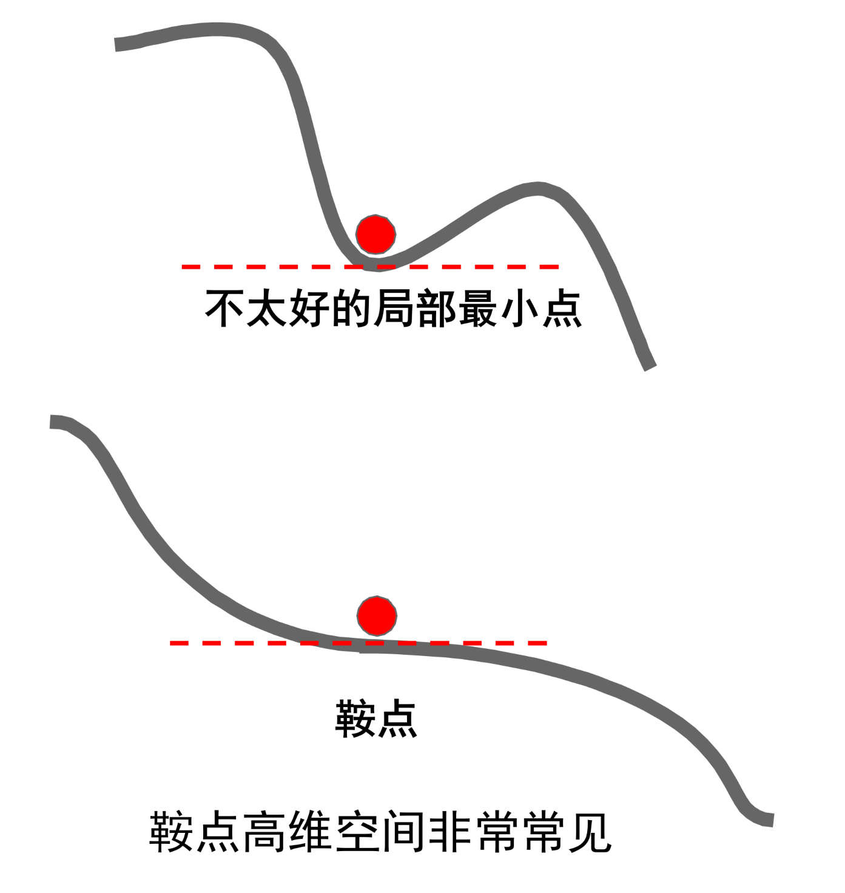


### 自适应梯度法与 RMSProp

> `自适应梯度法` 的思路与 `动量法`  完全不一样，但是都是为了解决 梯度下降算法存在的问题

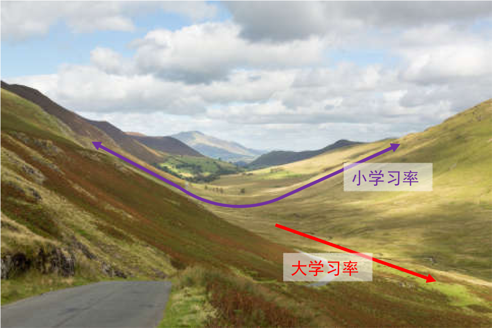

- 我们知道，提升整体的方向步长不能呢个解决 梯度下降算法的问题，而

  `自适应梯度法` 通过 

  - **减小震荡方向步长**
  - **增大平坦方向步长来减小震荡**，加速通往**谷底方向**；

  例如，对于上图来说，紫色方向比较震荡所以需要减小步长，红色方向比较平坦所以需要增大步长

- 那么，如何区分震荡方向与平坦方向呢？

  答：`梯度幅度的平方`较大的方向是**震荡方向**；`梯度幅度的平方`较小的方向是**平坦方向**。


#### 自适应梯度法 的数学表示

- **计算梯度**
  \[
  \boldsymbol g_t=\nabla_{\boldsymbol W}L(\boldsymbol W_t)
  \]
  假设神经网络有 \(n\) 个可训练参数，那么：
  \[
  \boldsymbol g_t=
  \begin{bmatrix}
  \frac{\partial L}{\partial w_1}\\[6pt]
  \frac{\partial L}{\partial w_2}\\[6pt]
  \vdots\\[6pt]
  \frac{\partial L}{\partial w_n}
  \end{bmatrix}_{\boldsymbol W=\boldsymbol W_t}
  \]

- **累积历史梯度的平方**
  \[
  \boldsymbol r_t=\boldsymbol r_{t-1}+\boldsymbol g_t\odot\boldsymbol g_t
  \]
  其中：

  - \(\boldsymbol r_t\)：截至当前迭代的梯度平方累积值。
  - \(\boldsymbol r_{t-1}\)：上一次迭代的梯度平方累积值。
  - \(\boldsymbol g_t\)：当前权重参数对应的梯度。
  - \(\odot\)：逐元素乘法。
  - \(\boldsymbol r_0=\boldsymbol 0\)：初始化梯度平方累积值为零向量。

- **更新参数**
  \[
  \boldsymbol W_{t+1}
  =\boldsymbol W_t-
  \underbrace{\frac{\epsilon}{\sqrt{\boldsymbol r_t}+\delta}}_{\text{自适应学习率}}
  \odot
  \underbrace{\boldsymbol g_t}_{\text{当前梯度}}
  \]
  - 其中：
    - \(\boldsymbol W_t\)：当前参数。
    - \(\boldsymbol g_t\)：当前参数对应的梯度。
    - \(\boldsymbol r_t\)：当前梯度平方累积值。
    - \(\epsilon\)：基础学习率。
    - \(\delta\)（超参数）：防止分母为零的极小常数，通常取 \(10^{-8}\)。
    - \(\boldsymbol W_{t+1}\)：更新后的参数。


#### 自适应梯度法的伪代码表示

- <font color="red">小批量梯度下降算法</font>

  > Require: 学习率 $\epsilon$ 
  >
  > Require: 初始参数 $\theta$ （表示所有可训练参数，即\[ \boldsymbol\theta= \begin{bmatrix} w_1\\ w_2\\ b \end{bmatrix} \]）
  >
  > 
  >
  > while 停止标准未满足 do:  
  >
  >   1. 从训练集中采样$m$（批量大小）个样本$\{x^{(1)}, \dots, x^{(m)}\}$ 
  >      对应的目标为$\{y^{(1)}, \dots, y^{(m)}\}$  
  >
  >   2. 计算梯度：$\boldsymbol{g} \leftarrow \frac{1}{m} \nabla_{\theta} \sum_{i} L(f(\boldsymbol{x}^{(i)}; \theta), \boldsymbol{y}^{(i)})$ 
  >
  >   3. 更新权值：$\theta \leftarrow \theta - \epsilon \boldsymbol{g}$ 
  >
  >   end while

- <font color="red">AdaGrad（自适应梯度法的一种）</font>

  > Require: 学习率 $\epsilon$, 衰减速率 $\rho$
  >
  > Require: 初始参数 $\theta$
  >
  > Require: 小常数$\delta$, 用于被小数除时的数值稳定。（通常设为$10^{-5}$）
  >
  > 
  >
  > 初始化累积变量 $r = 0$
  >
  > while 停止标准未满足 do:
  >
  > 1. 从训练集中采样$m$（批量大小）个样本$\{x^{(1)}, \cdots, x^{(m)}\}$
  >   对应的目标为$\{y^{(1)}, \cdots, y^{(m)}\}$
  > 2. 计算梯度：$g \leftarrow \frac{1}{m} \nabla_{\theta} \sum_i L(f(x^{(i)}; \theta), y^{(i)})$
  > 3. 累积平方梯度：$r \leftarrow r + g * g$
  > 4. 更新权值：$w \leftarrow w - \frac{\varepsilon}{\sqrt{r} + \delta} g$
  >   end while

  - AdaGrad确实可以加快梯度下降的速度并且减少震荡，但是存在一个问题：

    梯度$r$ 会在训练过程中一直累加，到后面 梯度$r$ 会变成一个非常非常大的值

    那么此时，权值更新的公式 $\frac{\varepsilon}{\sqrt{r} + \delta}$ 中由于 $\sqrt{r}$ 非常大，导致  $\frac{\varepsilon}{\sqrt{r} + \delta}$ 中的 $\varepsilon$ 失去了调节作用，也就是 $\frac{\varepsilon}{\sqrt{r} + \delta}$ 会因为  $\sqrt{r}$ 而变得非常小

    又因为 $\frac{\varepsilon}{\sqrt{r} + \delta}$ 非常小，所以 权值$w$ 更新的步长会变得非常小

    这并不是我们希望的。所以我们有一种改进算法 `RMSProp算法`

- <font color="red">RMSProp（自适应梯度法的一种）</font>

  > Require: 学习率 $\epsilon$，衰减速率 $\rho$  
  >
  > Require: 初始参数 $\theta$  
  >
  > Require: 小常数 $\delta$，用于被小数除时的数值稳定。（通常设为 $10^{-5}$）  
  >
  > 
  >
  > 初始化累积变量 $r = 0$  
  >
  > while 停止标准未满足 do:  
  >
  >   1. 从训练集中采样 $m$（批量大小）个样本 $\{x^{(1)}, \dots, x^{(m)}\}$
  >
  >        对应的目标为 $\{y^{(1)}, \dots, y^{(m)}\}$  
  >
  >   2. 计算梯度：$g \leftarrow \frac{1}{m} \nabla_{\theta} \sum_{i} L(f(x^{(i)}; \theta), y^{(i)})$  
  >
  >   3. 累积平方梯度：$r \leftarrow \rho r + (1 - \rho) g * g$  （$\rho$的取值范围为$[0,1)$，$\rho=0$时仅考虑当前梯度的强度，一般设置为0.999）
  >
  >   4. 更新权值：$w \leftarrow w - \frac{\epsilon}{\sqrt{r} + \delta} g$  
  >
  >   end while


### ADAM（动量法与自适应梯度法的结合）

- 动量法：方向一致的梯度相互增强，方向相反的梯度相互抵消

- 自适应梯度法：历史梯度较大的参数采用较小的有效学习率，历史梯度较小的参数采用相对较大的有效学习率
- ADAM：把上面两者的思想合在一起

#### ADAM 的数学表示

- **计算梯度**
  \[
  \boldsymbol g_t=\nabla_{\boldsymbol W}L(\boldsymbol W_t)
  \]
  假设神经网络有 \(n\) 个待优化参数，那么：
  \[
  \boldsymbol g_t= \begin{bmatrix} \frac{\partial L}{\partial w_1}\\[6pt] \frac{\partial L}{\partial w_2}\\[6pt] \vdots\\[6pt] \frac{\partial L}{\partial w_n} \end{bmatrix}_{\boldsymbol W=\boldsymbol W_t}
  \]

- **计算一阶矩估计（Momentum 思想）**
  \[
  \boldsymbol m_t= \beta_1\boldsymbol m_{t-1} +(1-\beta_1)\boldsymbol g_t
  \]
  其中：

  - \(\boldsymbol m_t\)：当前梯度的一阶矩估计。
  - \(\boldsymbol m_{t-1}\)：上一次迭代的一阶矩估计。
  - \(\boldsymbol g_t\)：当前梯度。
  - \(\beta_1\)：一阶矩的指数衰减系数，通常取 \(0.9\)。
  - \(\boldsymbol m_0=\boldsymbol 0\)：初始一阶矩估计。

  **作用：利用历史梯度改善参数的更新趋势，缓解震荡。**

- **计算二阶矩估计（RMSProp 思想）**
  \[
  \boldsymbol v_t= \beta_2\boldsymbol v_{t-1} +(1-\beta_2)\boldsymbol g_t\odot\boldsymbol g_t
  \]
  其中：

  - \(\boldsymbol v_t\)：当前梯度的二阶原始矩估计。
  - \(\boldsymbol v_{t-1}\)：上一次迭代的二阶原始矩估计。
  - \(\boldsymbol g_t\odot\boldsymbol g_t\)：当前梯度的逐元素平方。
  - \(\beta_2\)：二阶矩的指数衰减系数，通常取 \(0.999\)。
  - \(\boldsymbol v_0=\boldsymbol 0\)：初始二阶矩估计。

  **作用：根据历史梯度的大小，自适应调整各个参数的有效学习率。**

- **偏差修正**

  由于一阶矩和二阶矩均初始化为零向量：
  \[
  \boldsymbol m_0=\boldsymbol 0,\qquad \boldsymbol v_0=\boldsymbol 0
  \]
  导致**训练初期的矩估计存在偏向零的现象**，因此需要进行偏差修正（迭代次数从 \(t=1\) 开始）。

  一阶矩偏差修正：
  \[
  \hat{\boldsymbol m}_t= \frac{\boldsymbol m_t}{1-\beta_1^t}
  \]
  二阶矩偏差修正
  \[
  \hat{\boldsymbol v}_t= \frac{\boldsymbol v_t}{1-\beta_2^t}
  \]
  其中：

  - $t$：当前迭代次数，从 \(1\) 开始计数。

  - \(\hat{\boldsymbol m}_t\)：修正后的一阶矩估计。
  - \(\hat{\boldsymbol v}_t\)：修正后的二阶矩估计。

  ---

  为什么这样就可以在训练初期修正偏差，而且对后期没有影响呢？

  - 假设 $\beta_1=0.9, \beta_2=0.999$

  - 在训练初期（冷启动），也就是 $t$很小时，

    比如$t=1$，那么 $\hat{\boldsymbol m}_t= \frac{\boldsymbol m_t}{1-0.9}=10m_t$，此时 修正值可以有一个比较高的初始值

  - 在训练后期，也就是 $t$很大时，

    比如$t=999$，那么此时 $\beta_1^t=0.9^{999}\approx0$，所以$1-\beta_1^t\approx1$，所以 $\hat{\boldsymbol m}_t= \frac{\boldsymbol m_t}{1-\beta_1^t}=m_t$

    也就是说，后期因为 $t$很大，所以 修正值基本上与原始值相等

- **更新参数**
  \[
  \boldsymbol W_{t+1} = \boldsymbol W_t- \underbrace{ \frac{\epsilon}{\sqrt{\hat{\boldsymbol v}_t}+\delta} }_{\text{自适应学习率}} \odot \underbrace{ \hat{\boldsymbol m}_t }_{\text{修正后的动量}}
  \]
  其中：

  - \(\boldsymbol W_t\)：当前参数。
  - \(\boldsymbol W_{t+1}\)：更新后的参数。
  - \(\hat{\boldsymbol m}_t\)：修正后的一阶矩估计。
  - \(\hat{\boldsymbol v}_t\)：修正后的二阶矩估计。
  - \(\epsilon\)：基础学习率，通常取 \(0.001\)。
  - \(\delta\)：防止分母为零的极小常数，通常取 \(10^{-8}\)。
  - \(\odot\)：逐元素乘法。

  公式中的开方、除法和乘法均为逐元素运算。


#### ADAM 的伪代码表示

> Require: 学习率 $\epsilon$，衰减速率 $\rho$，动量系数$\mu$。（建议值分别为0.999，0.9）
>
> Require: 初始参数 $\theta$
>
> Require: 小常数$\delta$，用于被小数除时的数值稳定。（通常设为$10^{-5}$）
>
> 
>
> 初始化累积变量 $r = 0, v = 0$
>
> while 停止标准未满足 do:
>
> 1. 从训练集中采样$m$（批量大小）个样本$\{x^{(1)}, \cdots, x^{(m)}\}$对应的目标为$\{y^{(1)}, \cdots, y^{(m)}\}$
> 2. 计算梯度：$g \leftarrow \frac{1}{m} \nabla_\theta \sum_i L(f(x^{(i)}; \theta), y^{(i)})$
> 3. 累积梯度（动量法思想）：$v \leftarrow \mu v + (1 - \mu)g$
> 4. 累积平方梯度（RMSProp思想）：$r \leftarrow \rho r + (1 - \rho)g * g$
> 5. 修正偏差：$\tilde{v} = \frac{v}{1-\mu^t}$；$\tilde{r} = \frac{r}{1-\rho^t}$
> 6. 更新权值：$\theta \leftarrow \theta - \frac{\epsilon}{\sqrt{\tilde{r}}+\delta}\tilde{v}$
>   end while


### 总结

- 不同优化算法在**损失函数等高线**上的表现

  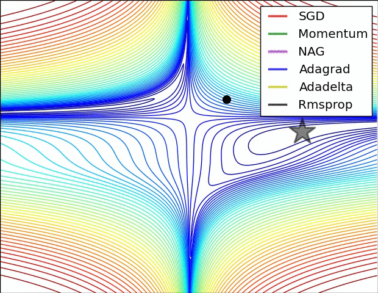

- 不同优化算法在**鞍点**上的表现

  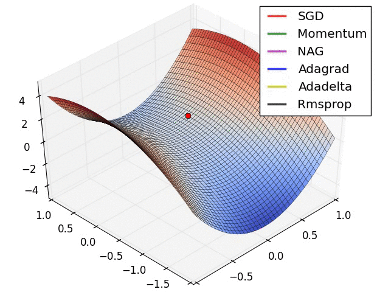


# 训练过程

## 权值初始化

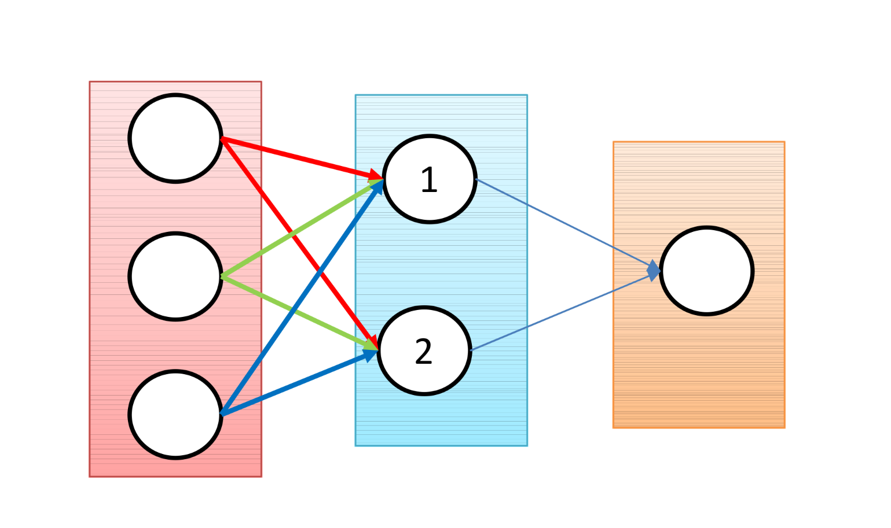

**权值初始化问题**：在神经网络开始训练之前，应该如何为各层神经元的权重赋予合适的初始值，从而保证神经网络能够有效地学习。

神经网络中的权重需要通过反向传播和梯度下降不断更新：
\[
\boldsymbol W_{t+1} =\boldsymbol W_t-\eta\frac{\partial L}{\partial\boldsymbol W_t}
\]
但是，在第一次更新之前，必须先确定权重的初始值 \(\boldsymbol W_0\)。

下面我们介绍几种权值初始化的方式


### 全零初始化（错误方式）

- **全零初始化**：网络中不同的神经元有相同的输出，进行同样的参数更新；因此，这些神经元学到的参数都一样，等价于一个神经元。

- **举个例子**：

  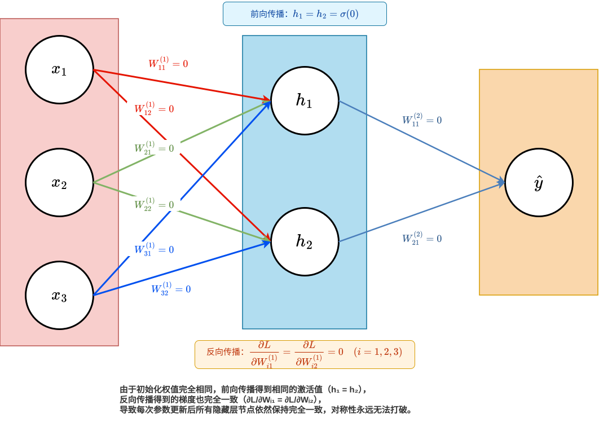


### 随机权值初始化（不够好）

- **随机权值初始化**：在神经网络开始训练之前，从某个概率分布中随机采样数值，作为各个神经元权重的初始值。

  好处：这使神经网络因为权值不一样，所以每一层计算的结果不一样，那么返回的梯度也不一样。

  但是光是更新不相同，能不能解决我们的问题？

- **举个例子说明问题**

  **网络结构**：10个隐层，1个输出层，每个隐层包含500个神经元，使用的双曲正切激活函数。

  我们来统计每个隐层的输出（每个隐层有500个输出）：

  - 初始权值采样自 $N(0,0.01)$ 的高斯分布

    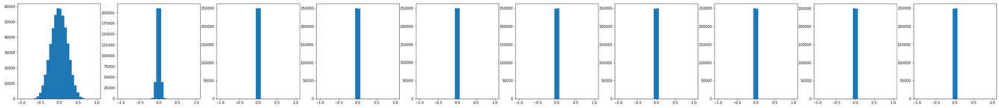

    第一隐藏层的输出值呈近似正态分布。然而，随着网络层数的增加，输出值的分布逐渐向 0 收缩。从第三个隐藏层开始，输出值几乎全部集中在 0 附近。

    这说明**权值初始化过小**，使得**输入信号在前向传播过程中不断衰减**，导致后续网络难以有效利用输入信息，即**前向计算流不畅通**。

    与此同时，由于权重也参与反向传播过程中的梯度连乘运算，过小的权重可能使梯度随着网络深度的增加而不断衰减，从而导致**梯度消失**，使靠近输入层的权重难以得到有效更新。

    因此，不合理的随机权值初始化不仅会影响**前向传播过程中的信号传递**，还会影响**反向传播过程中的梯度传递**，最终导致神经网络难以有效学习。

  - 初始权值采样自 $N(0,1)$ 的高斯分布

    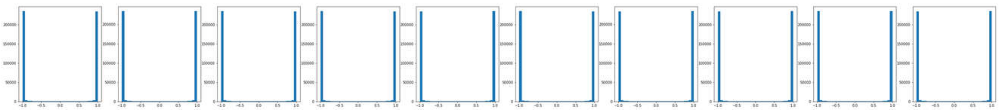

    我们发现每一层的响应值大部分是-1或1，如果我的损失函数是tanh函数，那么在1或-1时梯度基本上是0，那就基本上更新不了权值

> [!IMPORTANT]
>
> - **结论**：始化时让权值不相等，并不能保证网络能够正常的被训练。
> - **有效的初始化方法**：使网络各层的激活值和局部梯度的方差在传播过程中尽量保持一致；以保持网络中正向和反向数据流动。


### Xavier初始化

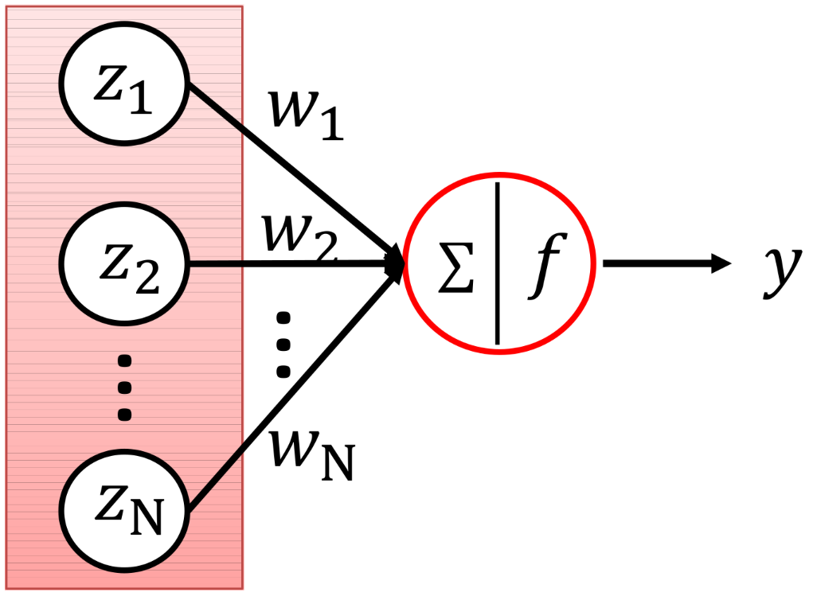

- 一个神经元，其输入为$z_1,z_2,...z_{\mathbb{N}}$，这$N$个输入是独立同分布的；其权值为$w_1,.....,w_N$, 它们也是独立同分布的，且$w$与z是独立的；其激活函数为$f$，其最终输出$y$的表达式：
  $$
  y=f(w_1*z_1+\cdots+w_N*z_N)
  $$

- **目标**：使网络各层的激活值和局部梯度的方差在传播过程中尽量保持一致，即寻找 $w$ 的分布使得 输出$y$ 与 输入$z$ 的方差一致。

  那么我们的想法是 我们需要找到是什么地方修改了方差？

- **假设**：假设$f$为双曲正切函数，$w_1, \cdotp \cdotp \cdotp , w_N$ 独 立 同 分 布，$z_1, \cdotp \cdotp \cdotp , z_N$独立同分布，随机变量$w$与$z$独立，且均值都为0，则有（$Var$是方差）：
  $$
  \begin{aligned}Var(y)&=Var\left(\sum_{i=1}^{n}w_iz_i\right)=\sum_{i=1}^{n}Var(w_iz_i)\\&=\sum_{i=1}^{n}[E(w_i)]^2Var(z_i)+[E(z_i)]^2Var(w_i)+Var(w_i)Var(z_i)\\&=\sum_{i=1}^{n}Var(w_i)Var(z_i)\\&=nVar(w_i)Var(z_i)\end{aligned}
  $$
  我们得到了结论：
  $$
  Var(y)=nVar(w_i)Var(z_i)=NVar(w_i)Var(z_i)
  $$
  也就是说说，我们希望 输出$y$ 与 输入$z$ 的方差一样，那么只能是：
  $$
  Var(w)=1/N
  $$

- **结论**：

  所以，权值采样必须来自  $\mathcal{N}(0, \textcolor{red}{1/N})$ 的高斯分布，其中 **$\textcolor{red}{N}$为输入神经元的个数**

  使用Xavier初始化 权值，就会得到：

  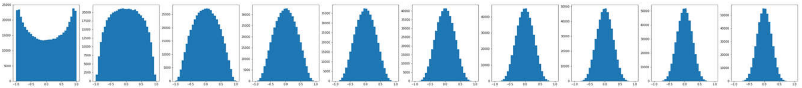

  可以看到基本满足正太分布

- **问题**：Xavier初始化方法 不太适合 **ReLU激活函数**！

  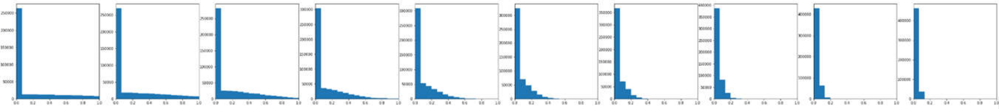

  这个时候就需要用到 `MSRA初始化方法`

### HE初始化(MSRA)

- **HE初始化**：权值采样必须来自  $\mathcal{N}(0, \textcolor{red}{2/N})$ 的高斯分布，其中 **$\textcolor{red}{N}$为输入神经元的个数**

- 效果展示：

  - 网络结构：10个隐层，1个输出层，每个隐层包含500个神经元，使用的ReLU激活函数。

  - 效果图：每一层隐层的输出

    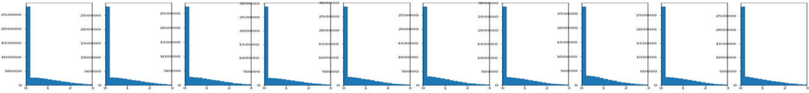

    可以看到，相比于 **Xavier初始化**，**HE初始化** 得到的结果分布更均匀


### 小结

- 好的初始化方法可以防止前向传播过程中的信息消失，也可以解决反向传递过程中的梯度消失。
- **激活函数** 选择 双曲正切 或者 Sigmoid 时，建议使用 **Xaizer初始化方法**；
- **激活函数** 选择 ReLU 或Leakly ReLU 时，推荐使用 **He初始化方法**


## 批归一化（BN操作）

- 批归一化的思路与权值初始化的思路完全不同

  > **权值初始化** 通过控制权重的初始分布，间接控制神经元输出值的分布；
  >
  > 而 **批归一化** 则在前向传播过程中，直接对神经元的输出值进行标准化。

  **目标**：我们希望 输出$y$是一个 **标准正态分布（0均值1方差的函数）**，或者说保证分布不变，那么我们能不能这样做呢？

  **操作**：对于同一个神经元在当前批次中产生的所有输出值 $y_i$，首先计算其均值和方差，然后对每个输出值减去均值、除以标准差，使标准化后的输出值具有 0 均值和接近 1 的方差。

- **小批量梯度下降算法回顾**：每次迭代时会读入一批数据，比如32个样本；经过当前神经元后会有32个输出值 $y_1, \dots, y_{32}$。 
- **批归一化操作**：对这32个输出进行**减均值除方差操作**；可保证当前神经元的输出值的分布符合0均值1方差。
- **如果每一层的每个神经元进行批归一化，就能解决前向传递过程中的信号消失问题。**


#### 批归一化与梯度消失

- 理论上 批归一化 应该放在 非线性操作 之后；

  但是实际做算法时发现，批归一化 一般放在 非线性操作之前 的性能更好。为什么呢？

- 我们来看一个结果：

  一般全连接后数据会跑到两边，我们是没有办法控制的。如果我们进行了BN操作，那么我们把样本输出都放到中间，这时候 tanh激活函数 也不会导致梯度为0

  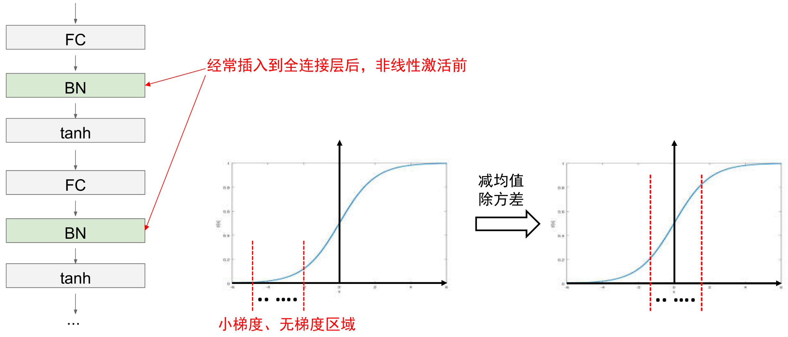

- 所以经过批归一化，我能保证数据输出是0均值1方差的

> [!NOTE]
>
> - `问题`：输出的0均值1方差的正态分布是最有利于网络分类的分布吗？
>
>   `回答`：根据对分类的贡献自行决定数据分布的均值与方差。
>
> - `问题`：单张样本测试时，均值和方差怎么设置？
>
>   `回答`：来自于训练中。累加训练时每个批次的均值和方差，最后进行平均用平均后的结果作为预测时的均值和方差。

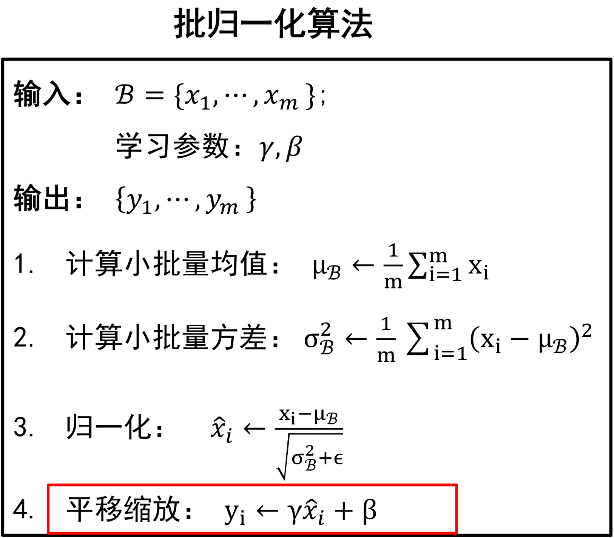


## 欠拟合、过拟合和Dropout


## 模型正则 与 超参数调优

