# 图像分类任务

## 难点

> [!NOTE]
>
> 我们必须要知道各种难点，但是每一个难点都对应了一个解决方案。那么也就是说只要我们清楚每一步都做什么，清楚计算机视觉系统设计怎样，那么才可以为后面更好地铺路

1. 语义鸿沟

   图像识别要做的任务：跨越“语义鸿沟”，建立像素到语义的映射

   - 像素：低层，用字节表示
   - 语义：高层，用几个词语描述

   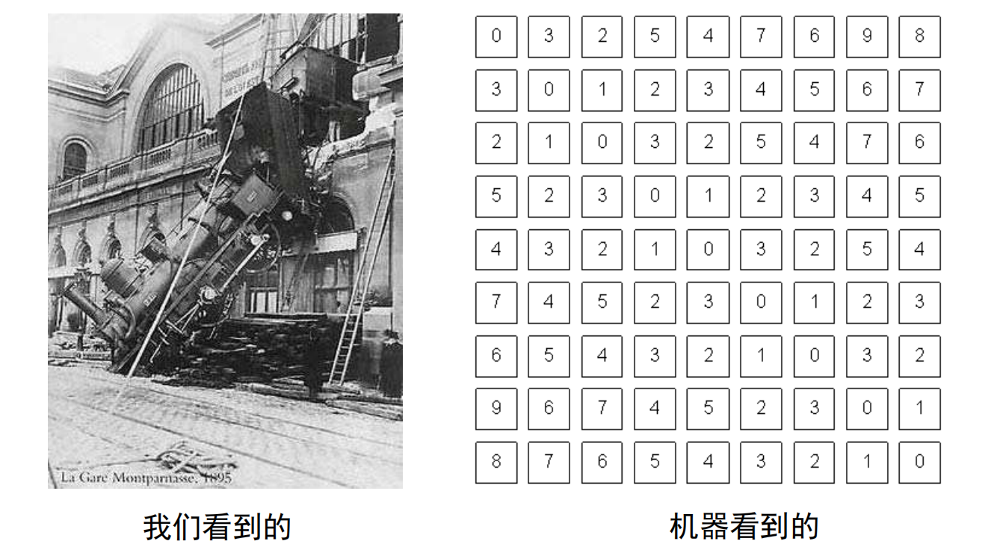

2. 视角

   人来看：这三个雕像都是同一个石雕

   机器看：这三个雕像的像素差异很大

   

3. 光照

   人看最右边的图就可以知道石膏是白色的，但是最左边的石膏在暗光环境下还是白色吗？不是！

   所以光照的变化引起了物体整体颜色的变化，也会对我们的识别算法产生影响

   

4. 尺度

   假如我们训练的时候用右边的图训练，得到的结果：笔记本占人很小的一部分

   但是如果我们用左边的图进行验证，这个笔记本占据了人的很大一部分，那么我们的识别算法是死了

   所以我们要考虑物体离摄像机的远近

   

5. 遮挡

   第三张图所示的遮挡，系统基本是挂掉的

   

6. 形变

   如果我们训练的猫是四脚走路的，但是刚好遇见了：

   

7. 背景杂波

   要识别的物体与背景非常相似，那么这个背景就是一种噪声，阻碍了对物体的识别

   

8. 类内形变

   同一个语义的多形态问题

   

9. 运动模糊

   我们对鸟头做了很精细的识别，但是遇到这样的运动模糊就挂了

   这种问题不是来自物体本身，而是来自成像器件

   一种方法是高速相机，另一种方法是`运动模糊恢复`

   

10. 类别繁多

    计算机视觉系统识别的东西越多，那么拟合就更难。

    不过我们做某种任务就只需要考虑我们需要识别的东西

    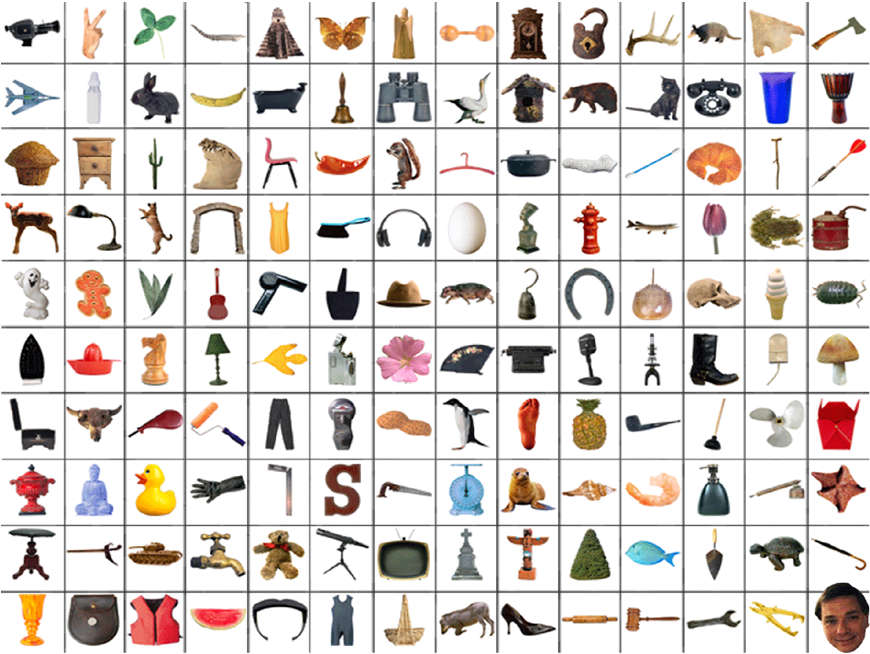


## 基于规则的分类方法是否可行？

简单的说我设计一个图像分类系统，我要做的事情是什么？🤔

👉其实就是做一个分类器，如图：（传入图像，我希望这个函数返回图像标签）

> [!NOTE]
>
> 跨越语义鸿沟，是我们图像识别所需要的

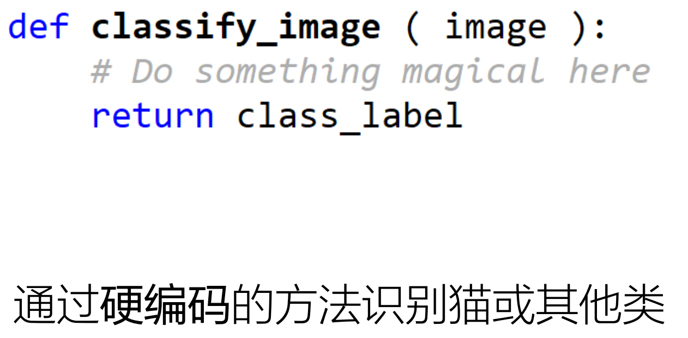

举个例子：猫

最早有什么尝试呢？🤔

👉我对这张图提取一个边缘，然后我去记录图像上每一个边缘点是往哪里走的，然后把这些走向变为一种规则。但是我们遇到那些躺着、卧着、站着的猫，这套系统能工作吗？不能！

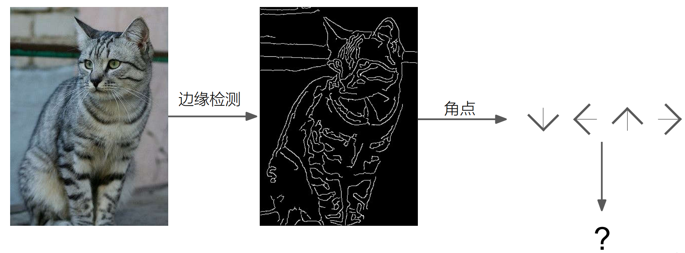

> 所以直观来看，通过`硬编码`的方法识别猫或其他类，是一件**很困难**的事。
>
> 我们现在更常用的是`数据驱动`的方法👇


## 什么是`数据驱动`的图像分类范式？

### 数据驱动的图像分类的`系统设计`步骤

1. `数据集构建`：我要识别猫，我就要找到一堆猫的图片，然后打上标签🐱。我还找到一堆狗的图片，然后打上标签🐕

   从数据集的角度来看，我们可以把机器人的学习分为：

   - `有监督`：每个图片都是有标签的，将来我要从图片与标签的关系里面去学到这种内容与标签之间的关系（图像识别更倾向于这种）
   - `无监督`：有一类数据集，有很多数据但是没有标签，那我们更多的希望从数据里去找一些规律，这种就是无监督

2. `分类器设计与学习`：我要从数据中去归纳出规律。步骤：
   
   - 找一个数学模型（就是分类器）
   - 有了数学模型以后，从数据中把数学模型中未知的参数填上
3. `分类器决策`：我们最终的目标就是能用这个模型对未知的图像进行决策


### 核心步骤：分类器设计与学习

我们需要设计的是：图像表示、分类模型、损失函数、优化算法

- `图像表示`：我们要把输入的图像设计为能够被算法接受的形式。

  我输入的可以是一个图像，也可以是一个三维矩阵（RGB），那么算法需要的是图像还是三维矩阵呢？

- `分类模型`：我要选择一个分类模型来对模型进行预测。

  但是无论这个分类模型是好的还是坏的，他都会输出一个`预测值`

  👇

- `损失函数`：我们需要把`预测值`与`真实值`通过`损失函数`进行比较，然后输出一个`损失值`

  `损失值`：反映了当前分类器的性能的好坏。因为随便一个模型都可以用于预测，只是预测的好与坏的程度，决定了这个模型能不能用。那么损失值就是用于评估这个分类模型做的好不好

  👇

- `优化算法`：如果我们得到一个不好的模型，我们就要更新这个模型的参数，那么谁来更新呢? -> 优化算法

  `优化算法` 看到这个 `损失值` 后，通过调整这个参数来让损失值下降，这就是优化算法做的事。

  优化算法输出是一组新的模型参数。

  我们希望新的模型参数比上一次的模型参数更好一些，**预测值与真实值之间的差异越来越小**

> 这几个步骤会一直进行循环，直到这个分类器的性能损失下降到一定程度时，我们就认为这个分类器达到我们的需求

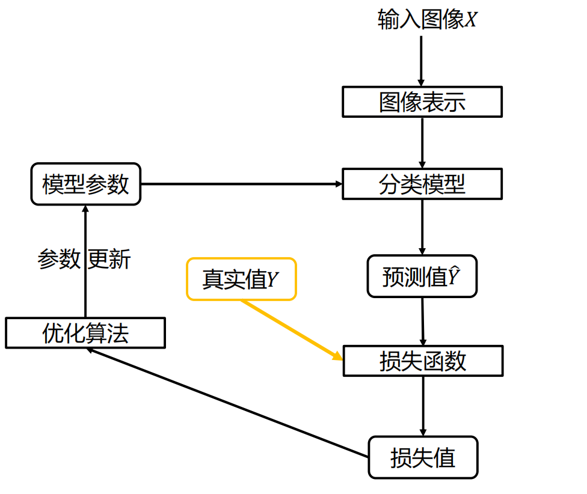

实际使用：`决策`

我们训练好一个分类器后，就需要进行`决策`，也就是模型的部署使用

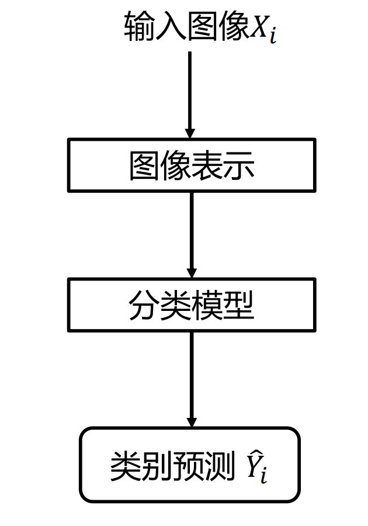

#### 图像表示

1. `像素表示`

   即使用RGB三维矩阵来表示，假如一张图像的像素是300*300，那么这个三维矩阵就是300\*300\*3

2. `全局特征表示`（如GIST）

   `全局特征`：特征计算过程中要依赖所有的像素，一旦测试样本出现了遮挡而训练样本没有时，特征就会丢失一部分，计算的时候这个特征就可能与原来全局计算的特征不太一样

   因为像素维度还是太高了，那么我们能不能从图像中抽取一个特征来表示整图呢？

   GIST：从图像上抽取一些频率的特征。它把图像均分为16块（假设），每一块抽出一些频率表示，把这些特征连起来变为一个长的特征向量（适用于风景类，室内场景，城市建筑等大场景的分类。但是对于猫狗不合适，因为猫狗是属于局部特征表示）

3. `局部特征表示`（如SIFT特征+词袋模型）

   从图像中抽取出100个有典型意义的区块，然后用这个区块来表示整图。这个时候即使有几个区块被遮挡住了，影响也不大

   比如我用眼睛、鼻子、嘴巴来描述人脸，即使我的眼睛左眼被挡住了，我还有一个右眼、鼻子、嘴巴

> [!NOTE]
>
> 在这门课程中，我们要说的是`像素表示`
>
> 神经网络强调的是`结构设计`，它把特征提取和分类集成到一起了。所以不在乎你的图像有没有特征或被特征提取过，你可以把图像直接输给神经网络就好了，神经网络就可以做后面的事情

#### 分类器

> 我们要理解每个分类器的强项是什么，理解它的原理，可以对其进行改造以适应我们的任务

- 近邻分类器
- 贝叶斯分类器
- 线性分类器
- 支撑向量机分类器
- 神经网络分类器
- 随机森林

#### 损失函数

- 0-1损失
- 多类支撑向量机损失
- 交叉熵损失

#### 优化算法

损失值反应了损失函数不行的程度，所以我们要根据损失值来调整模型参数，希望我的模型下一次预测值的的损失值越小越好

- 一阶方法
  - 梯度下降
  - 随机梯度下降
  - 小批量随机梯度下降
- 二阶方法
  - 牛顿法
  - BFGS
  - L-BFGS

#### 训练过程

- 数据集划分

- 数据预处理

- 数据增强

- 欠拟合与过拟合

  - 减小算法复杂度
  - 使用权重正则项
  - 使用droput正则化

- 超参数调整

  超参数：模型设计阶段需要指定的一些参数。神经网络是由神经元组成的，神经元个数就是我需要设计的，我们设计好了这个神经网络才能去学习。那么这个神经个数就是一个超参数，怎么设计合理是我们需要考虑的

  参数：样本里的参数【】

- 模型集成：用多个模型来让系统的性能更好

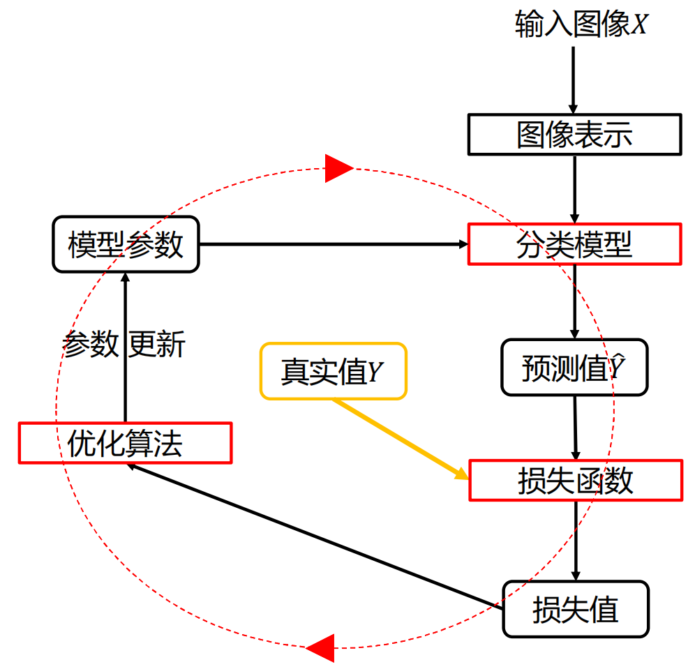


### 图像分类任务的评价指标

- `正确率` = 分对的样本数/全部样本数
- `错误率` = 1 - 正确率

#### Top1指标与Top5指标

- `Top1 准确率`：对于一张图像，**模型可能会预测出多个候选标签**，并且这些标签通常会按照**置信度从高到低排序**。Top-1 只看模型预测的第一个标签，也就是置信度最高的标签，是否和真实标签一致。

  例如一张图像的真实类别是“狗”。如果模型预测的第一个标签是“狗”，那么这次预测就是正确的；如果模型第一个标签预测成“猫”，即使后面的标签里包含“狗”，在 Top-1 评价中也算错误。

- `Top5 准确率`：对于一张图像，模型会给出置信度最高的前 5 个预测标签。只要这 5 个标签里面有一个和真实标签一致，就认为这次预测是正确的。

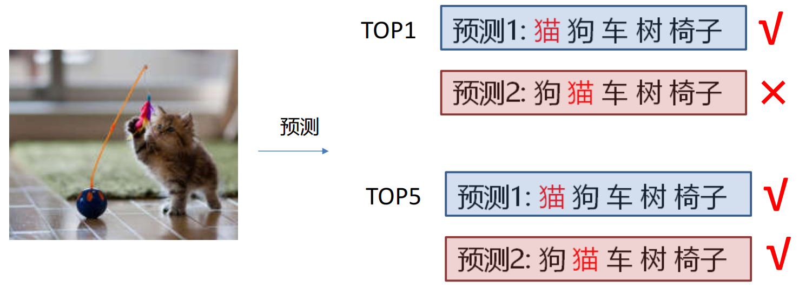


# 线性分类器

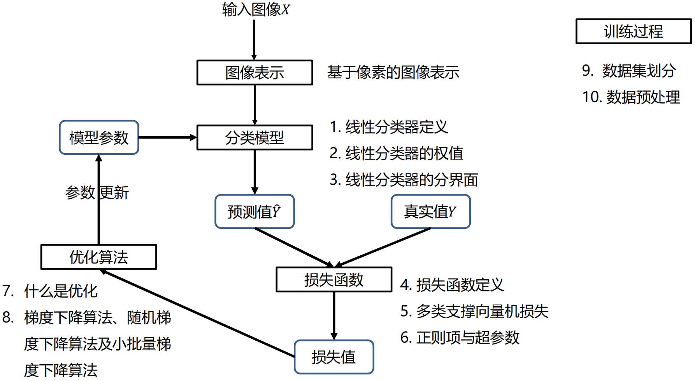


## 图像类型

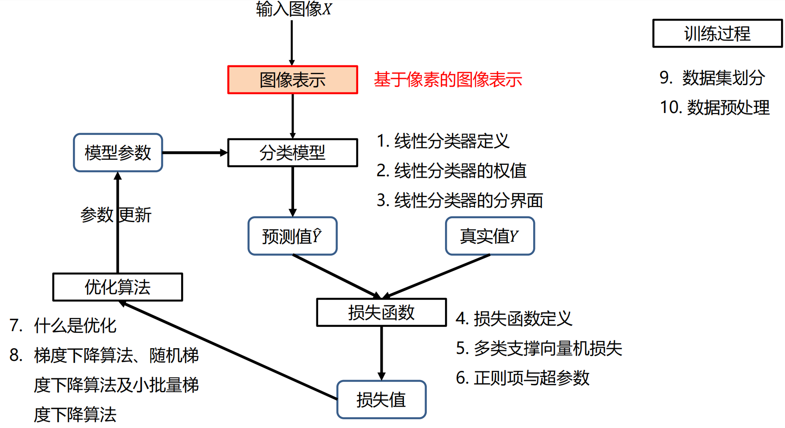

图像分为三类：

1. 二进制图像：要么黑，要么白

   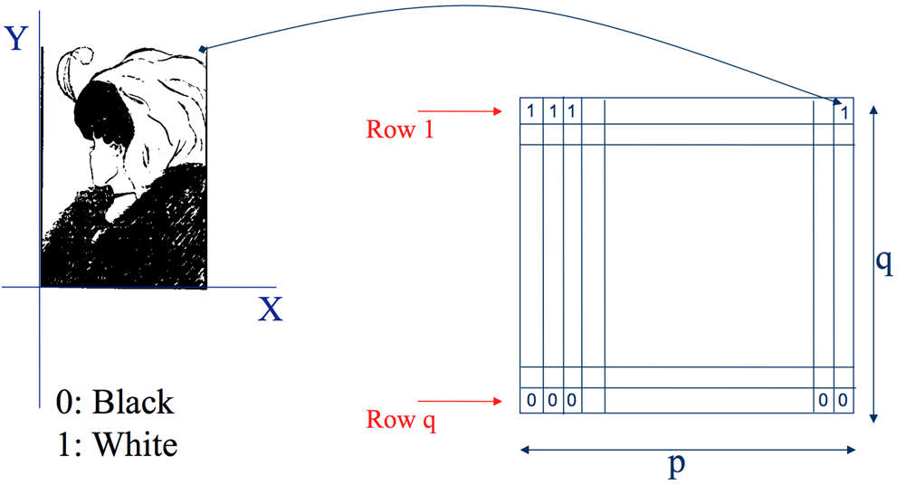

2. 灰度图像：一个像素由一个byte表示，所以取值范围为0~255（256种可能）

   最黑是0，最白是255

   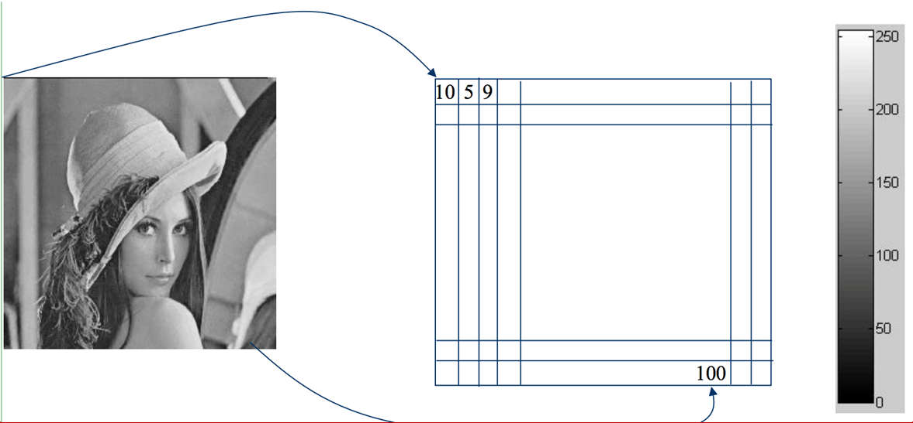

3. 彩色图像：一个像素由R,G,B表示，R,G,B分别用一个byte表示，也就是一个像素用3个byte表示

   比如下面这张图的像素是500\*500，那么因为有RGB三个通道，每个通道都是500\*500的像素，所以这张RGB图的表示是500\*500\*3（宽500，高500，深3）

   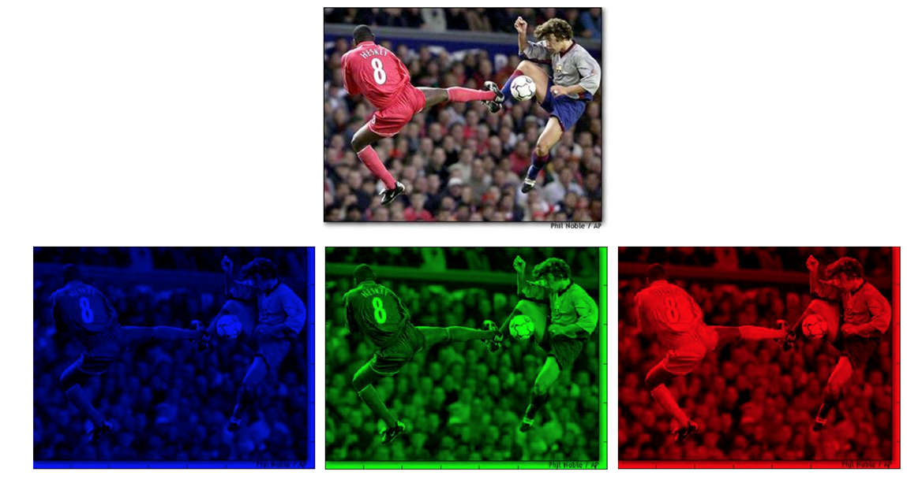

## 图像表示

> [!NOTE]
>
> 大多数分类算法都要求输入`向量`！

将图像转换成向量的方法有很多，这里我们用一种最简单的方法，**直接将图像矩阵转换成向量**

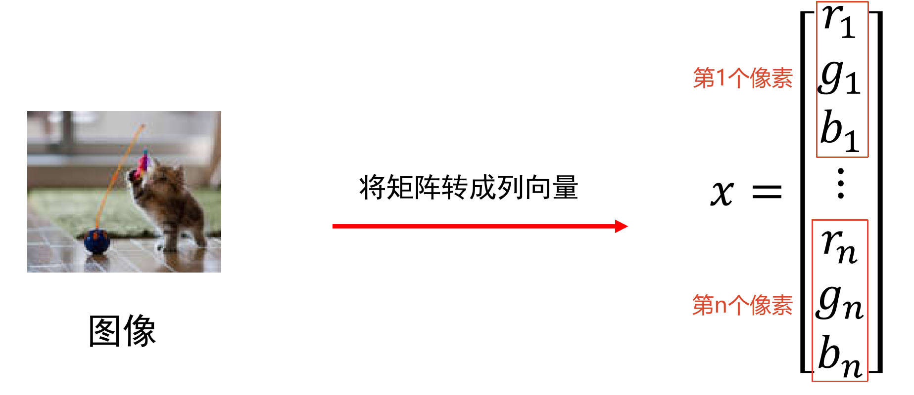

举个例子：已知`CIFAR10`中每一张图像的像素都是**32*32**，而且每张图像都是RGB图，那么CIFAR10中每一张图像转换为向量是多少维？

因为每张图像的像素是32\*32，而且是RGB图，所以答案是32\*32\*3=3072维

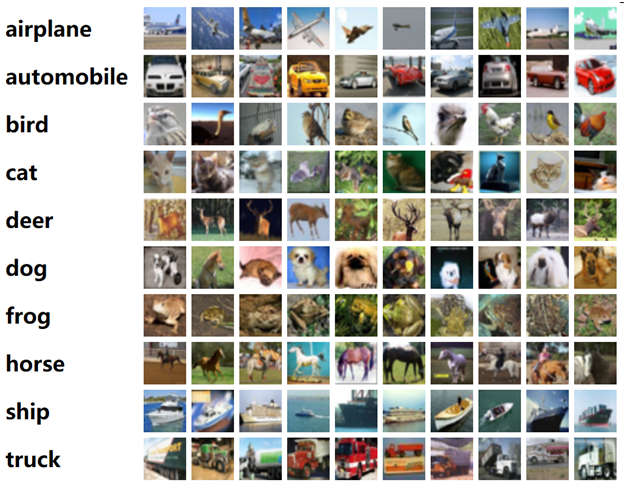


## 分类模型选择

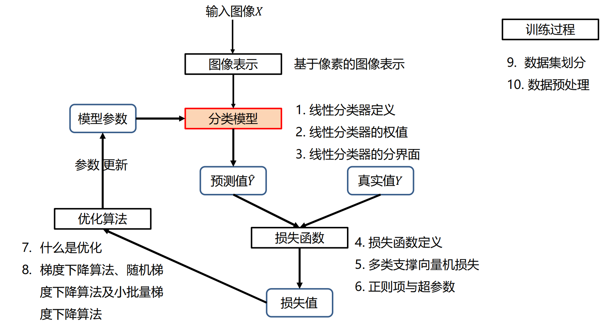

> [!IMPORTANT]
>
> 线性分类器的优点
>
> - 形式简单、易于理解
>
> - 通过层级结构（`神经网络`）或者高维映射（`支撑向量机`）可以形成功能强大的非线性模型，也就是说：
>
>   <p style="color: red; text-align: center;">
>     线性分类器是神经网络的基础，也是支撑向量机的基础
>   </p>


## 什么是线性分类器？

> `线性分类器`是一种线性映射，将输入的图像特征映射为类别分数。
>
> <div style="text-align: center; line-height: 1.8;">
>   <div>输入图像 X（3072 维向量）</div>
>   <div>↓</div>
>   <div>线性转换</div>
>   <div>↓</div>
>   <div>1 个类别标签</div>
>   <br>
>   <div>
>     这个转换过程是线性的，因此称为<strong>线性分类器</strong>
>   </div>
> </div>

### 线性分类器定义

我们先来看这个具体的数学描述：

我们设定 $x$代表输入的 $d$维图像即$x=\begin{bmatrix}x_1&x_2&\cdots&x_d\end{bmatrix}^T$，$c$为类别个数（例如 CIFAR-10 有 $c=10$ 类），则：

$$
f_i(x,w_i)=w_i^Tx+b_i
\\
\mathrm{i}=1,\cdots,c
$$
其中

- $f_i$：第 $i$ 个类别的分类分数

- $w_i=\begin{bmatrix}w_{i1}&\cdots&w_{id}\end{bmatrix}^T$：第$i$个类别的权值向量，$d$表示每个$w_i$都是一个$d$维向量
- $b_i$：第 $i$ 个类别对应的偏置

也就是说，每一个类别都有一套自己的参数：
$$
w_i=
\begin{bmatrix}
w_{i1} \\
w_{i2} \\
\vdots \\
w_{id}
\end{bmatrix},
\quad
b_i
$$
可以理解为：

> $w_i$ 用来衡量输入图像 $x$ 和第 $i$ 个类别有多匹配，
> $b_i$ 用来整体调整第 $i$ 个类别的分数。

> [!NOTE]
>
> `决策规则`：
>
> 如果 $f_i(x)>f_j(x),\quad\forall j\neq i$，则决策 输入图像$x$ 属于 第$i$类

### 线性分类器示例

**任务**：为图片分配类别标签（汽车类、猫类、鸟类）。即我们已知图片，假设我也已经有线性分类器了，我们怎么决策呢？

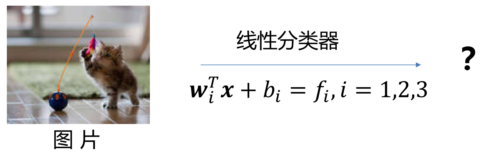

步骤：

1. 图像表示成向量。假设图像只包含4个像素，把这个图像的像素展开为一个向量，即

   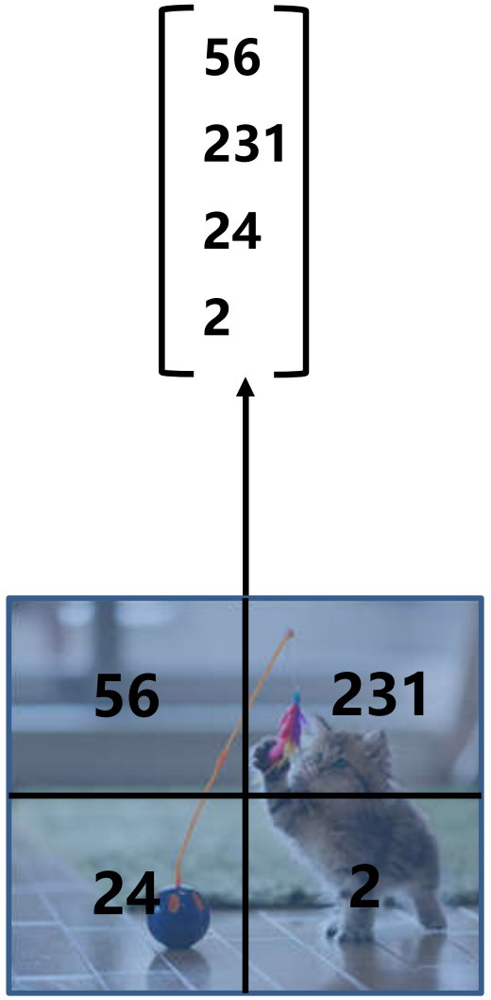

2. 计算当前图片每个类别的分数

   > 对应类别的权值 * 图像像素展开得到的向量 + 偏移 = 得分
   >
   > 那么这样我们就得到了一个`分数向量`，每一项都代表了对应类的得分

   

3. 按类别的分判定当前图像

   在这里，我们得到的这个`图像对应猫类`的分数最高，所以这个线性分类器输出的就是猫类

   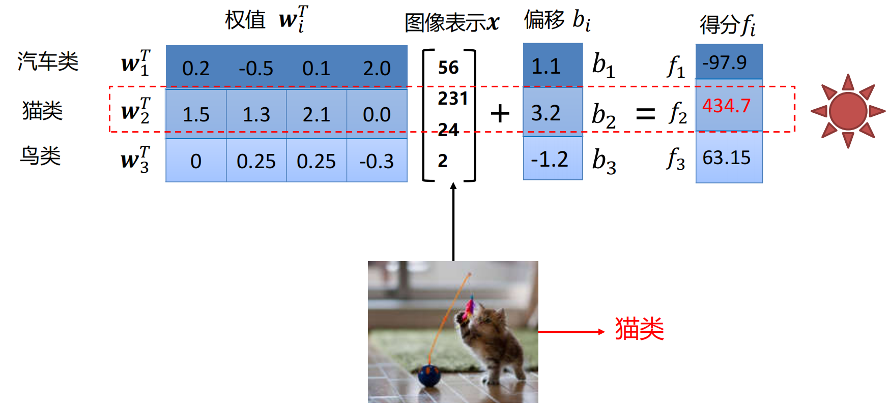


### 线性分类器的矩阵表示

通过观察我们可以注意到：

- 权值矩阵$W$：**行数**由`类别`决定，**列数**由`图像表示（图像的像素向量）`决定

- 偏移向量$b$：**行数**由`类别`决定

- 得分向量$f$：**行数**由`类别`决定

- **问题：CIFAR10 数据集分类任务的分类器，$W$，$x$，$b$ 的维度是多少？**

  回答：CIFAR10有**10个类别**且**图像大小为32x32x3**，因此:

  $x$ 是图像向量，其维度为3072维；

  $W$ 是权值矩阵，其维度为10x3072；

  $b$ 是偏置向量，其维度为10x1的向量；

  $f$ 是得分向量，其维度为10x1的向量；

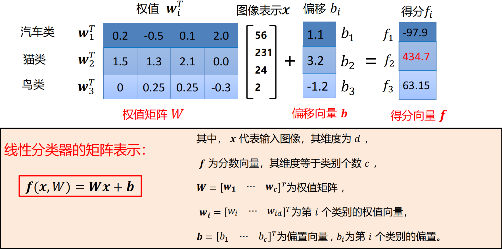


### 线性分类器的权值向量（从权值角度理解）

🤔线性分类器的 权值矩阵$W$ 到底是个什么？这个 $W$ 的含义是什么?

- 权值看做是一种模板
- 输入图像与评估模板的匹配程度越高，分类器输出的分数就越高


### 线性分类器的分界面（从几何角度理解）

🤔分类问题的`本质`是什么？

假设我们把图像表示为2维向量（2维特征），分类问题就是希望找一些`决策面`，把这个图像给分开为好几个类别。

因为是 **线性分类器**，所以 **决策面**就是`线性`的

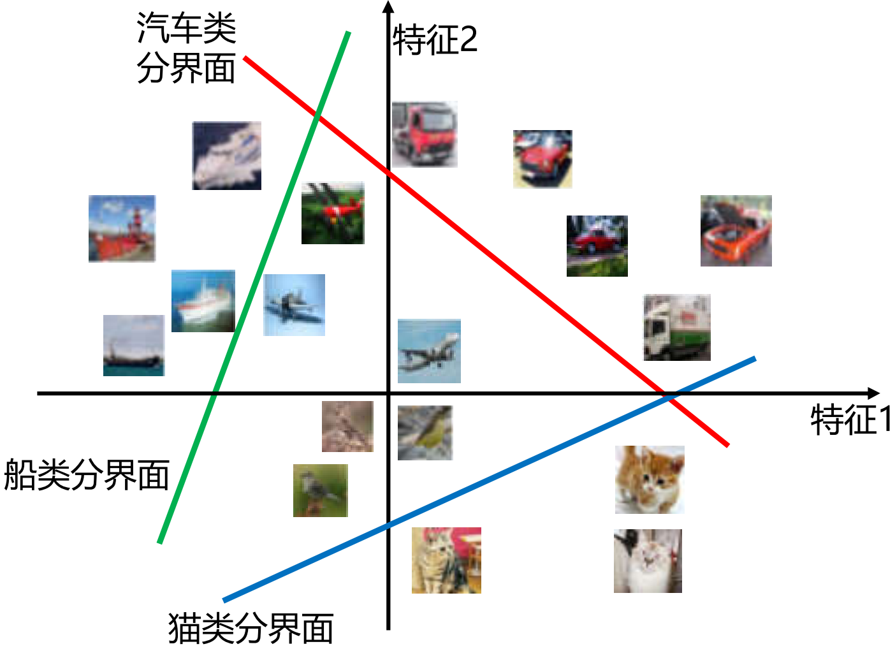


# 损失函数

现在我们讨论线性分类器模型，之前的模型我们得到的是$W$和$b$，我就可以计算对应类别的分数。

🤔那么这个$W$和$b$好或不好，我们应该怎么办？我们总是需要一个东西去度量，所以需要`损失函数`，然后我们还需要学习，那就需要`优化算法`

## 损失函数的定义

### 如何衡量分类器对当前样本的效果好坏？

如图，我有两个分类器，分别得到一个正确的结果与一个错误的结果，那么人眼看，肯定是：**分类器1的性能>分类器2的性能**

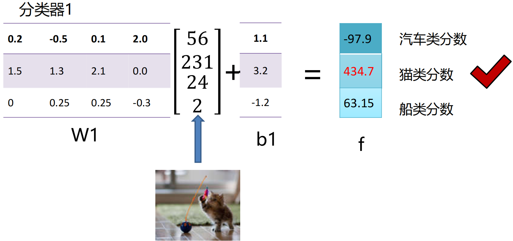

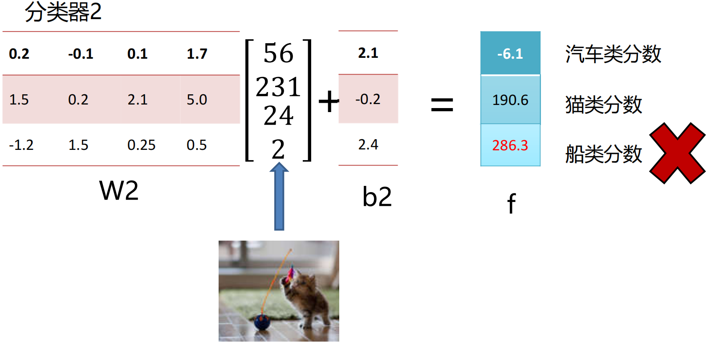

问题来了：机器人怎么去看到这个效果呢？如何定量表示呢？


### 什么是损失函数？

损失函数搭建了模型性能与模型参数之间的桥梁，指导模型参数优化。

- `损失函数`是一个函数，用于度量给定分类器的预测值与真实值的不一致程度，其`输出`通常是一个`非负实值`。

- 其输出的非负实值可以作为`反馈信号`来对分类器参数进行调整，以**降低当前示例**对应的`损失值`，**提升**分类器的`分类效果`。

损失函数的一般定义：
$$
L=\frac{1}{N}\sum_iL_i\left(f(x_i,W),y_i\right)
$$
其中:

- $x_i$：数据集中**第$i$张图片**；
- $f(x_i,W)$：分类器对$x_i$的类别预测；
- $y_i$为样本 $i$ 真实类别标签(整数);
- $L_i$为第 $i$ 个样本的损失当预测值；
- $L$为数据集损失，它是数据集中所有样本损失的平均。


## 多类支撑向量机损失（`折页损失`）

因为每一个样本在每一个类别下都各有一个分数，我们来展开讨论的话，对于第$i$个样本中第$j$个标签：
$$
s_{ij}=f_j\left(x_i,w_j,b_j\right)=w_j^Tx_i+b_j
$$
其中：

- $y$：样本标签

- $j$：类别标签，取值范围$\{1，2，...，c\}$；
- $w_j,b_j$：第j个类别分类器的参数；
- $x_i$:表示数据集中的第$i$个样本
- $s_{i,j}$：第$i$个样本第$j$类别的预测分数


**第i个样本的多类支撑向量机损失定义如下**：
$$
\begin{aligned}L_{i}&=\sum_{j\neq y_i}\begin{cases}0&\quad ifs_{y_i}\geq s_{ij}+1\\s_{ij}-s_{y_i}+1&\quad otherwise&\end{cases}\\&=\sum_{j\neq y_i}\max(0,s_{ij}-s_{y_i}+1)\end{aligned}
$$
其中：

- $j\neq y_i$：表示不考虑自己（自己跟自己做什么比较呢？肯定是没有损失，也就是损失是0）

- $s_{y_i}$：第$i$个样本真实类别的预测分数（即如果样本是狗，那么$s_{y_i}$就是狗类对应的分数）

- $s_{y_i}\geq s_{ij}+1$：表示 第$i$个样本真实类别的预测分数 **必须大于等于** 第$i$个样本其他类别的预测分数+1

  - 结果等于0，这时候就认为没有损失！
  - 这里1代表一个边界，让其他样本类别的分数不要靠近真实样本的分数。比如真是类别是狗的情况下，图片的狗类得分是0.5，猫类得分是0.4，那么这个模型还是不行的

- 其实对应的函数图就是：

  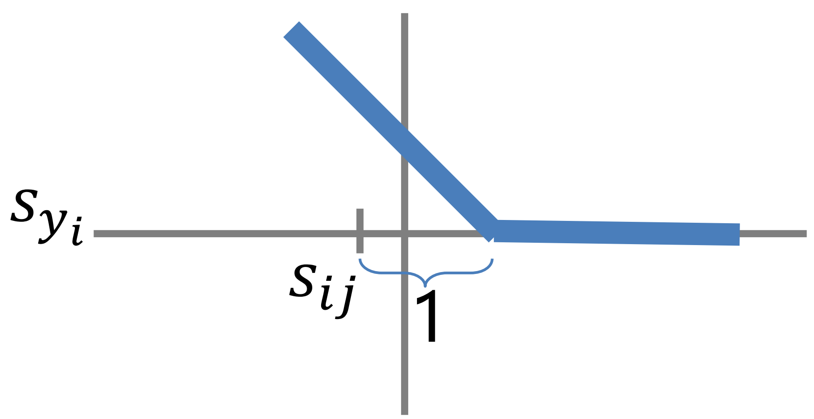

**举个例子**：假设有3个类别的训练样本各一张，分类器是线性分类器$f(x,W)=Wx+b$，其中权值$W$，$b$已知，分类器对三个样本的打分如下，计算各个样本的LOSS值

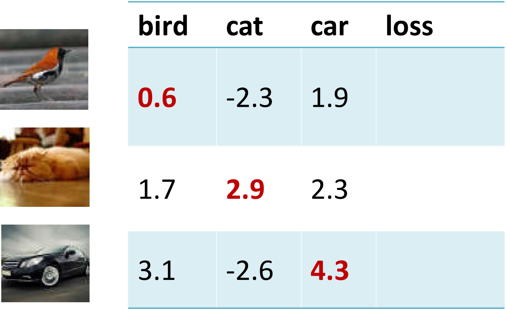

当前分类器对于鸟这张图像的损失：
$$
\begin{aligned}L_{i}
&=
\sum_{j\neq y_i}\max(0,s_{ij}-s_{y_i}+1)\\
&=
\max(0,-2.3-0.6+1)+\max(0,1.9-0.6+1)\\
&=
\max(0,-1.9)+\max(0,2.3)\\&=0+2.3\\&=2.3\end{aligned}
$$
说明：

- 首先是cat与bird做比较，因为cat得分为-2.3，而bird得分为0.6，此时就认为没有损失！
- 然后是car与bird做比较，因为car得分为1.9，而bird得分为0.6，此时就认为有损失，损失值为$1.9-0.6+1=2.3$
- 然后损失值相加，得到 $0+2.3=2.3$，也就是最终损失值是2.3
- 按照这样的步骤，我们分别得到：
  - 图1损失值：2.3
  - 图2损失值：$0+0.4=0.4$
  - 图3损失值：$0+0=0$

- 得到 `当前分类器对于整个数据集图像的损失`：（整个数据集损失的平均值）
  $$
  L=\frac{1}{N}\sum_{i=1}^NL_i
  $$
  带入公式，得：
  $$
  L=(2.3+0.4+0)/3=0.9
  $$


## 正则项与超参数

### 再谈损失函数

> **如果某组参数 $W$ 能让训练损失 $L(W)=0$，那这组 $W$ 是唯一的吗？**
>
> 答案是：**一般不唯一。**

- 公式是：
  $$
  L(W)=\frac{1}{N}\sum_i L_i(f(x_i,W),y_i)
  $$
  其中：

  - $W$：模型参数，比如神经网络里的权重。
  - $x_i$：第 $i$ 个训练样本。
  - $y_i$：第 $i$ 个样本的真实标签。
  - $f(x_i,W)$：模型对 $x_i$ 的预测。
  - $L_i$：第 $i$ 个样本的损失。
  - $L(W)$：整个训练集上的平均损失。

  如果 $L(W)=0$，通常表示：**模型在训练集上完全拟合了所有样本**。但这不代表 $W$ 唯一。

- **举个例子**：示例：假设两个线性器分类$f_1(x,W_1)=W_1x$，$f_2(x,W_2)=W_2x$，其中，$W_2=2W_1$。对于下面图像已知分类器1的打分结果(如表所示),请计算分类器2的打分结果，以及两个分类器对当前样本的多类支撑向量机损失：

  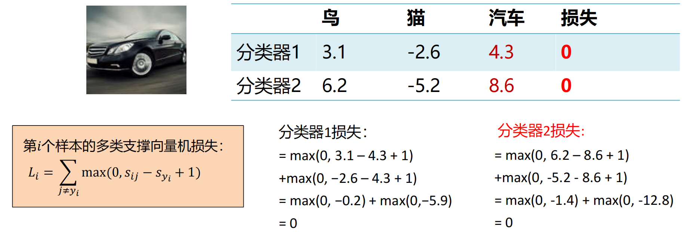

  我们发现在这个例子中，`分类器1损失`与`分类器2损失`都是0，但是此时 参数$W$ 并不是一样的

  > 🤔问题来了，我应该选择 参数$W_1$ 还是 参数$W_2$呢？
  >
  > 答案：引入`正则项`


### 正则项

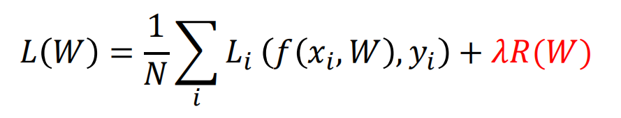

#### 数据损失（上面所说的损失函数）

> 评价 分类器 在样本上的表现

- 在刚才的例子中，我们得到 `分类器1` 与 `分类器2` 的数据损失都是0

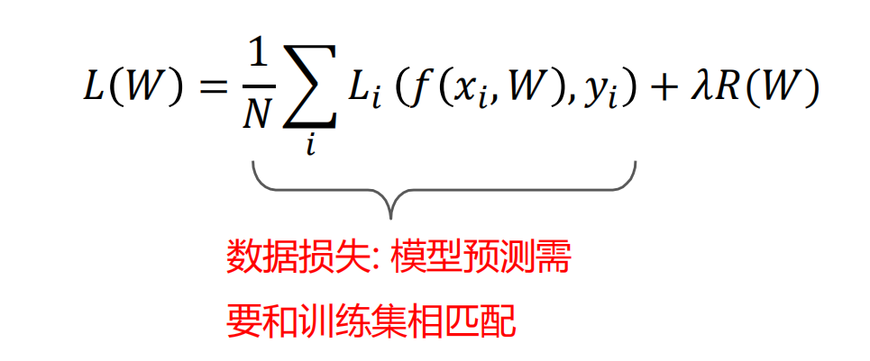

#### 正则项损失

> 评价 模型参数

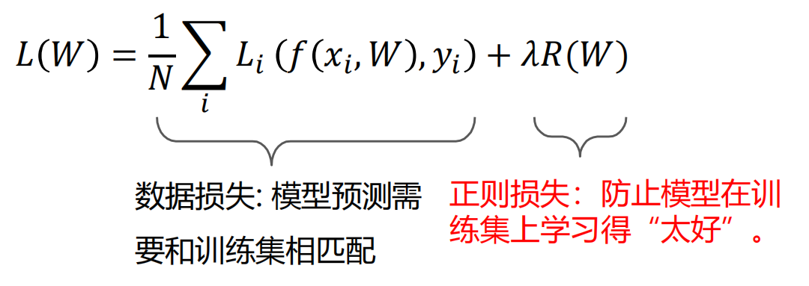

其中：

- $\lambda$：是一个`超参数（在开始学习过程之前设置值的参数，而不是通过学习得到的）`，控制着正则损失在总损失中所占的比重

- $R(W)$：是一个与权值$W$有关，跟图像数据无关的函数


### 超参数

- 概念：在开始学习过程之前设置值的参数，而不是学习得到。
- 超参数一般都会对模型性能有着重要的影响。

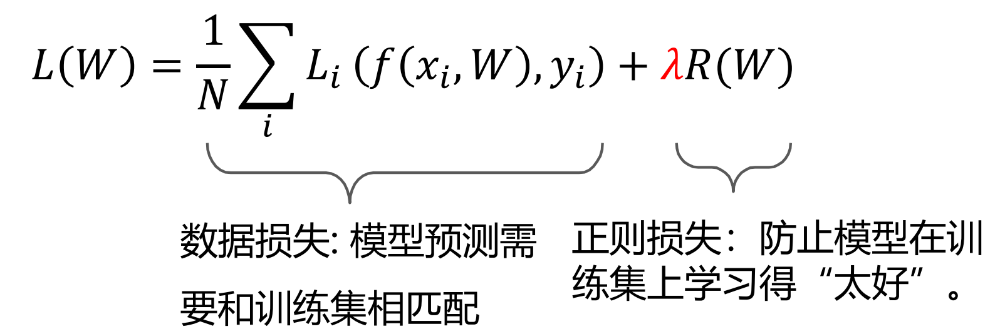

其中：

- $\lambda=0$：表示优化结果仅与数据损失相关
- $\lambda=\infty$：表示优化结果与数据损失无关，仅考虑权重损失。此时，系统最优解为 $W=0$。


### L2正则项

- 公式：
  $$
  R(W)=\sum_k\sum_lW_{k,l}^2
  $$
  其中：

  - $W_{k,l}$：表示第 $k$ 行、第 $l$ 列的那个权重。
  - $\sum_k\sum_l$：把矩阵里面每一个元素都拿出来平方，再全部加起来。
  - **为什么叫`L2`？** 因为它实际上就是权重矩阵的 **平方的 L2 范数**。

- 举个例子：

  - 条件：样本：$x=[1,1,1,1]$，分类器1：$W_1=[1,0,0,0]$，分类器2：$W_2=[0.25,0.25,0.25,0.25]$，$\lambda=1$

  - 代入损失函数公式 $L(W)=\frac{1}{N}\sum_iL_i\left(f(x_i,W),y_i\right)+\lambda R(W)$ 得到：

    分类器输出：$$W_1^Tx=W_2^Tx=1$$（也就是说对于**这两个分类器**而言，在该样本上`数据损失`是一样的 ）

    正则损失：$\mathrm{R}(w_1)=1\quad\mathrm{R}(w_2)=0.25$（那么这个时候谁的正则项小，我就取谁，但是有什么物理含义呢？🤔）

  - **探讨正则损失的物理含义**

    在上面我们列出了两组权值 $W_1=[1,0,0,0]$ 与 $W_2=[0.25,0.25,0.25,0.25]$，

    $W_2$意义在于让$x$的每一维都参与运算来得到最后的结果，而$W_1$只关注了第一维的特征

    这就会引出一个问题：在真实过程中，我的传感器设备得到的数据的低维度不准确的情况下，$W_1$就容易出错，而$W_2$考虑了全部维度的特征，那么$W_2$的容错率更高。

  > [!IMPORTANT]
  >
  > `L2正则项损失`：我不光让我的损失能够选出唯一解，同时让这个解尽量的去考虑所有的特征，**让我的模型有了一定的偏好（偏好权值比较分散！）**

- 所以正则项解决了2个问题:
  1. 让解唯一
  2. 让我们去选择 权值$W$ 时有一定的`偏好性`。在所有可选的$W$里面，我可以选择对我现在所做的事情最有利的那一组权值


### 常用的正则项损失

L1正则项：$R(W)=\sum_k\sum_l|W_{k,l}|$

L2正则项：$R(W)=\sum_k\sum_lW_{k,l}^2$

弹性网络正则项Elastic net(L1+L2):$R(W)=\sum_k\sum_l\beta W_{k,l}^2+|W_{k,l}|$


# 优化算法

我们现在有了`损失函数`，能够准确地定量地度量预测值与真实值之间的关系，算出来的结果就叫做`损失值`。

🤔假设现在`损失值`很大，我们应该怎么去调整模型呢？我们不可能初始一设置一组权值，就能让这个模型分类性能很好。我随机给模型一组权值，通常结果并不好。那么我们就需要有东西来帮我调整这些参数

## 什么是参数优化

> `参数优化`是机器学习的核心步骤之一，它`利用损失函数`的输出值`作为反馈信号`来`调整分类器参数`，以提升分类器对`训练样本`的`预测性能`。
>
> - **优化算法目标**：损失函数$L$是一个与参数$W$有关的函数，优化的目标就是找到使损失函数$L$达到最优的那组参数$W$。
>
>   直接方法：$\frac{\partial L}{\partial W}=0$（当然还要区分`局部极小点`，`局部极大点`，`鞍点`）
>
>   通常，$L$形式比较复杂，很难从这个等式直接求解出$W$！

## 梯度下降算法

假设 特征$W$维度是1，损失值$L$与特征$W$的函数如图：（`二维`）

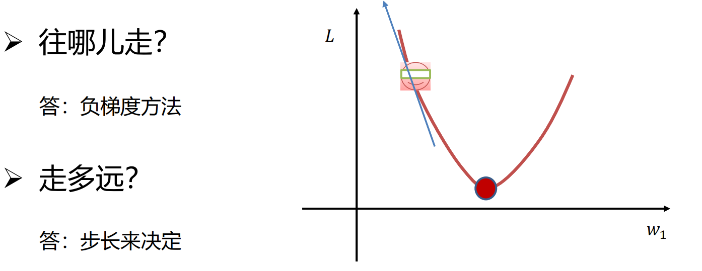

假设 特征$W$维度是2，损失值$L$与特征$W$的函数如图：（`三维`）


所以：

> `梯度下降`: 利用所有样本计算损失并更新梯度
>
> ```
> while True:
> 	权值的梯度 = 计算梯度(损失, 训练样本, 权值)
> 	更新后的权值 = 当前权值 – 学习率 * 权值的梯度
> ```


## 梯度计算

### 数值法（计算量大，不精确）

一维变量，函数求导：
$$
\frac{dL(w)}{dw}=\lim_{h\to0}\frac{L(w+h)-L(w)}{h}
$$
**示例**：损失函数 $L(w)=w^2$ 求$w=1$点处的梯度
$$
\frac{dL(w)}{dw}=\lim_{h\to0}\frac{L(w+h)-L(w)}h\approx\frac{L(1+0.0001)-L(1)}{0.0001}=2.0001
$$


### 解析法（精确，速度快，导数函数推导易错）

示例：损失函数 $L(w)=w^2$ 求$w=1$点处的梯度

$$
\nabla L(w)=2w
\\
\nabla_{w=1}L(w)=2
$$


> [!NOTE]
>
> **数值梯度有什么作用？**
>
> 答：求梯度时一般使用解析梯度，而数值梯度主要用于解析梯度的正确性校验（梯度检查）。


### 梯度下降算法的计算效率

> `梯度下降`: 利用所有样本计算损失并更新梯度
>
> **当N很大时，权值的梯度计算量很大！**

$$
\begin{aligned}&L(W)=\frac{1}{N}\sum_{i=1}^NL_i(x_i,y_i,W)+\lambda R(W)\\&\nabla_WL(W)=\frac{1}{N}\sum_{i=1}^N\nabla_WL_i(x_i,y_i,W)+\lambda\nabla_WR(W)\end{aligned}
$$

```
while True
	权值的梯度 ← 计算梯度(损失, 训练样本, 权值)
	权值 ← 权值 – 学习率 * 权值的梯度
```

所以我们就提出`随机梯度下降算法`


### 随机梯度下降算法

> [!NOTE]
>
> `随机梯度下降`: 每次随机**选择一个样本$x_i$**，计算损失并更新梯度
>
> 🤔那么每次都是指选一个样本，如果这个样本是一个噪声，那么是不是会带偏这个梯度（本来是梯度下降变成了梯度上升）
>
> 👉会。每次采的样本会指引函数向各个方向走，但是大量的样本会让我们的整体趋势是向下走的

$$
\begin{gathered}L(W)=L_i(x_i,y_i,W)+\lambda R(W)\\\nabla_WL(W)=\nabla_WL_i(x_i,y_i,W)+\lambda\nabla_WR(W)\end{gathered}
$$

```
while True
	数据 ← 从训练数据采样(训练数据,1)
	权值的梯度 ← 计算梯度(损失, 数据, 权值)
	权值 ← 权值 – 学习率 * 权值的梯度
```


### 小批量梯度下降算法

小批量随机梯度下降: 每次随机选择$m$（批量的大小）个样本,计算损失并更新梯度
$$
\begin{aligned}&L(W)=\frac{1}{m}\sum_{i=1}^{m}L_i(x_i,y_i,W)+\lambda R(W)\\&\nabla_WL(W)=\frac{1}{m}\sum_{i=1}^m\nabla_WL_i(x_i,y_i,W)+\lambda\nabla_WR(W)\end{aligned}
$$

- iteration：表示1次迭代，每次迭代更新1次网络结构的参数；
- batch-size：1次迭代所使用的样本量；
- epoch：1个epoch表示过了1遍训练集中的所有样本。

```
while True
	数据 ← 从训练数据采样(训练数据,批量大小)
	权值的梯度 ← 计算梯度(损失, 数据, 权值)
	权值 ← 权值 – 学习率 * 权值的梯度
```


### 总结

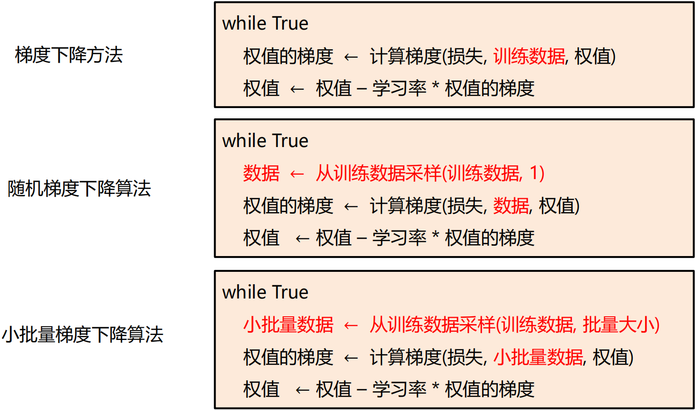


# 训练过程

## 数据集划分


## 数据预处理

