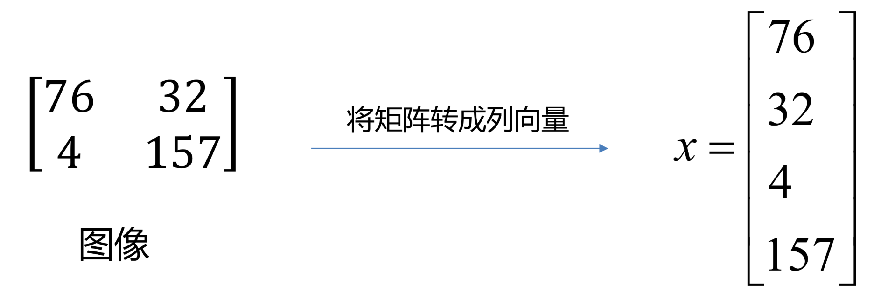

# 图像表示

如何表示图像？

直接利用原始像素作为特征，展开为列向量。

例如：cifar10中每个图像可表示为一个3072（32\*32\*3）维的向量

# 分类模型

## 多层感知器

### 回顾线性分类器

- 什么是线性分类器：
  $$
  f(x,W)=Wx+b
  $$
  其中

  - **分数向量 \(f\)**：表示输入图像在各个类别上的得分，其维度等于类别个数 \(c\)。\[ f=\begin{bmatrix} f_1 & f_2 & \cdots & f_c \end{bmatrix}^{T}\in\mathbb{R}^{c} \]

  - **输入向量 \(x\)**：表示输入图像，其维度为 输入图像的特征维度\(d\)。   \[ x=\begin{bmatrix} x_1 & x_2 & \cdots & x_d \end{bmatrix}^{T}\in\mathbb{R}^{d} \]

  - **权值矩阵 \(W\)**：行数为 类别数$c$ ，列数为 输入图像的特征维度\(d\)。

    \[ W=\begin{bmatrix} w_1 & \cdots & w_c \end{bmatrix}^{T}\in\mathbb{R}^{c\times d} \] ， 其中\(w_i\)为第\(i\)个类别的权值向量 \[ w_i=\begin{bmatrix} w_{i1} & w_{i2} & \cdots & w_{id} \end{bmatrix}^{T}\in\mathbb{R}^{d} \]

  - **偏置向量 \(b\)**：由 \(c\) 个类别的偏置组成，其中 \(b_i\) 为第 \(i\) 个类别的偏置。 \[ b=\begin{bmatrix} b_1 & \cdots & b_c \end{bmatrix}^{T}\in\mathbb{R}^{c} \]

> [!NOTE]
>
> **对于线性分类器来说，将输入图像向量化后，只需要经过一个线性变换（\(Wx+b\)），就可以得到该图像在各个类别上的预测分数，并选择分数最高的类别作为最终分类结果。**

### 全连接神经网络

> [!NOTE]
>
> 全连接神经网络 **级联多个变换** 来实现 **输入到输出的映射**。

- 两层全连接网络
  $$
  f=
  \underbrace{
  W_2
  \underbrace{
  \max\left(0,\underbrace{W_1x+b_1}_{\text{第一层仿射变换}}\right)
  }_{\text{非线性激活函数}}
  +b_2
  }_{\text{第二层仿射变换}}
  $$
  **解释：** 两层全连接网络包含两次仿射变换，并在两次仿射变换之间引入非线性激活函数，使网络具有学习非线性关系的能力。

  其中：

  - **第一层线性变换：**
    $$
    z_1=W_1x+b_1
    $$
    其中，$x$ 是输入的图像向量，经过第一层线性变换后，得到预激活向量 $z_1$。

    这里不建议将 \(z_1\) 称为类别分数向量，因为第一层的输出并不直接对应不同的类别，而是隐藏层神经元的输出（激活前）。

  - **非线性激活函数（ReLU）：**
    $$
    h=\max(0,W_1x+b_1)
    $$
    这里的 $\max$ 并不是从向量中选取最大的元素，而是将向量中的每一个元素分别与 0 取最大值，即保留正数，将负数置为 0。

    经过激活函数后，**向量的维度保持不变**，得到隐藏层特征向量 $h$。

    例如：经过 ReLU 激活函数之后，\[ h= \max\left( 0, \begin{bmatrix} -3\\ 2\\ -5\\ 4 \end{bmatrix} \right) = \begin{bmatrix} \max(0,-3)\\ \max(0,2)\\ \max(0,-5)\\ \max(0,4) \end{bmatrix} = \begin{bmatrix} {\color{red}0}\\ 2\\ {\color{red}0}\\ 4 \end{bmatrix} \]

  - **第二层线性变换：**
    $$
    f=W_2\underbrace{\max(0,W_1x+b_1)}_{\text{隐藏层特征向量}}+b_2
    $$
    将隐藏层特征向量作为第二层的输入，经过第二次线性变换，最终得到**输入图像在不同类别上的分数向量**。

- 三层全连接网络
  \[
  f=W_3{\color{red}\max}\left(0,W_2{\color{red}\max}\left(0,W_1x+b_1\right)+b_2\right)
  \]

# 全连接神经网络的权值

现在我们来解释 全连接神经网络 中的 权值模板

全连接神经网络 与 线性分类器很相似也存在 权值模板$W_1,W_2,...$ 。那么 全连接神经网络 与 线性分类器 有什么不一样呢？

我们能不能直观理解一下，全连接神经网络这种 级联线性分类器的 构架是怎么工作的？

- 在前面讲过，在线性分类器中，权值可以看作是模板。

  那么在全连接神经网络中，我们可以将 $W_1$ 也看作模板。但是这个$W_1$的行数与线性分类器有很大的不一样。

  - 线性分类器 的 权值模板$W$ 必须是固定的，因为 这里的$W$的 行数是类别数量 \(c\)，列数是输入特征的维度 \(d\)
  - 

## 激活函数

