# 线性分类器

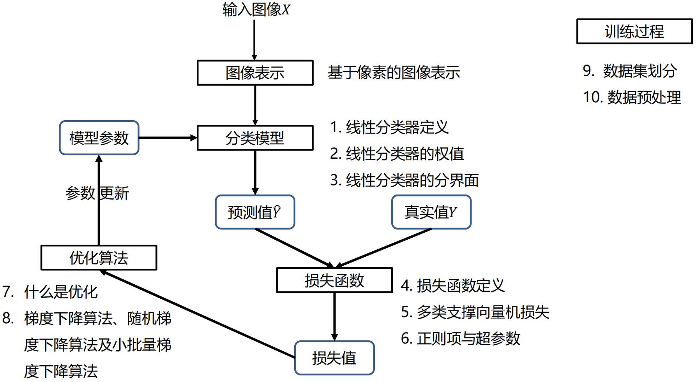


## 图像类型

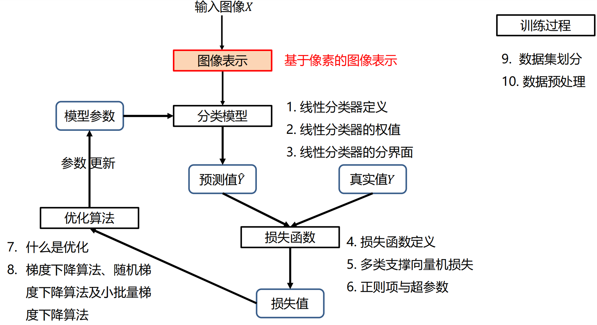

图像分为三类：

1. 二进制图像：要么黑，要么白

   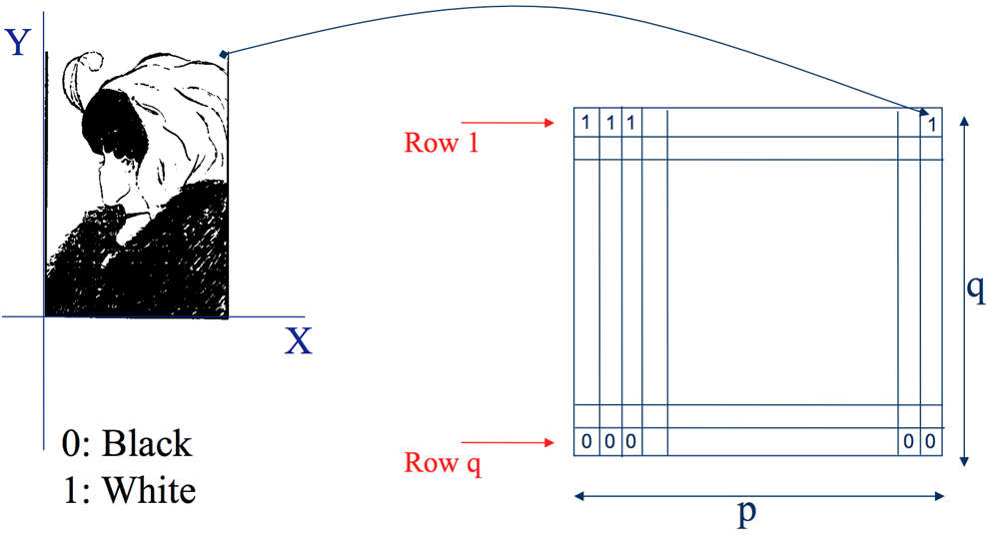

2. 灰度图像：一个像素由一个byte表示，所以取值范围为0~255（256种可能）

   最黑是0，最白是255

   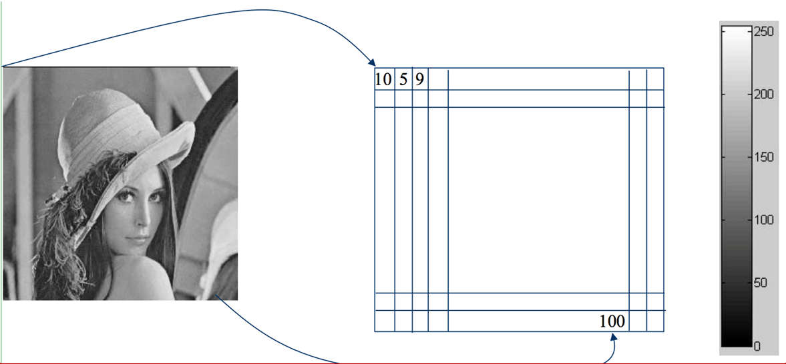

3. 彩色图像：一个像素由R,G,B表示，R,G,B分别用一个byte表示，也就是一个像素用3个byte表示

   比如下面这张图的像素是500\*500，那么因为有RGB三个通道，每个通道都是500\*500的像素，所以这张RGB图的表示是500\*500\*3（宽500，高500，深3）

   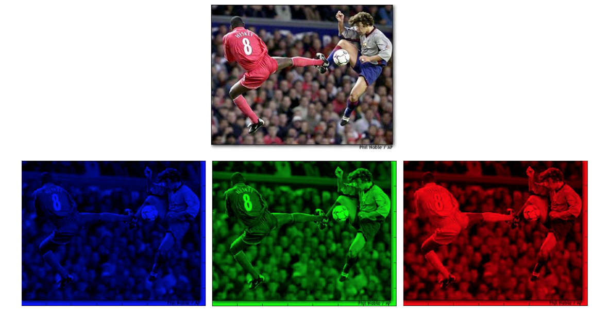

## 图像表示

> [!NOTE]
>
> 大多数分类算法都要求输入`向量`！

将图像转换成向量的方法有很多，这里我们用一种最简单的方法，**直接将图像矩阵转换成向量**

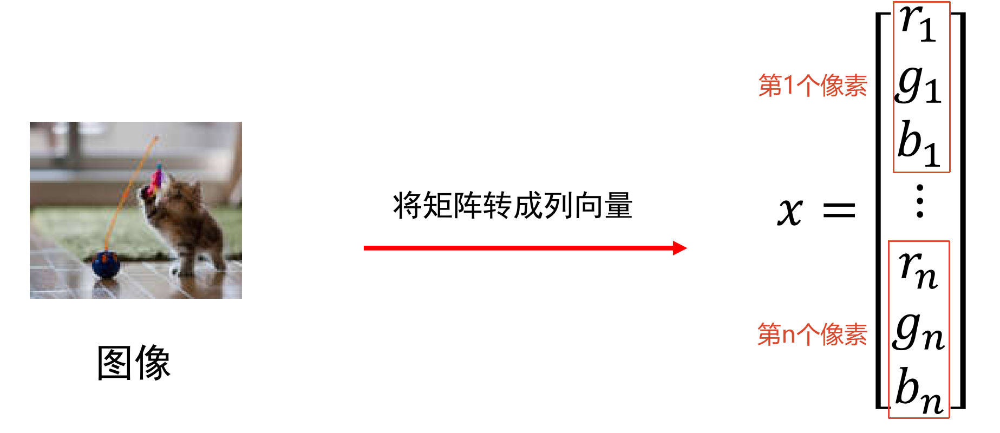

举个例子：已知`CIFAR10`中每一张图像的像素都是**32*32**，而且每张图像都是RGB图，那么CIFAR10中每一张图像转换为向量是多少维？

因为每张图像的像素是32\*32，而且是RGB图，所以答案是32\*32\*3=3072维

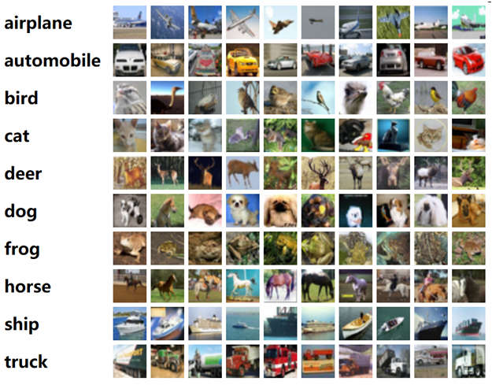


## 分类模型选择

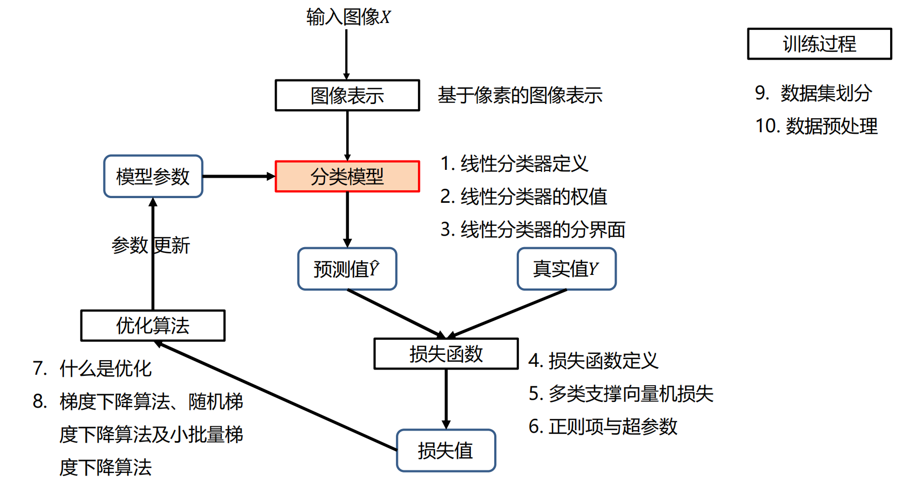

> [!IMPORTANT]
>
> 线性分类器的优点
>
> - 形式简单、易于理解
>
> - 通过层级结构（`神经网络`）或者高维映射（`支撑向量机`）可以形成功能强大的非线性模型，也就是说：
>
>   <p style="color: red; text-align: center;">
>     线性分类器是神经网络的基础，也是支撑向量机的基础
>   </p>


## 什么是线性分类器？

> `线性分类器`是一种线性映射，将输入的图像特征映射为类别分数。
>
> <div style="text-align: center; line-height: 1.8;">
> <div>输入图像 X（3072 维向量）</div>
> <div>↓</div>
> <div>线性转换</div>
> <div>↓</div>
> <div>1 个类别标签</div>
> <br>
> <div>
>  这个转换过程是线性的，因此称为<strong>线性分类器</strong>
> </div>
> </div>

### 线性分类器定义

我们先来看这个具体的数学描述：

我们设定 $x$代表输入的 $d$维图像即$x=\begin{bmatrix}x_1&x_2&\cdots&x_d\end{bmatrix}^T$，$c$为类别个数（例如 CIFAR-10 有 $c=10$ 类），则：

$$
f_i(x,w_i)=w_i^Tx+b_i
\\
\mathrm{i}=1,\cdots,c
$$
其中

- $f_i$：第 $i$ 个类别的分类分数

- $w_i=\begin{bmatrix}w_{i1}&\cdots&w_{id}\end{bmatrix}^T$：第$i$个类别的权值向量，$d$表示每个$w_i$都是一个$d$维向量
- $b_i$：第 $i$ 个类别对应的偏置

也就是说，每一个类别都有一套自己的参数：
$$
w_i=
\begin{bmatrix}
w_{i1} \\
w_{i2} \\
\vdots \\
w_{id}
\end{bmatrix},
\quad
b_i
$$
可以理解为：

> $w_i$ 用来衡量输入图像 $x$ 和第 $i$ 个类别有多匹配，
> $b_i$ 用来整体调整第 $i$ 个类别的分数。

> [!NOTE]
>
> `决策规则`：
>
> 如果 $f_i(x)>f_j(x),\quad\forall j\neq i$，则决策 输入图像$x$ 属于 第$i$类

### 线性分类器示例

**任务**：为图片分配类别标签（汽车类、猫类、鸟类）。即我们已知图片，假设我也已经有线性分类器了，我们怎么决策呢？

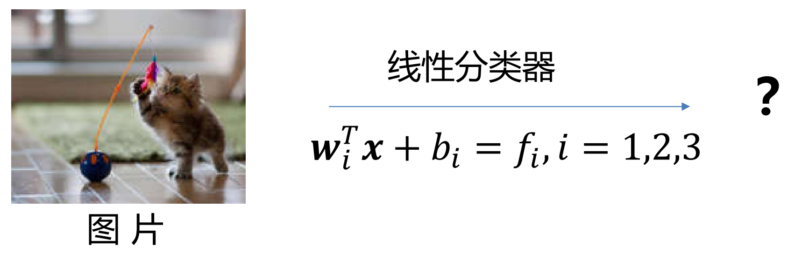

步骤：

1. 图像表示成向量。假设图像只包含4个像素，把这个图像的像素展开为一个向量，即

   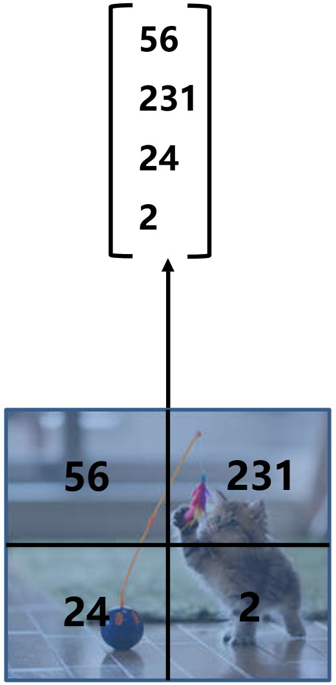

2. 计算当前图片每个类别的分数

   > 对应类别的权值 * 图像像素展开得到的向量 + 偏移 = 得分
   >
   > 那么这样我们就得到了一个`分数向量`，每一项都代表了对应类的得分

   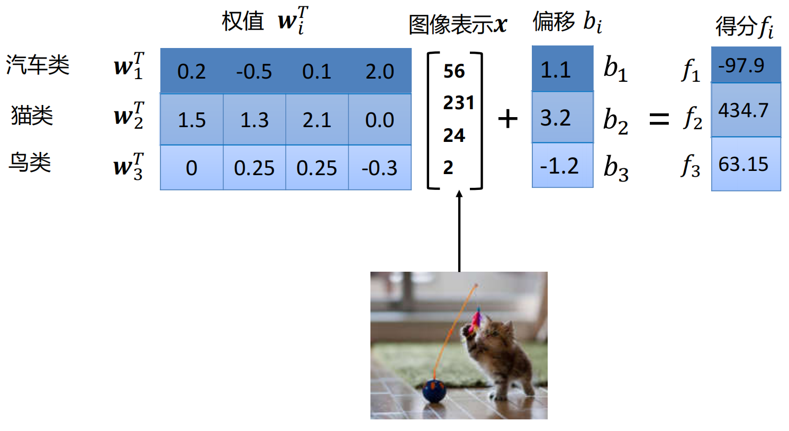

3. 按类别的分判定当前图像

   在这里，我们得到的这个`图像对应猫类`的分数最高，所以这个线性分类器输出的就是猫类

   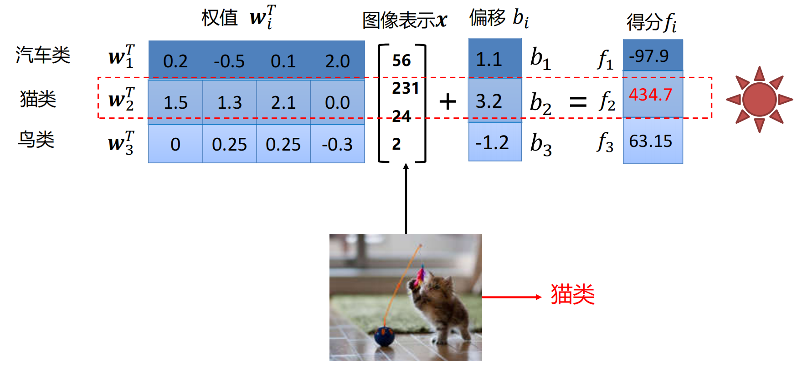


### 线性分类器的矩阵表示

通过观察我们可以注意到：

- 权值矩阵$W$：**行数**由`类别`决定，**列数**由`图像表示（图像的像素向量）`决定

- 偏移向量$b$：**行数**由`类别`决定

- 得分向量$f$：**行数**由`类别`决定

- **问题：CIFAR10 数据集分类任务的分类器，$W$，$x$，$b$ 的维度是多少？**

  **回答**：CIFAR10有**10个类别**且**图像大小为32x32x3**，因此:

  $x$ 是图像向量，其维度为3072维（$d$为`特征数量`，也就是3072）；

  $W$ 是权值矩阵，其维度为10x3072；

  $b$ 是偏置向量，其维度为10x1的向量；

  $f$ 是得分向量，其维度为10x1的向量；

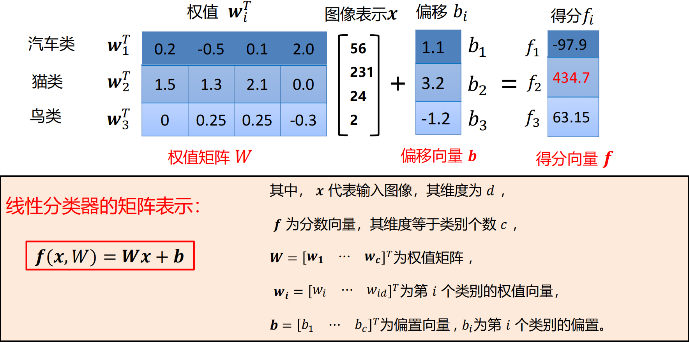


### 线性分类器的权值向量（从权值角度理解）

🤔线性分类器的 权值矩阵$W$ 到底是个什么？这个 $W$ 的含义是什么?

- 权值矩阵$W$ 看做是一种`模板`，其实就是**一个类别的平均值**
- 输入图像$x$ 与评估模板$w$ 的匹配程度越高，分类器输出的分数就越高

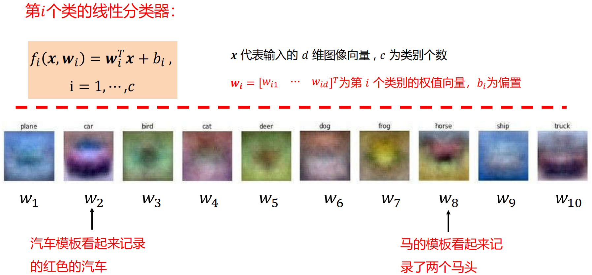


### 线性分类器的分界面（从几何角度理解）

🤔分类问题的`本质`是什么？

👉假设我们把图像表示为2维向量（2维特征），分类问题就是希望找一些`决策面（分类器用来划分不同分类区域的边界）`，把一堆图像给分开为好几个类别。

因为是 **线性分类器**，所以 **决策面**就是`线性`的

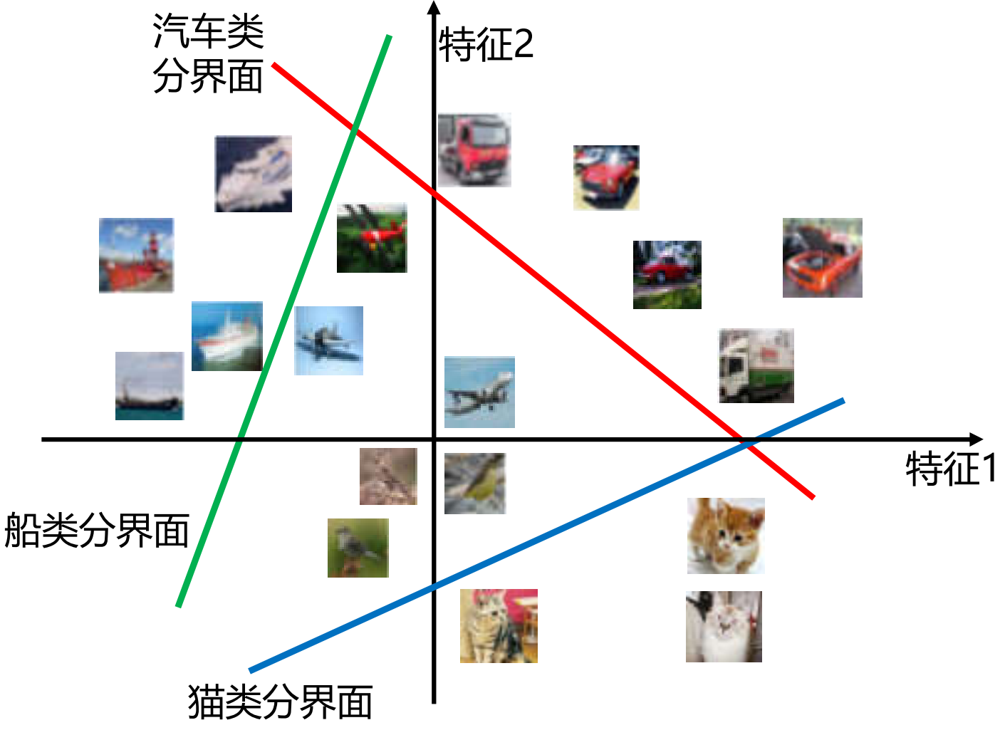

- 以上面为例：

  - 根据上图，我们得到的条件是：

    - 特征数量（图像像素总数） $d=2$，有3个类别即$c=3$

    - 所以：

      图像表示为$x=\begin{bmatrix}x_1\\x_2\end{bmatrix}$ （特征数量 × 1）

      权重表示为\[ W= \begin{bmatrix} w_{11}&w_{12}\\ w_{21}&w_{22}\\ w_{31}&w_{32} \end{bmatrix} \in\mathbb R^{3\times2} \]（类别数 × 特征数量）

  - 我们输入的线性公式是：
    \[
    f_i(x,w_i)=w_i^Tx+b_i,\qquad i=1,\ldots,c
    \]
    我们的输入向量是 $x=\begin{bmatrix}x_1\\x_2\end{bmatrix}$ ，于是每个类别的权重向量也变成 \[ w_i=\begin{bmatrix}w_{i1}\\w_{i2}\end{bmatrix} \]，代入到公式得：
    \[
    \begin{aligned} f_i(x,w_i)&=w_i^Tx+b_i\\ &=\begin{bmatrix}w_{i1}&w_{i2}\end{bmatrix}\begin{bmatrix}x_1\\x_2\end{bmatrix}+b_i\\ &=w_{i1}x_1+w_{i2}x_2+b_i \end{aligned}
    \]

  - 我们只分 3个类别，即**汽车、船、猫**

    由于每个类别都有自己的参数，因此：

    **汽车类别：**
    \[
    f_1(x)=w_{11}x_1+w_{12}x_2+b_1
    \]
    **船类别：**
    \[
    f_2(x)=w_{21}x_1+w_{22}x_2+b_2
    \]
    **猫类别：**
    \[
    f_3(x)=w_{31}x_1+w_{32}x_2+b_3
    \]
    假设我们分别令三个分类分数等于零：
    \[
    \begin{cases} w_{11}x_1+w_{12}x_2+b_1=0\\ w_{21}x_1+w_{22}x_2+b_2=0\\ w_{31}x_1+w_{32}x_2+b_3=0 \end{cases}
    \]
    那么这三个方程在二维坐标系中分别描述一条直线，对应你看到的图：

    - `红色直线`：可以表示汽车类别分数 \(f_1(x)=0\)。
    - `绿色直线`：可以表示船类别分数 \(f_2(x)=0\)。
    - `蓝色直线`：可以表示猫类别分数 \(f_3(x)=0\)。

  - 结论：

    - 分数等于0的线就是`决策面` $w_i^Tx+b_i=0,i=1,\cdots,c$

      <img src="data:image/svg+xml;charset=utf-8,%3Csvg%20font-family%3D%22-apple-system-body%2C%20ui-sans-serif%2C%20-apple-system%2C%20system-ui%2C%20Segoe%20UI%2C%20Helvetica%2C%20Apple%20Color%20Emoji%2C%20Arial%2C%20sans-serif%2C%20Segoe%20UI%20Emoji%2C%20Segoe%20UI%20Symbol%22%20font-weight%3D%22400%22%20data-d-component%3D%22svg%22%20fill%3D%22currentColor%22%20style%3D%22color%3Argb(13%2C%2013%2C%2013)%22%20viewBox%3D%220%200%20340%20290%22%20width%3D%22100%25%22%20xmlns%3D%22http%3A%2F%2Fwww.w3.org%2F2000%2Fsvg%22%3E%3Crect%20x%3D%2248%22%20y%3D%2220%22%20width%3D%22260%22%20height%3D%22240%22%20fill%3D%22%233B82F6%22%20fill-opacity%3D%220.07%22%2F%3E%3Cpath%20d%3D%22M48%2020%20H308%20V20%20L48%20260%20Z%22%20fill%3D%22%2316A34A%22%20fill-opacity%3D%220.12%22%2F%3E%3Cline%20x1%3D%2248%22%20y1%3D%2220%22%20x2%3D%2248%22%20y2%3D%22260%22%20stroke%3D%22currentColor%22%20stroke-opacity%3D%220.09%22%2F%3E%3Cline%20x1%3D%2248%22%20y1%3D%22260%22%20x2%3D%22308%22%20y2%3D%22260%22%20stroke%3D%22currentColor%22%20stroke-opacity%3D%220.09%22%2F%3E%3Cline%20x1%3D%22100%22%20y1%3D%2220%22%20x2%3D%22100%22%20y2%3D%22260%22%20stroke%3D%22currentColor%22%20stroke-opacity%3D%220.09%22%2F%3E%3Cline%20x1%3D%2248%22%20y1%3D%22212%22%20x2%3D%22308%22%20y2%3D%22212%22%20stroke%3D%22currentColor%22%20stroke-opacity%3D%220.09%22%2F%3E%3Cline%20x1%3D%22152%22%20y1%3D%2220%22%20x2%3D%22152%22%20y2%3D%22260%22%20stroke%3D%22currentColor%22%20stroke-opacity%3D%220.09%22%2F%3E%3Cline%20x1%3D%2248%22%20y1%3D%22164%22%20x2%3D%22308%22%20y2%3D%22164%22%20stroke%3D%22currentColor%22%20stroke-opacity%3D%220.09%22%2F%3E%3Cline%20x1%3D%22204%22%20y1%3D%2220%22%20x2%3D%22204%22%20y2%3D%22260%22%20stroke%3D%22currentColor%22%20stroke-opacity%3D%220.09%22%2F%3E%3Cline%20x1%3D%2248%22%20y1%3D%22116%22%20x2%3D%22308%22%20y2%3D%22116%22%20stroke%3D%22currentColor%22%20stroke-opacity%3D%220.09%22%2F%3E%3Cline%20x1%3D%22256%22%20y1%3D%2220%22%20x2%3D%22256%22%20y2%3D%22260%22%20stroke%3D%22currentColor%22%20stroke-opacity%3D%220.09%22%2F%3E%3Cline%20x1%3D%2248%22%20y1%3D%2268%22%20x2%3D%22308%22%20y2%3D%2268%22%20stroke%3D%22currentColor%22%20stroke-opacity%3D%220.09%22%2F%3E%3Cpath%20d%3D%22M48%2010%20V260%20H320%22%20fill%3D%22none%22%20stroke%3D%22currentColor%22%20stroke-width%3D%222%22%2F%3E%3Cpath%20d%3D%22M48%2010%20l-4%209%20h8%20Z%20M320%20260%20l-9%20-4%20v8%20Z%22%20fill%3D%22currentColor%22%2F%3E%3Cline%20x1%3D%2248%22%20y1%3D%22116%22%20x2%3D%22205%22%20y2%3D%22260%22%20stroke%3D%22%23DC2626%22%20stroke-width%3D%223.5%22%2F%3E%3Ccircle%20cx%3D%22204%22%20cy%3D%2268%22%20r%3D%226%22%20fill%3D%22%2316A34A%22%20stroke%3D%22%23fff%22%20stroke-width%3D%222%22%2F%3E%3Ccircle%20cx%3D%22100%22%20cy%3D%22212%22%20r%3D%226%22%20fill%3D%22%232563EB%22%20stroke%3D%22%23fff%22%20stroke-width%3D%222%22%2F%3E%3Ccircle%20cx%3D%22126%22%20cy%3D%22188%22%20r%3D%225%22%20fill%3D%22%23DC2626%22%20stroke%3D%22%23fff%22%20stroke-width%3D%221.5%22%2F%3E%3Ctext%20x%3D%22213%22%20y%3D%2261%22%20font-size%3D%2212%22%20fill%3D%22%2316A34A%22%20font-weight%3D%22600%22%3EA%20(3%2C4)%3C%2Ftext%3E%3Ctext%20x%3D%22110%22%20y%3D%22228%22%20font-size%3D%2212%22%20fill%3D%22%232563EB%22%20font-weight%3D%22600%22%3EB%20(1%2C1)%3C%2Ftext%3E%3Ctext%20x%3D%22146%22%20y%3D%22179%22%20font-size%3D%2211%22%20fill%3D%22%23DC2626%22%20font-weight%3D%22600%22%3EC%20(1.5%2C1.5)%3C%2Ftext%3E%3Ctext%20x%3D%22211%22%20y%3D%22119%22%20font-size%3D%2212%22%20fill%3D%22%2315803D%22%3E%E5%88%86%E6%95%B0%20%26gt%3B%200%3C%2Ftext%3E%3Ctext%20x%3D%22190%22%20y%3D%22144%22%20font-size%3D%2211%22%20fill%3D%22%2315803D%22%3E%E6%B1%BD%E8%BD%A6%E5%8C%BA%E5%9F%9F%3C%2Ftext%3E%3Ctext%20x%3D%2266%22%20y%3D%22237%22%20font-size%3D%2211%22%20fill%3D%22%232563EB%22%3E%E5%88%86%E6%95%B0%20%26lt%3B%200%3C%2Ftext%3E%3Ctext%20x%3D%2266%22%20y%3D%22250%22%20font-size%3D%2211%22%20fill%3D%22%232563EB%22%3E%E9%9D%9E%E6%B1%BD%E8%BD%A6%E5%8C%BA%E5%9F%9F%3C%2Ftext%3E%3Ctext%20x%3D%2260%22%20y%3D%22106%22%20font-size%3D%2211%22%20fill%3D%22%23DC2626%22%3E%E5%86%B3%E7%AD%96%E9%9D%A2%EF%BC%9Ax%E2%82%81%2Bx%E2%82%82%E2%88%923%3D0%3C%2Ftext%3E%3Ctext%20x%3D%22316%22%20y%3D%22278%22%20text-anchor%3D%22end%22%20font-size%3D%2212%22%20fill%3D%22currentColor%22%3E%E7%89%B9%E5%BE%811%20(x%E2%82%81)%3C%2Ftext%3E%3Ctext%20x%3D%2210%22%20y%3D%2215%22%20font-size%3D%2212%22%20fill%3D%22currentColor%22%3E%E7%89%B9%E5%BE%812%20(x%E2%82%82)%3C%2Ftext%3E%3Ctext%20x%3D%2235%22%20y%3D%22275%22%20font-size%3D%2211%22%20fill%3D%22currentColor%22%3E0%3C%2Ftext%3E%3C%2Fsvg%3E" alt="img" style="zoom: 25%;" />

    - $w$ 控制着线的方向
    - $b$ 控制着线的偏移
    - **箭头方向代表分类器的正方向，沿着箭头方向距离决策面越远分数就越高**。

    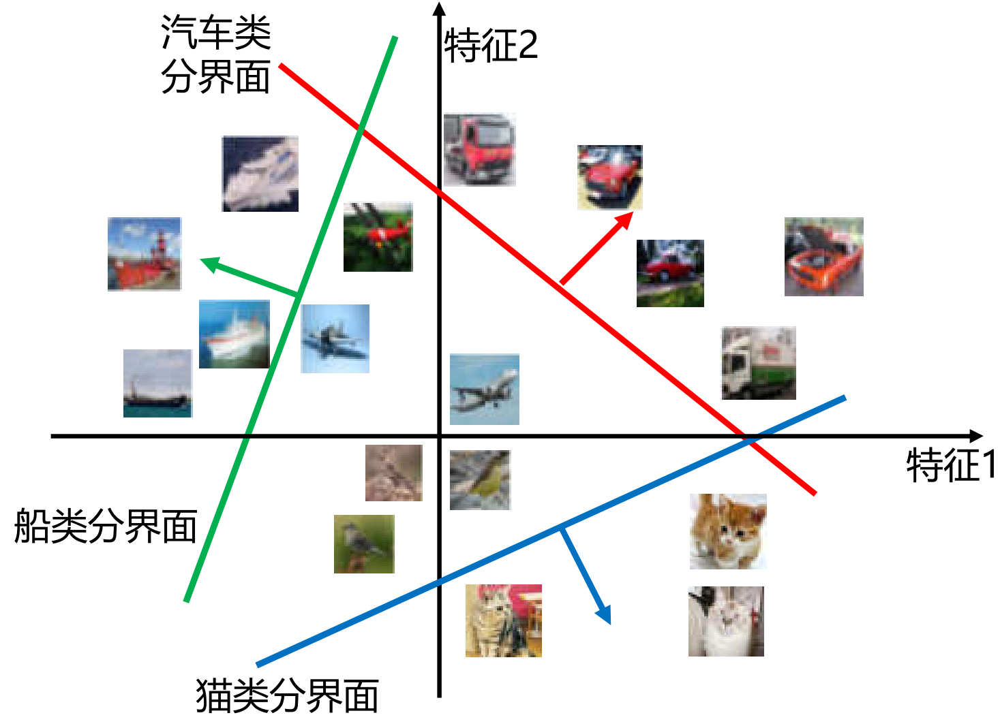


# 损失函数


现在我们讨论线性分类器模型，之前的模型我们得到的是 权值矩阵$W$ 和 偏置$b$，我就可以计算对应类别的分数。

🤔那么这个 权值矩阵$W$ 和 偏置$b$ 好或不好，我们应该怎么办？

- 我们总是需要一个东西去度量，所以需要`损失函数`
- 然后我们还需要学习，那就需要`优化算法`

## 损失函数的定义

### 如何衡量分类器对当前样本的效果好坏？

如图，我有两个分类器，分别得到一个正确的结果与一个错误的结果，那么人眼看，肯定是：**分类器1的性能 > 分类器2的性能**

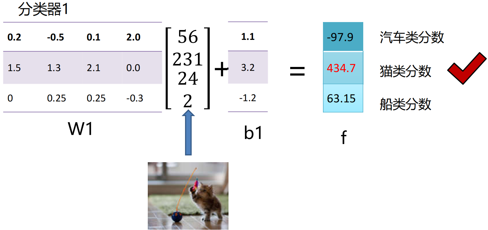

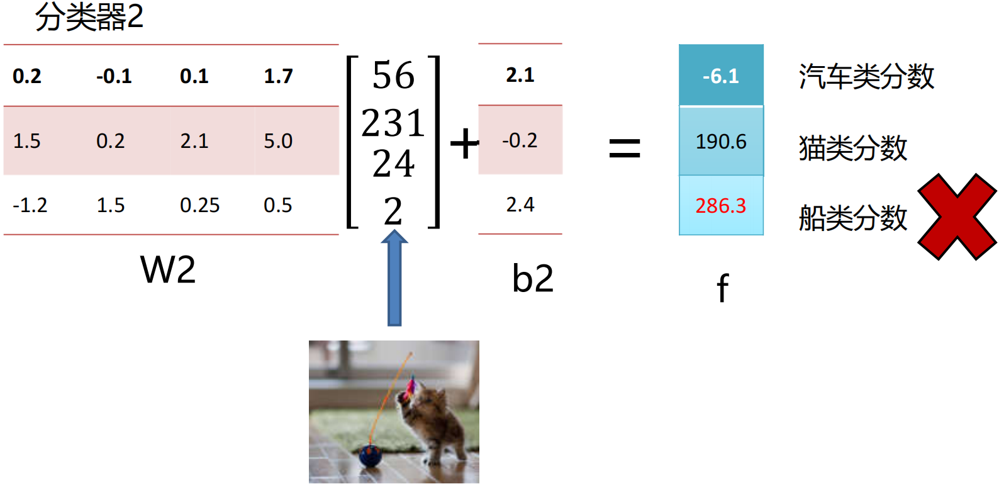

🤔**问题来了：机器人怎么去看到这个效果呢？如何定量表示呢？**

那么这就需要使用`损失函数`


### 什么是损失函数？

> 损失函数搭建了模型性能与模型参数之间的桥梁，指导模型参数优化。
>
> - **损失函数（Loss Function）** 是一个函数，用于度量分类器的**预测输出**与样本的**真实标签**之间的不一致程度，其输出通常是一个**非负实数**。
>
> - 损失值越小，通常表示模型的预测结果与真实标签越一致；损失值越大，通常表示两者越不一致。
>
> - 在模型训练过程中，可以利用损失函数提供的反馈，通过**优化算法**调整模型参数，使损失值逐渐减小，从而提升分类器的分类效果。

- **单个样本的损失函数**

  对于数据集中的第 $i$个样本，其损失函数可以表示为：
  $$
  L_i=\ell(f(x_i,W),y_i)
  $$
  其中：

  - (x_i)：数据集中的**第 (i) 张图像**。
  - (W)：线性分类器的**权重矩阵**，属于模型参数。
  - (f(x_i,W))：分类器对图像 (x_i) 的**预测输出**。
  - (y_i)：图像 (x_i) 对应的**真实类别标签**，通常使用整数表示。
  - (\ell)：损失函数，用于计算预测输出与真实标签之间的不一致程度。
  - (L_i)：第 (i) 个样本的**损失值**，通常是一个非负实数。

  **需要注意：**

  - 对于 线性分类器$f(x_i,W)=Wx_i$ ，其输出通常是一个包含各个类别得分的向量，而不是直接输出一个类别标签。

    例如，假设分类器需要区分三个类别 $f(x_i,W)=\begin{bmatrix}2.5\ 1.2\ 0.3\end{bmatrix}$，这个向量表示分类器对三个类别分别给出的得分。

    最终预测类别$\hat y_i$ 可以通过 得分最大的类别$\arg\max_j f_j(x_i,W)$ 确定，即使用函数 $\hat y_i=\arg\max_j f_j(x_i,W)$

  - 但在计算常见的`分类损失函数`时，通常需要使用模型输出的**完整得分向量**（或由得分转换得到的概率），而不只是最终预测的类别编号。

- **整个数据集的损失函数**

  假设数据集中共有 (N) 个样本，则整个数据集的平均损失可以定义为：
  $$
  L(W)=\frac{1}{N}\sum_{i=1}^{N}L_i
  $$
  将单个样本的损失函数代入，可得：
  $$
  L(W)=\frac{1}{N}\sum_{i=1}^{N}\ell(f(x_i,W),y_i)
  $$
  其中：

  - (N)：数据集中的样本总数。
  - (i)：样本索引，取值为 (1,2,\ldots,N)。
  - (L_i)：第 (i) 个样本的损失值。
  - (L(W))：整个数据集的**平均损失**，反映分类器在该数据集上的整体预测表现。

- **损失函数与模型参数的关系**

  在线性分类器中：
  $$
  x_i\xrightarrow{\text{分类模型 }f(x_i,W)}f(x_i,W)
  $$
  随后，损失函数同时接收分类器的预测输出和真实标签：
  $$
  \left.
  \begin{aligned}
  &f(x_i,W)&&\text{（预测输出）}\
  &y_i&&\text{（真实标签）}
  \end{aligned}
  \right}
  \xrightarrow{\text{损失函数 }\ell}L_i
  $$
  由于分类器的预测输出 (f(x_i,W)) 依赖模型参数 (W)，因此损失值也会受到模型参数的影响。

  **模型训练的目标，就是通过优化算法不断调整参数 (W)，尽可能减小训练数据集上的平均损失 (L(W))。**


## 多类支撑向量机损失（`折页损失`）

因为每一个样本在每一个类别下都各有一个分数，我们来展开讨论的话，对于第$i$个样本中第$j$个标签：
$$
s_{ij}=f_j\left(x_i,w_j,b_j\right)=w_j^Tx_i+b_j
$$
其中：

- $y$：样本标签

- $j$：类别标签，取值范围$\{1，2，...，c\}$；
- $w_j,b_j$：第j个类别分类器的参数；
- $x_i$:表示数据集中的第$i$个样本
- $s_{i,j}$：第$i$个样本第$j$类别的预测分数


**第i个样本的多类支撑向量机损失定义如下**：
$$
\begin{aligned}L_{i}&=\sum_{j\neq y_i}\begin{cases}0&\quad ifs_{y_i}\geq s_{ij}+1\\s_{ij}-s_{y_i}+1&\quad otherwise&\end{cases}\\&=\sum_{j\neq y_i}\max(0,s_{ij}-s_{y_i}+1)\end{aligned}
$$
其中：

- $j\neq y_i$：表示不考虑自己（自己跟自己做什么比较呢？肯定是没有损失，也就是损失是0）

- $s_{y_i}$：第$i$个样本真实类别的预测分数（即如果样本是狗，那么$s_{y_i}$就是狗类对应的分数）

- $s_{y_i}\geq s_{ij}+1$：表示 第$i$个样本真实类别的预测分数 **必须大于等于** 第$i$个样本其他类别的预测分数+1

  - 结果等于0，这时候就认为没有损失！
  - 这里1代表一个边界，让其他样本类别的分数不要靠近真实样本的分数。比如真是类别是狗的情况下，图片的狗类得分是0.5，猫类得分是0.4，那么这个模型还是不行的

- 其实对应的函数图就是：

  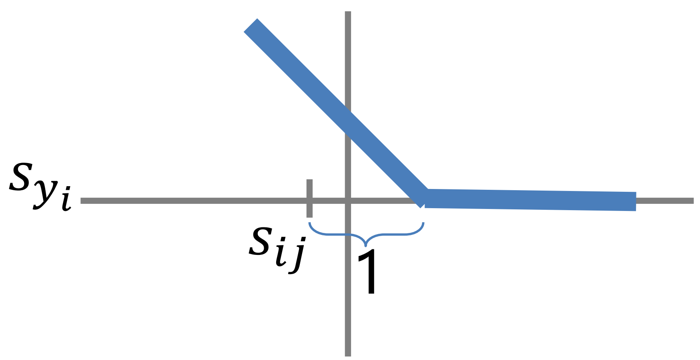

**举个例子**：假设有3个类别的训练样本各一张，分类器是线性分类器$f(x,W)=Wx+b$，其中权值$W$，$b$已知，分类器对三个样本的打分如下，计算各个样本的LOSS值

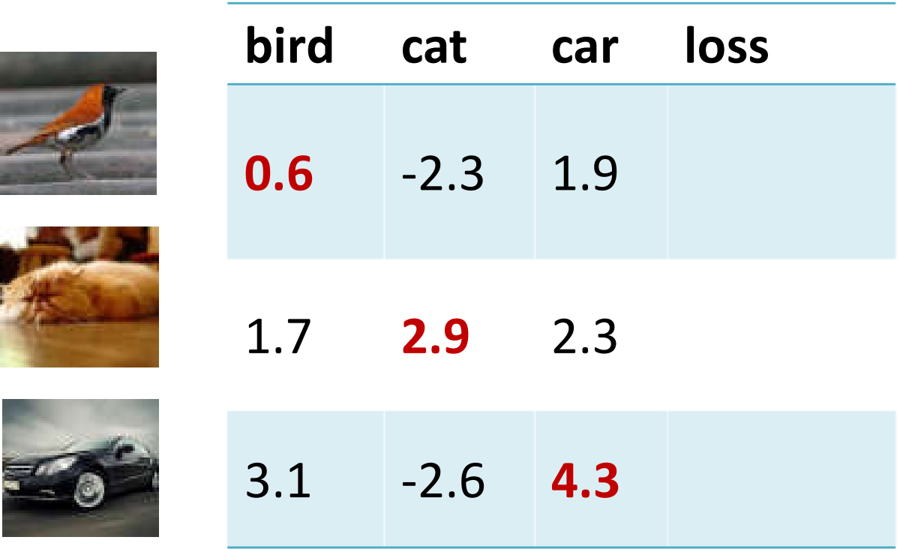

当前分类器对于鸟这张图像的损失：
$$
\begin{aligned}L_{i}
&=
\sum_{j\neq y_i}\max(0,s_{ij}-s_{y_i}+1)\\
&=
\max(0,-2.3-0.6+1)+\max(0,1.9-0.6+1)\\
&=
\max(0,-1.9)+\max(0,2.3)\\&=0+2.3\\&=2.3\end{aligned}
$$
说明：

- 首先是cat与bird做比较，因为cat得分为-2.3，而bird得分为0.6，此时就认为没有损失！

- 然后是car与bird做比较，因为car得分为1.9，而bird得分为0.6，此时就认为有损失，损失值为$1.9-0.6+1=2.3$

- 然后损失值相加，得到 $0+2.3=2.3$，也就是最终损失值是2.3

- 按照这样的步骤，我们分别得到：

  - 图1损失值：2.3
  - 图2损失值：$0+0.4=0.4$
  - 图3损失值：$0+0=0$

- 得到 `当前分类器对于整个数据集图像的损失`：（整个数据集损失的平均值）
  $$
  L=\frac{1}{N}\sum_{i=1}^NL_i
  $$
  带入公式，得：
  $$
  L=(2.3+0.4+0)/3=0.9
  $$


## 正则项与超参数

### 再谈损失函数

> **如果某组参数 $W$ 能让训练损失 $L(W)=0$，那这组 $W$ 是唯一的吗？**
>
> 答案是：**一般不唯一。**

- 公式是：
  $$
  L(W)=\frac{1}{N}\sum_i L_i(f(x_i,W),y_i)
  $$
  其中：

  - $W$：模型参数，比如神经网络里的权重。
  - $x_i$：第 $i$ 个训练样本。
  - $y_i$：第 $i$ 个样本的真实标签。
  - $f(x_i,W)$：模型对 $x_i$ 的预测。
  - $L_i$：第 $i$ 个样本的损失。
  - $L(W)$：整个训练集上的平均损失。

  如果 $L(W)=0$，通常表示：**模型在训练集上完全拟合了所有样本**。但这不代表 $W$ 唯一。

- **举个例子**：示例：假设两个线性器分类$f_1(x,W_1)=W_1x$，$f_2(x,W_2)=W_2x$，其中，$W_2=2W_1$。对于下面图像已知分类器1的打分结果(如表所示),请计算分类器2的打分结果，以及两个分类器对当前样本的多类支撑向量机损失：

  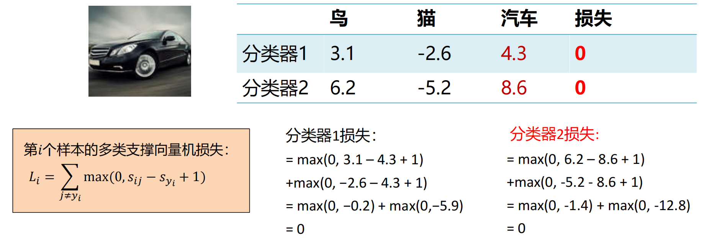

  我们发现在这个例子中，`分类器1损失`与`分类器2损失`都是0，但是此时 参数$W$ 并不是一样的

  > 🤔问题来了，我应该选择 参数$W_1$ 还是 参数$W_2$呢？
  >
  > 答案：引入`正则项`


### 正则项

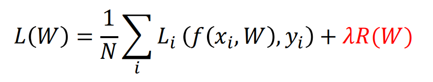

#### 数据损失（上面所说的损失函数）

> 评价 分类器 在样本上的表现

- 在刚才的例子中，我们得到 `分类器1` 与 `分类器2` 的数据损失都是0

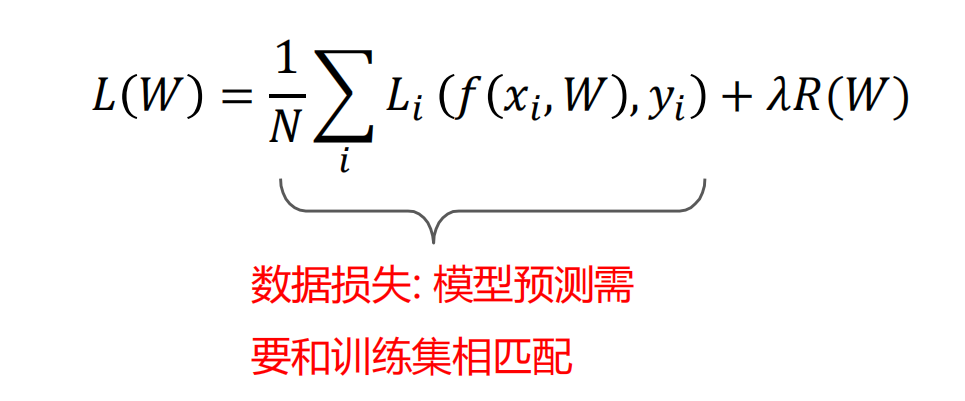

#### 正则项损失

> 评价 模型参数

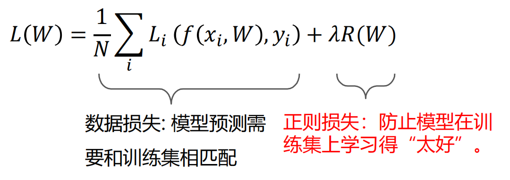

其中：

- $\lambda$：是一个`超参数（在开始学习过程之前设置值的参数，而不是通过学习得到的）`，控制着正则损失在总损失中所占的比重

- $R(W)$：是一个与权值$W$有关，跟图像数据无关的函数


### 超参数

- 概念：在开始学习过程之前设置值的参数，而不是学习得到。
- 超参数一般都会对模型性能有着重要的影响。

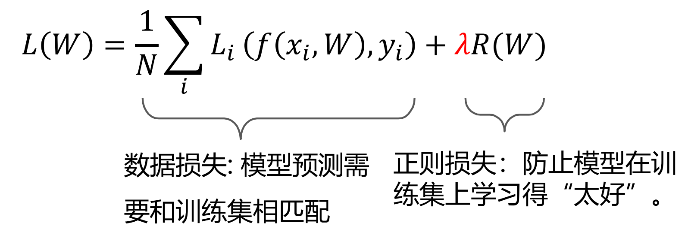

其中：

- $\lambda=0$：表示优化结果仅与数据损失相关
- $\lambda=\infty$：表示优化结果与数据损失无关，仅考虑权重损失。此时，系统最优解为 $W=0$。


### L2正则项

- 公式：
  $$
  R(W)=\sum_k\sum_lW_{k,l}^2
  $$
  其中：

  - $W_{k,l}$：表示第 $k$ 行、第 $l$ 列的那个权重。
  - $\sum_k\sum_l$：把矩阵里面每一个元素都拿出来平方，再全部加起来。
  - **为什么叫`L2`？** 因为它实际上就是权重矩阵的 **平方的 L2 范数**。

- 举个例子：

  - 条件：样本：$x=[1,1,1,1]$，分类器1：$W_1=[1,0,0,0]$，分类器2：$W_2=[0.25,0.25,0.25,0.25]$，$\lambda=1$

  - 代入损失函数公式 $L(W)=\frac{1}{N}\sum_iL_i\left(f(x_i,W),y_i\right)+\lambda R(W)$ 得到：

    分类器输出：$$W_1^Tx=W_2^Tx=1$$（也就是说对于**这两个分类器**而言，在该样本上`数据损失`是一样的 ）

    正则损失：$\mathrm{R}(w_1)=1\quad\mathrm{R}(w_2)=0.25$（那么这个时候谁的正则项小，我就取谁，但是有什么物理含义呢？🤔）

  - **探讨正则损失的物理含义**

    在上面我们列出了两组权值 $W_1=[1,0,0,0]$ 与 $W_2=[0.25,0.25,0.25,0.25]$，

    $W_2$意义在于让$x$的每一维都参与运算来得到最后的结果，而$W_1$只关注了第一维的特征

    这就会引出一个问题：在真实过程中，我的传感器设备得到的数据的低维度不准确的情况下，$W_1$就容易出错，而$W_2$考虑了全部维度的特征，那么$W_2$的容错率更高。

  > [!IMPORTANT]
  >
  > `L2正则项损失`：我不光让我的损失能够选出唯一解，同时让这个解尽量的去考虑所有的特征，**让我的模型有了一定的偏好（偏好权值比较分散！）**

- 所以正则项解决了2个问题:

  1. 让解唯一
  2. 让我们去选择 权值$W$ 时有一定的`偏好性`。在所有可选的$W$里面，我可以选择对我现在所做的事情最有利的那一组权值


### 常用的正则项损失

L1正则项：$R(W)=\sum_k\sum_l|W_{k,l}|$

L2正则项：$R(W)=\sum_k\sum_lW_{k,l}^2$

弹性网络正则项Elastic net(L1+L2):$R(W)=\sum_k\sum_l\beta W_{k,l}^2+|W_{k,l}|$


# 优化算法

我们现在有了`损失函数`，能够准确地定量地度量预测值与真实值之间的关系，算出来的结果就叫做`损失值`。

🤔假设现在`损失值`很大，我们应该怎么去调整模型呢？我们不可能初始一设置一组权值，就能让这个模型分类性能很好。我随机给模型一组权值，通常结果并不好。那么我们就需要有东西来帮我调整这些参数

## 什么是参数优化

> `参数优化`是机器学习的核心步骤之一，它`利用损失函数`的输出值`作为反馈信号`来`调整分类器参数`，以提升分类器对`训练样本`的`预测性能`。
>
> - **优化算法目标**：损失函数$L$是一个与参数$W$有关的函数，优化的目标就是找到使损失函数$L$达到最优的那组参数$W$。
>
>   直接方法：$\frac{\partial L}{\partial W}=0$（当然还要区分`局部极小点`，`局部极大点`，`鞍点`）
>
>   通常，$L$形式比较复杂，很难从这个等式直接求解出$W$！

## 梯度下降算法

假设 特征$W$维度是1，损失值$L$与特征$W$的函数如图：（`二维`）

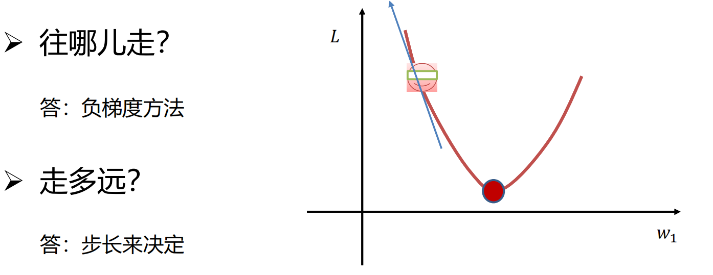

假设 特征$W$维度是2，损失值$L$与特征$W$的函数如图：（`三维`）


所以：

> `梯度下降`: 利用所有样本计算损失并更新梯度
>
> ```
> while True:
> 	权值的梯度 = 计算梯度(损失, 训练样本, 权值)
> 	更新后的权值 = 当前权值 – 学习率 * 权值的梯度
> ```


## 梯度计算

### 数值法（计算量大，不精确）

一维变量，函数求导：
$$
\frac{dL(w)}{dw}=\lim_{h\to0}\frac{L(w+h)-L(w)}{h}
$$
**示例**：损失函数 $L(w)=w^2$ 求$w=1$点处的梯度
$$
\frac{dL(w)}{dw}=\lim_{h\to0}\frac{L(w+h)-L(w)}h\approx\frac{L(1+0.0001)-L(1)}{0.0001}=2.0001
$$


### 解析法（精确，速度快，导数函数推导易错）

示例：损失函数 $L(w)=w^2$ 求$w=1$点处的梯度

$$
\nabla L(w)=2w
\\
\nabla_{w=1}L(w)=2
$$


> [!NOTE]
>
> **数值梯度有什么作用？**
>
> 答：求梯度时一般使用解析梯度，而数值梯度主要用于解析梯度的正确性校验（梯度检查）。


### 梯度下降算法的计算效率

> `梯度下降`: 利用所有样本计算损失并更新梯度
>
> **当N很大时，权值的梯度计算量很大！**

$$
\begin{aligned}&L(W)=\frac{1}{N}\sum_{i=1}^NL_i(x_i,y_i,W)+\lambda R(W)\\&\nabla_WL(W)=\frac{1}{N}\sum_{i=1}^N\nabla_WL_i(x_i,y_i,W)+\lambda\nabla_WR(W)\end{aligned}
$$

```
while True
	权值的梯度 ← 计算梯度(损失, 训练样本, 权值)
	权值 ← 权值 – 学习率 * 权值的梯度
```

所以我们就提出`随机梯度下降算法`


### 随机梯度下降算法

> [!NOTE]
>
> `随机梯度下降`: 每次随机**选择一个样本$x_i$**，计算损失并更新梯度
>
> 🤔那么每次都是指选一个样本，如果这个样本是一个噪声，那么是不是会带偏这个梯度（本来是梯度下降变成了梯度上升）
>
> 👉会。每次采的样本会指引函数向各个方向走，但是大量的样本会让我们的整体趋势是向下走的

$$
\begin{gathered}L(W)=L_i(x_i,y_i,W)+\lambda R(W)\\\nabla_WL(W)=\nabla_WL_i(x_i,y_i,W)+\lambda\nabla_WR(W)\end{gathered}
$$

```
while True
	数据 ← 从训练数据采样(训练数据,1)
	权值的梯度 ← 计算梯度(损失, 数据, 权值)
	权值 ← 权值 – 学习率 * 权值的梯度
```


### 小批量梯度下降算法

小批量随机梯度下降: 每次随机选择$m$（批量的大小）个样本,计算损失并更新梯度
$$
\begin{aligned}&L(W)=\frac{1}{m}\sum_{i=1}^{m}L_i(x_i,y_i,W)+\lambda R(W)\\&\nabla_WL(W)=\frac{1}{m}\sum_{i=1}^m\nabla_WL_i(x_i,y_i,W)+\lambda\nabla_WR(W)\end{aligned}
$$

- iteration：表示1次迭代，每次迭代更新1次网络结构的参数；
- batch-size：1次迭代所使用的样本量；
- epoch：1个epoch表示过了1遍训练集中的所有样本。

```
while True
	数据 ← 从训练数据采样(训练数据,批量大小)
	权值的梯度 ← 计算梯度(损失, 数据, 权值)
	权值 ← 权值 – 学习率 * 权值的梯度
```


### 总结

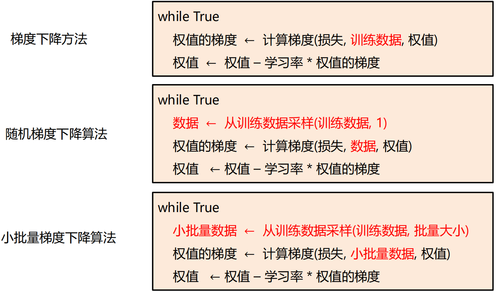


# 训练过程

## 数据集划分


## 数据预处理


